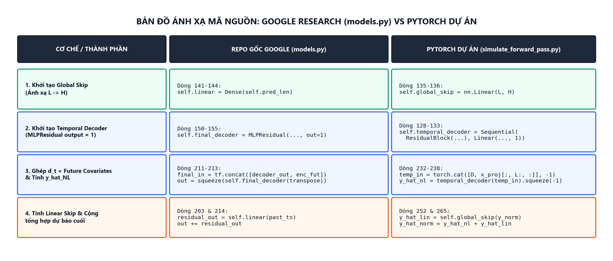
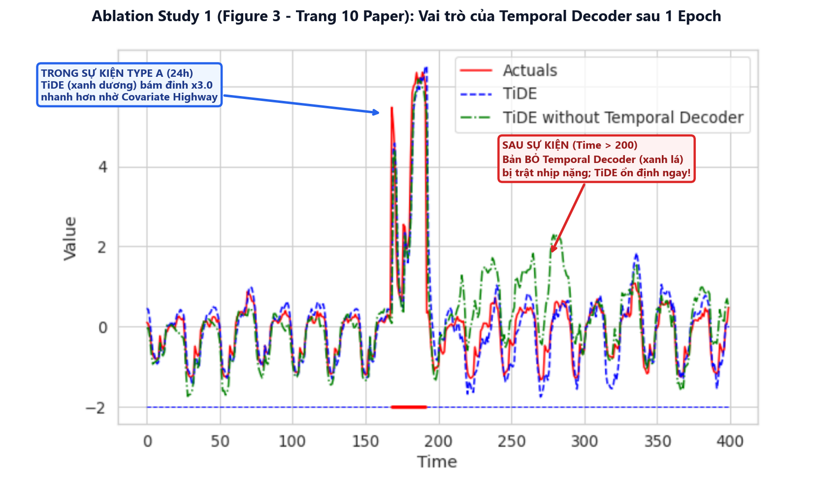
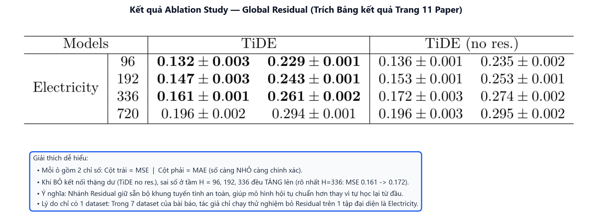
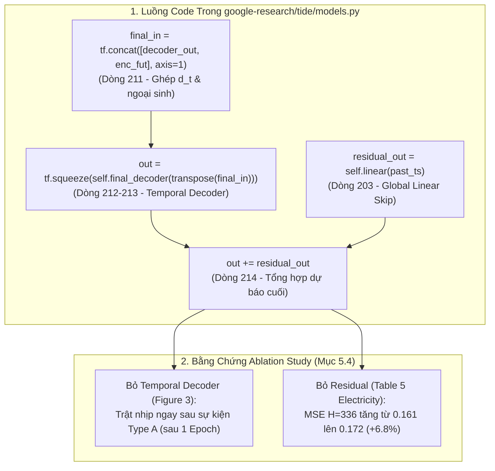

# SLIDE 02 (PHẦN 2): SOURCE CODE & PHÂN TÍCH ABLATION STUDY — TEMPORAL DECODER VÀ GLOBAL RESIDUAL

> **Mục tiêu Slide 02 (Phần 2):** Trình bày **Source code hiện thực tương ứng** trong repository gốc Google Research (`models.py`) và bản PyTorch trong dự án; phân tích vai trò thực chứng của **Temporal Decoder** và **Global Residual** qua hai thí nghiệm **Ablation Study** (Mục 5.4, Trang 10–11 Paper gốc) cùng các giới hạn tiềm ẩn.

---

## 🖼️ Hình Ảnh & Sơ Đồ Minh Họa Đưa Lên Slide







### Sơ đồ đối chiếu dòng chảy Source Code & Kết luận Ablation Study:



---

## 📋 Nội Dung Cụ Thể Trình Bày Trên Slide (Hiển thị cho khán giả)

### 1. Source Code hiện thực trong Repository gốc & Dự án
* **Repo gốc Google Research (TensorFlow/Keras):** [`google-research/tide/models.py`](https://github.com/google-research/google-research/blob/master/tide/models.py)

```python
# --- TRONG TideModel.__init__ ---
# Global Residual Connection (Dòng 141-144)
self.linear = tf.keras.layers.Dense(self.pred_len, activation=None)

# Temporal Decoder (Dòng 150-155)
self.final_decoder = MLPResidual(
    hidden_dim=model_config.get('final_decoder_hidden'),
    output_dim=1, layer_norm=layer_norm, dropout_rate=dropout_rate
)

# --- TRONG TideModel.call ---
residual_out = self.linear(past_ts)                                  # Dòng 203: [B, H]
final_in = tf.concat([decoder_out, enc_fut], axis=1)                 # Dòng 211: [B, p + r_tilde, H]
out = self.final_decoder(tf.transpose(final_in, (0, 2, 1)))          # Dòng 212: [B, H, 1]
out = tf.squeeze(out, axis=-1)                                       # Dòng 213: [B, H]
out += residual_out                                                  # Dòng 214: [B, H]
```

* **Code PyTorch đối chiếu trong dự án:** [`simulate_forward_pass.py#L232-L266`](../../../simulate_forward_pass.py#L232-L266)

```python
temp_in = torch.cat([D, x_proj[:, self.L :, :]], dim=-1)            # Dòng 232-235: [B, H, p + r_tilde]
y_hat_nl = self.temporal_decoder(temp_in).squeeze(-1)                # Dòng 238: [B, H]
y_hat_lin = self.global_skip(y_norm)                                 # Dòng 252: [B, H]
y_hat_norm = y_hat_nl + y_hat_lin                                    # Dòng 265: [B, H]
```

### 2. Phân tích Ablation Study 1: Vai trò Temporal Decoder (Figure 3, Trang 10–11)
* **Thiết kế thí nghiệm:** Dữ liệu `Electricity` bán tổng hợp thêm sự kiện **Type A** (nhân biên độ chuỗi lên $3.0 \to 3.2$ lần trong $24\text{h}$) và **Type B** (giảm $2.0 \to 2.2$ lần) tác động lên $80\%$ chuỗi, đánh giá chỉ sau **1 Epoch**.
* **Kết quả quan sát:**
  * **Trong khi xảy ra sự kiện:** Bản có Temporal Decoder thích nghi biên độ nhanh hơn nhờ đường dẫn trực tiếp từ biến chỉ báo sự kiện.
  * **Ngay sau khi sự kiện kết thúc:** Bản **không có Temporal Decoder bị trật nhịp nặng (thrown off)** do `Dense Encoder` chưa kịp tự điều chỉnh lại nhận thức về bối cảnh quá khứ; trong khi **bản có Temporal Decoder gần như miễn nhiễm hoàn toàn** chỉ sau đúng 1 Epoch.

### 3. Phân tích Ablation Study 2: Vai trò Global Residual (Table 5, Trang 11)
So sánh trên tập `Electricity` (trung bình 5 lần chạy) giữa **TiDE đầy đủ** và **TiDE (no res.)** *(loại bỏ cả skip trong ResidualBlock và Global Linear Residual)*:

| Horizon ($H$) | TiDE (Đầy đủ) — MSE | TiDE (no res.) — MSE | TiDE (Đầy đủ) — MAE | TiDE (no res.) — MAE | Nhận xét |
| :---: | :---: | :---: | :---: | :---: | :--- |
| **96** | $\mathbf{0.132 \pm 0.003}$ | $0.136 \pm 0.001$ | $\mathbf{0.229 \pm 0.001}$ | $0.235 \pm 0.002$ | Sụt giảm có ý nghĩa thống kê |
| **192** | $\mathbf{0.147 \pm 0.003}$ | $0.153 \pm 0.001$ | $\mathbf{0.243 \pm 0.001}$ | $0.253 \pm 0.001$ | Sai số MSE tăng $+0.006$, MAE $+0.010$ |
| **336** | $\mathbf{0.161 \pm 0.001}$ | $0.172 \pm 0.003$ | $\mathbf{0.261 \pm 0.002}$ | $0.274 \pm 0.002$ | **Cách biệt lớn nhất** ($+0.011$ MSE) |
| **720** | $0.196 \pm 0.002$ | $0.196 \pm 0.003$ | $\mathbf{0.294 \pm 0.001}$ | $0.295 \pm 0.002$ | Tiệm cận ở tầm siêu dài |

### 4. Giới hạn tiềm ẩn của cơ chế tổng hợp hiện tại
1. **Cộng cứng tỷ lệ $1 : 1$ (`out += residual_out`):** Trọng số cố định ở mọi bước $t$ và mọi chuỗi $\implies$ dễ cộng thêm nhiễu phi tuyến vào vùng chuỗi đang vận động tuyến tính đều đặn.
2. **Chưa lọc xu hướng mượt cho nhánh tuyến tính:** Khác với DLinear (tách Trend/Seasonal bằng Moving Average), TiDE chiếu thẳng $y_{1:L}$ thô qua `self.linear`, dễ bị nhạy cảm với các điểm nhiễu gai (*outliers*) trong lịch sử.

---

## 🔗 Vị Trí Mã Nguồn Tham Chiếu Cho Slide 02
* **Repo gốc Google Research (`models.py`):**
  * Khởi tạo `self.linear` & `self.final_decoder`: [models.py#L141-L155](https://github.com/google-research/google-research/blob/master/tide/models.py#L141-L155)
  * Thực thi ghép nối, chạy `final_decoder`, và cộng `out += residual_out`: [models.py#L203](https://github.com/google-research/google-research/blob/master/tide/models.py#L203) & [models.py#L211-L214](https://github.com/google-research/google-research/blob/master/tide/models.py#L211-L214)
* **Code PyTorch trong dự án:**
  * Thực thi Temporal Decoder, Global Skip & Tổng hợp: [simulate_forward_pass.py#L228-L266](../../../simulate_forward_pass.py#L228-L266)
  * Kiểm thử luồng shape `(B, H)`: [test_tensor_shapes.py#L117-L135](../../sprint-1/test_tensor_shapes.py#L117-L135)

---

## 🎙️ Kịch Bản Lời Nói Thuyết Trình (Speaker Notes)

> *"Sang Phần 2 là Source Code và Phân tích Ablation Study. Trên slide là mã nguồn trích nguyên văn từ file `models.py` trong repo gốc Google Research ở các dòng 141 đến 214, đặt cạnh bản PyTorch của dự án mình.*
>
> *Các bạn chú ý dòng 203 tính `residual_out`, dòng 211 ghép cặp `decoder_out` với biến ngoại sinh tương lai `enc_fut`, dòng 212 chạy `final_decoder`, và đúng tại **dòng 214**: `out += residual_out` cộng trực tiếp hai nhánh lại với nhau.*
>
> *Để chứng minh hai thành phần này không hề thừa thãi, bài báo đưa ra 2 thí nghiệm Ablation Study ở Mục 5.4:*
> *1. Với **Temporal Decoder** (Figure 3): Nhóm tác giả chèn sự kiện tăng biên độ gấp 3 lần trong 24 giờ trên tập Electricity. Chỉ sau đúng 1 Epoch, bản thiếu Temporal Decoder bị trật nhịp nặng sau khi sự kiện kết thúc, còn bản đầy đủ xử lý mượt mà tức thì.*
> *2. Với **Residual Connections** (biểu đồ Table 5 trên màn hình): Khi loại bỏ toàn bộ kết nối thặng dư (`TiDE no res.`), sai số MSE/MAE ở các tầm dự báo 96 đến 336 đều tăng lên có ý nghĩa thống kê—ví dụ ở $H=336$, MSE tăng từ `0.161` lên `0.172`.*
>
> *Tuy nhiên, nhìn lại dòng code 214 `out += residual_out`, ta phát hiện ra một giới hạn lớn: đó là **phép cộng cứng 1:1**. Nó không biết tự điều tiết tỷ trọng lúc nào nên tin nhánh tuyến tính, lúc nào nên tin nhánh phi tuyến. Đây chính là điểm mở cho Phần 3 đề xuất cải tiến ngay sau đây."*
