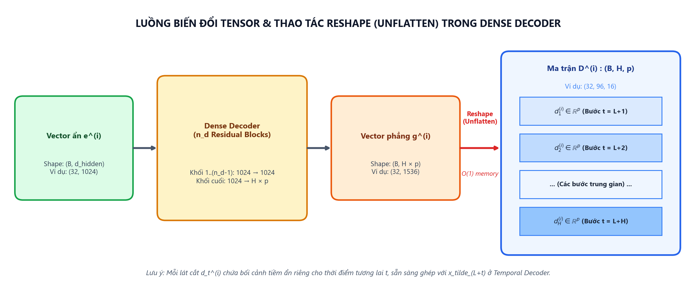
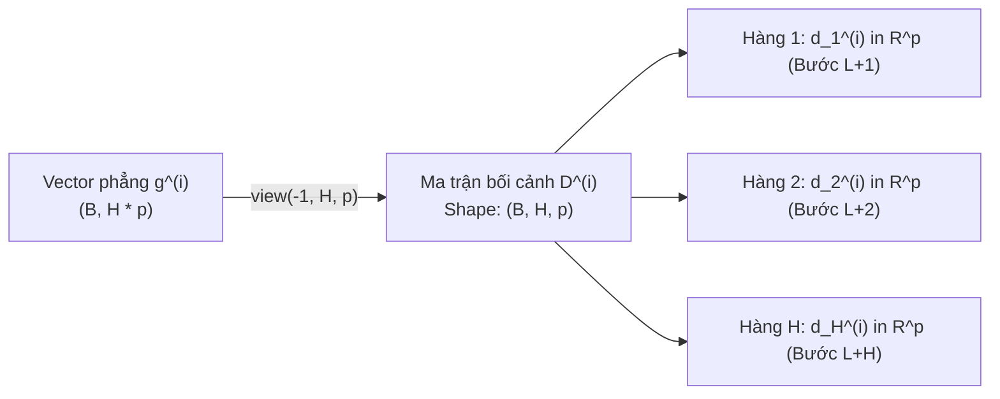

# SLIDE 02: TOÁN HỌC GIẢI NÉN ($e^{(i)} \to g^{(i)}$), RESHAPE (UNFLATTEN) & Ý NGHĨA VECTOR $d_t^{(i)}$

> **Mục tiêu Slide 02:** Trình bày tường minh các công thức toán học, luồng biến đổi kích thước Tensor từ `(B, 1024)` sang `(B, 96, 16)`, vai trò của thao tác `Reshape (Unflatten)` và ý nghĩa ngữ nghĩa của từng vector lát cắt $d_t^{(i)}$.

---

## 🖼️ Hình Ảnh & Sơ Đồ Minh Họa Đưa Lên Slide

### Sơ đồ phân rã ma trận bối cảnh $D^{(i)}$ thành các vector thời gian $d_t^{(i)}$:

---

## 📋 Nội Dung Cụ Thể Trình Bày Trên Slide (Hiển thị cho khán giả)

### 1. Công thức chuyển $e^{(i)}$ thành vector phẳng $g^{(i)}$ ($H \times p$)
Đặt đầu vào là $v^{(0)} = e^{(i)} \in \mathbb{R}^{d_{\text{hidden}}}$. Sau $n_d - 1$ khối trung gian giữ nguyên chiều $d_{\text{hidden}}$, khối `ResidualBlock` cuối cùng ($l = n_d$) chiếu trực tiếp ra số chiều $H \times p$:

$$
g^{(i)} = \text{LayerNorm}\Big( \text{Dropout}\big( W_{2}^{(n_d)} \text{ReLU}(W_1^{(n_d)} v^{(n_d - 1)} + b_1^{(n_d)}) + b_2^{(n_d)} \big) + W_{\text{skip}}^{(n_d)} v^{(n_d - 1)} \Big)
$$

* **Ma trận chiếu phi tuyến:** $W_2^{(n_d)} \in \mathbb{R}^{(H \cdot p) \times d_{\text{hidden}}}$
* **Ma trận chiếu nhánh tắt:** $W_{\text{skip}}^{(n_d)} \in \mathbb{R}^{(H \cdot p) \times d_{\text{hidden}}}$ (bắt buộc do $d_{\text{hidden}} \neq H \cdot p$)
* **Đầu ra phẳng:** $g^{(i)} \in \mathbb{R}^{H \cdot p}$

### 2. Vai trò của thao tác Reshape (Unflatten)

$$
D^{(i)} = \text{Reshape}\big(g^{(i)}, \; (H, p)\big) \in \mathbb{R}^{H \times p}
$$

* **Ánh xạ không gian:** Chuyển mảng $1\text{D}$ độ dài $H \cdot p$ thành ma trận $2\text{D}$ gồm $H$ hàng $\times$ $p$ cột.
* **Khôi phục trục thời gian:** Tái lập lại **chiều thời gian tương lai (Horizon Axis $H$)** vốn đã bị duỗi phẳng ở phía Encoder.
* **Hiệu năng tuyệt đối:** Trong bộ nhớ RAM, phép biến đổi này chỉ cập nhật chỉ số *stride* (`view`), không sao chép dữ liệu $\implies$ chi phí **$O(1)$ thời gian và bộ nhớ**.

### 3. Ý nghĩa của vector lát cắt $d_t^{(i)}$ cho từng thời điểm dự báo
* Ma trận $D^{(i)}$ gồm $H$ vector hàng $d_t^{(i)} \in \mathbb{R}^p$ ($t = 1 \dots H$).
* $d_t^{(i)}$ là **vector đặc trưng bối cảnh tiềm ẩn dành riêng cho thời điểm tương lai $L + t$**, tổng hợp từ xu hướng và chu kỳ quá khứ ứng với độ trễ $t$.
* **Tại sao phải giữ ở dạng vector $p$ chiều mà không ép thẳng về 1 số $\hat{y}_t$?**
  * Để giữ không gian thông tin phong phú nhằm **ghép cặp trực tiếp với biến ngoại sinh tương lai** $\tilde{x}_{L+t}$ (như thời tiết, ngày lễ tại đúng bước $t$) ở tầng `Temporal Decoder` kế tiếp.

### 4. Bảng theo dõi kích thước Tensor (Mẫu thực nghiệm Electricity)
Cấu hình chuẩn: Batch size $B = 32$, `hidden_size` $= 1024$, $H = 96$, $p = 16$, $n_d = 2$:

| Giai đoạn xử lý | Ký hiệu | Kích thước Tensor (Shape) | Giải thích phép biến đổi chiều |
| :--- | :---: | :---: | :--- |
| **Đầu vào (Từ Encoder)** | $e^{(i)}$ | `(32, 1024)` | Vector bối cảnh ẩn toàn cục |
| **Sau Residual Block 1** | $v^{(1)}$ | `(32, 1024)` | Tinh chỉnh phi tuyến trong không gian ẩn |
| **Sau Residual Block 2** | $g^{(i)}$ | `(32, 1536)` | Mở rộng sang $H \times p = 96 \times 16 = 1,536$ |
| **Sau Reshape (Unflatten)** | $D^{(i)}$ | `(32, 96, 16)` | Tái lập trục thời gian: `96` bước $\times$ `16` đặc trưng |
| **Mỗi lát cắt tương lai** | $d_t^{(i)}$ | `(32, 16)` | Vector đặc trưng riêng cho thời điểm $t$ |

---

## 🎙️ Kịch Bản Lời Nói Thuyết Trình (Speaker Notes)

> *"Trên slide này, chúng ta cùng theo dõi dòng chảy toán học bên trong Dense Decoder với ví dụ số liệu thực tế trên tập Electricity: $B=32$, chiều ẩn $1024$, cần dự báo $H=96$ giờ tới với kích thước đặc trưng mỗi bước là $p=16$.*
>
> *Đầu tiên, vector $e$ có shape `(32, 1024)` đi qua các khối Residual Block. Ở khối cuối cùng, tầng Linear ngõ ra phóng to nó thành vector phẳng $g$ dài đúng $96 \times 16 = 1536$ chiều. Lưu ý ở khối này bắt buộc phải có ma trận $W_{\text{skip}}$ ở nhánh tắt để khớp chiều từ 1024 sang 1536.*
>
> *Ngay sau đó là bước quan trọng nhất: **Thao tác Reshape (hay Unflatten)**. Ta cắt khúc vector phẳng 1536 chiều này thành ma trận 2D kích thước `(96, 16)`. Thao tác này không làm thay đổi giá trị số bên trong, chỉ tái lập lại trục thời gian $H=96$ và gần như không tốn thời gian CPU/GPU.*
>
> *Khi đó, mỗi hàng thứ $t$ chính là một vector $d_t$ dài 16 chiều. Một câu hỏi quan trọng hay gặp là: **Tại sao không giải mã thẳng ra 1 con số dự báo luôn mà phải sinh ra tới 16 chiều $d_t$?** Lý do là vì tại mỗi giờ tương lai, ta còn có các biến ngoại sinh như dự báo thời tiết hoặc giờ cao điểm. Ta cần giữ $d_t$ như một 'túi thông tin bối cảnh' dài 16 chiều để tầng Temporal Decoder phía sau ghép chung với ngoại sinh của đúng giờ đó rồi mới chốt ra con số dự báo cuối cùng."*
