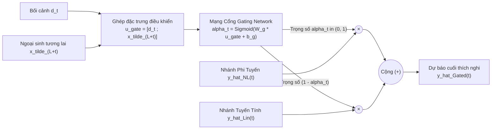

# SLIDE 03 (PHẦN 3): ĐỀ XUẤT CẢI TIẾN CƠ CHẾ KẾT HỢP NHÁNH PHI TUYẾN & TUYẾN TÍNH

> [!NOTE]
> **Mục tiêu Slide 03 (Phần 3):** Trả lời trực tiếp câu hỏi hướng nghiên cứu tiếp: ***"Có thể cải tiến cơ chế kết hợp nhánh phi tuyến (`Temporal Decoder`) và nhánh tuyến tính (`Global Residual`) để nâng cao độ chính xác không?"*** — Đưa ra **2 giả thuyết cải tiến khả thi** kèm phương trình toán học, mã nguồn PyTorch và kế hoạch kiểm chứng thực nghiệm.

---

## 🖼️ Hình Ảnh & Sơ Đồ Minh Họa Đưa Lên Slide

### 3.1. Slide 09 / 11 — Đề xuất 1: Cổng Hợp Nhất Thích Nghi (*Adaptive Gated Fusion*) vs Cộng cứng `1:1`


### 3.2. Slide 10 / 11 — Đề xuất 2: Tách Xu Hướng Kiểu DLinear (*Trend-Aware Dual-Stream*)


### 3.3. Slide 11 / 11 — Đóng Góp Khoa Học (Contributions) & Lộ Trình Thực Nghiệm


### 3.4. Sơ đồ khối Mermaid (Hiển thị trực tiếp trên GitHub)



---

## 📋 Nội Dung Cụ Thể Trình Bày Trên Slide (Hiển thị cho khán giả)

### 1. Hướng nghiên cứu tiếp: Vì sao có thể cải tiến phép cộng `out += residual_out`?

Trong TiDE gốc (`models.py#L214`), hai nhánh luôn cộng cứng theo tỷ lệ $1 : 1$. Tuy nhiên trong thực tế, chuỗi thời gian có **sự chuyển đổi chế độ theo thời gian**: lúc vận động ổn định (tuyến tính trội hơn) và lúc xảy ra sự kiện đột biến (ngoại sinh phi tuyến trội hơn). Do đó, **hoàn toàn có thể nâng cao độ chính xác** bằng cơ chế hợp nhất thích nghi (*Adaptive Fusion*).

### 2. Giả thuyết 1: Cổng Hợp Nhất Thích Nghi Theo Thời Gian (Adaptive Gated Fusion)

**2.1. Ý tưởng & Công thức toán học:**

Thay vì cộng cứng $1:1$, ta bổ sung một **Mạng Cổng siêu nhẹ** tính hệ số điều tiết $\alpha_t^{(i)} \in (0, 1)$ cho từng bước thời gian tương lai $t \in [H]$ dựa trên $\big[\mathbf{d}_t^{(i)} ; \tilde{\mathbf{x}}_{L+t}^{(i)}\big]$:

$$
\alpha_t^{(i)} = \sigma\Big( \mathbf{W}_g \cdot \big[ \mathbf{d}_t^{(i)} \; ; \; \tilde{\mathbf{x}}_{L+t}^{(i)} \big] + b_g \Big) \in (0, 1)
$$

$$
\hat{\mathbf{y}}_{\mathrm{Gated}, L+t}^{(i)} = \alpha_t^{(i)} \cdot \hat{\mathbf{y}}_{\mathrm{NL}, L+t}^{(i)} + \big(1 - \alpha_t^{(i)}\big) \cdot \hat{\mathbf{y}}_{\mathrm{Lin}, L+t}^{(i)}
$$

*(Hoặc biến thể giữ nguyên xương sống tuyến tính: $\hat{\mathbf{y}}_{\mathrm{Lin}, L+t}^{(i)} + \alpha_t^{(i)} \cdot \hat{\mathbf{y}}_{\mathrm{NL}, L+t}^{(i)}$).*

**2.2. Lợi ích & Chi phí triển khai:**

* Khi chuỗi yên tĩnh: $\alpha_t \to 0$ ưu tiên nhánh tuyến tính chống nhiễu; khi có sự kiện ngoại sinh mạnh (ngày lễ, sự kiện Type A): $\alpha_t \to 1$ khuếch đại đóng góp của Temporal Decoder.
* Chi phí cực rẻ: với `p = 16`, `r_tilde = 4`, lớp cổng chỉ tốn thêm đúng **$21$ tham số**, tốc độ tính toán gần như không đổi.

```python
# Code PyTorch thay thế dòng 265 của simulate_forward_pass.py
class AdaptiveGatedTiDEHead(nn.Module):
    def __init__(self, p: int, r_tilde: int):
        super().__init__()
        self.gate_proj = nn.Linear(p + r_tilde, 1)  # Chỉ tốn p + r_tilde + 1 params
        self.sigmoid = nn.Sigmoid()

    def forward(self, temp_in, y_hat_nl, y_hat_lin):
        alpha = self.sigmoid(self.gate_proj(temp_in)).squeeze(-1)  # [B, H]
        return alpha * y_hat_nl + (1.0 - alpha) * y_hat_lin
```

### 3. Giả thuyết 2: Phân rã Xu hướng & Điều tiết Horizon cho Global Residual (Xuất phát từ Bài báo)

**3.1. Cơ sở trực tiếp từ các điểm nghẽn & hướng mở trong Bài báo gốc:**
* **Điểm yếu thực nghiệm tại Table 2 (Trang 8):** Trên tập `Weather` (tần suất 10 phút, nhiễu cao) ở $H=96$, TiDE đạt MSE `0.166` (thua PatchTST `0.149` tới `10.2%`); trên `ETTm1` ở $H=96$, TiDE (`0.306`) cũng thua cả DLinear (`0.299`) và PatchTST (`0.293`).
* **Bão hòa ở tầm xa tại Table 5 (Trang 11):** Trên `Electricity` ở $H=720$, sai số của TiDE và `TiDE (no res.)` tiệm cận nhau (`0.196` vs `0.196`), cho thấy trọng số cộng cố định `1:1` suy giảm hiệu lực ở bước xa.
* **Hướng mở từ chính tác giả (Mục 6 Conclusion & Future Work, Trang 11):** Nhóm tác giả đề xuất cần phân tích sâu hơn hiệu quả của kiến trúc MLP so với Transformer ứng với **từng mức độ xu hướng (*trend*) và chu kỳ (*seasonality*)**; đồng thời tại Mục 4.2, nhánh Global Residual mới chiếu thẳng chuỗi thô $\mathbf{y}_{1:L}^{(i)}$ thay vì tách thành phần mượt như DLinear.

**3.2. Phương trình cải tiến & Cơ sở thuyết phục:**

$$
\hat{\mathbf{y}}_{\mathrm{final}}^{(i)} = \big(\mathbf{W}_{\mathrm{trend}} \mathbf{y}_{\mathrm{trend}}^{(i)} + \mathbf{W}_{\mathrm{rem}} \mathbf{y}_{\mathrm{rem}}^{(i)} + \mathbf{b}\big) + \sigma(\boldsymbol{\gamma}) \odot \hat{\mathbf{y}}_{\mathrm{NL}}^{(i)}
$$

* **Giữ nguyên tối ưu Phụ lục A:** Tách nền mượt $\mathbf{y}_{\mathrm{trend}}^{(i)}$ giúp nhánh Linear phát huy đúng chứng minh tối ưu cho hệ động lực tuyến tính mà không bị gai nhiễu tần số cao (`Weather`, `ETTm1`) kéo lệch.
* **Xử lý suy giảm ở $H=720$:** Vector học $\sigma(\boldsymbol{\gamma}) \in \mathbb{R}^H$ tự động tiết giảm độ trôi phi tuyến của Temporal Decoder tại các bước tương lai xa.
* **Bảo toàn $\mathrm{DLinear} \subset \mathrm{TiDE}$ & tốc độ $O(L+H)$:** Chi phí tham số tăng $< 0.1\%$, giữ nguyên tốc độ nhanh hơn Transformer $5\text{–}10\times$ (Mục 5.3).

### 4. Đóng góp khoa học (Xuất phát từ khoảng trống Bài báo) & Lộ trình kiểm chứng

**3 Đóng góp kỳ vọng chính (Contributions):**

1. **Hợp nhất thích nghi điều khiển từ ngoại sinh:** Khắc phục phép cộng cứng `1:1` (`models.py#L214`) bằng cổng $\alpha_t$ (`+21 params`). Tận dụng đúng tín hiệu ngoại sinh quyết định tốc độ bắt sự kiện Type A/B (**Figure 3, Trang 10**) và tối ưu hóa chế độ ổn định tuyến tính (**Phụ lục A**).
2. **Giải quyết trực tiếp bài toán Future Work tại Mục 6 (Trang 11):** Nâng cấp Global Residual bằng phân rã Trend/Remainder + trọng số $\sigma(\boldsymbol{\gamma})$ theo horizon để xử lý trực diện các benchmark TiDE thua PatchTST/DLinear (**Table 2 Trang 8**: `Weather`, `ETTm1`) và vùng bão hòa $H=720$ (**Table 5**).
3. **Hoàn thiện mảnh ghép Ablation Study còn thiếu tại Mục 5.4 (Trang 11):** Tác giả gộp chung bỏ cả `MLP ResidualBlock Skip` lẫn `Global Linear Residual` trong biến thể `TiDE (no res.)` và chỉ thử trên `1/7` tập (`Electricity`). Ta **tách riêng 2 thành phần skip** và mở rộng đánh giá sang đủ **7 datasets** (`Weather`, `Traffic`, `4 ETT`, `Electricity`).

| Bước kiểm chứng | Mục tiêu xuất phát từ Bài báo | Tiêu chí thuyết phục & Nghiệm thu |
| :--- | :--- | :--- |
| **Bước 1: Tách bạch Ablation Mục 5.4** | Mục 5.4 Trang 11 chưa tách `Global Linear` khỏi `MLP Skip` và thiếu `6/7` tập. | Đối chứng 3 baseline (`Full TiDE` vs `No Global Linear` vs `No MLP Skip`) trên `Electricity`, `Weather`, `Traffic`, `ETTm1`. |
| **Bước 2: Kiểm chứng trên điểm yếu Table 2** | TiDE thua PatchTST/DLinear ở `Weather H=96..336` & `ETTm1 H=96`. | So sánh **MSE / MAE** (5 seeds) của 2 Đề xuất vs TiDE Gốc & PatchTST; kỳ vọng rút ngắn khoảng cách `0.166 -> ~0.149` trên `Weather`. |
| **Bước 3: Nghiệm thu cơ chế & Chi phí (Mục 5.3)** | Giải thích $\alpha_t$ trên sự kiện `Type A/B` (Figure 3) và giữ tốc độ TiDE. | Đồ thị $\alpha_t$ tăng vọt đúng vùng sự kiện `24h`; tham số tăng $< 0.1\%$ và thời gian train/epoch tăng $< 5\%$. |

---

## 🎙️ Kịch Bản Lời Nói Thuyết Trình (Speaker Notes)

> "Cuối cùng ở Phần 3, toàn bộ đề xuất cải tiến của em **đều xuất phát trực tiếp từ những điểm nghẽn và gợi mở được chính nhóm tác giả Google Research ghi nhận trong bài báo**:
>
> 1. **Đề xuất 1 — Adaptive Gated Fusion (Slide 09):** Xuất phát từ dòng code 214 `out += residual_out` cộng cứng `1:1`. Kết hợp chứng minh từ Phụ lục A (mô hình tuyến tính đã tối ưu khi chuỗi vận động tuyến tính) và Figure 3 (biến ngoại sinh quyết định sự kiện Type A/B), ta chỉ cần thêm 1 cổng Sigmoid `alpha_t` tốn đúng **21 tham số** để tự động hạ nhiễu phi tuyến lúc yên tĩnh và mở hết cỡ khi có sự kiện đột biến.
>
> 2. **Đề xuất 2 — Phân rã Xu hướng & Điều tiết Horizon (Slide 10):** Xuất phát từ **Table 2 (Trang 8)** khi TiDE vẫn thua PatchTST `10.2%` trên tập `Weather` (`H=96`, nhiều nhiễu 10 phút) và thua DLinear ở `ETTm1`; đồng thời ở **Table 5 (Trang 11)** khi `H=720`, Global Residual gốc bị bão hòa (`0.196` vs `0.196`). Trong **Mục 6 Future Work**, chính tác giả cũng gợi mở phải xét ảnh hưởng của *trend* và *seasonality*. Tách chuỗi quá khứ qua `MovingAvg` như tinh thần DLinear giúp nhánh tuyến tính giữ được tính tối ưu ở Phụ lục A, còn hệ số học `sigma(gamma)` giúp hãm độ trôi phi tuyến ở tầm dự báo xa.
>
> 3. **Đóng góp & Lộ trình kiểm chứng (Slide 11):** Bên cạnh hai kiến trúc nâng cấp, ta còn hoàn thiện lỗ hổng ở **Mục 5.4 (Trang 11)** — tách bạch riêng `Global Linear Skip` khỏi `MLP Skip` và chạy đủ **7 datasets** thay vì chỉ `1/7` tập như bài báo gốc!"

---

> 📌 **Footer (Vị trí gốc đối chiếu trên Bài báo & Mã nguồn):**  
> **Bài báo:** Kế thừa từ **Mục 4.2 Decoding (Trang 6)** & **Mục 5.4 Ablation Study (Trang 10–11)** | **Điểm tích hợp code gốc:** [`google-research/tide/models.py#L203`](https://github.com/google-research/google-research/blob/master/tide/models.py#L203) & [`#L214`](https://github.com/google-research/google-research/blob/master/tide/models.py#L214) | **Điểm tích hợp dự án:** [`simulate_forward_pass.py#L265`](../../../simulate_forward_pass.py#L265)
