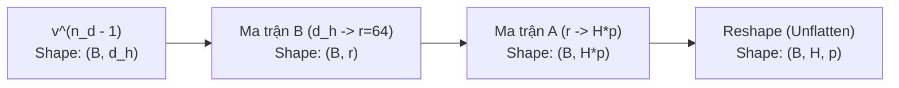

# PHẦN 3: Đề Xuất Cải Thiện Tốt Nhất & Lộ Trình Kiểm Chứng (Slide 11 – 12)

> **Phạm vi:** Chọn ra **1 đề xuất cải thiện duy nhất tốt nhất** xuất phát trực tiếp từ hạn chế đã được tác giả TiDE thừa nhận ở **Mục 6 Conclusion (Trang 11)** và nút thắt tham số tại **`models.py#L133-L137`** — giải pháp **Low-Rank Factorized Dense Decoder Projection**.

---

## Slide 11 / 13 — Đề Xuất Tốt Nhất: Low-Rank Dense Decoder Projection — Cơ Sở & Lý Do Chọn

### 1. Kế thừa trực tiếp từ các bài báo uy tín

- **Hu et al. (ICLR 2022) — LoRA (*Low-Rank Adaptation of Large Language Models*)** và **Sainath et al. (ICASSP 2013) — Low-Rank Matrix Factorization for DNN**.
- Cơ sở lý thuyết: Thay vì học trực tiếp ma trận trọng số dày đặc kích thước khổng lồ $\mathbf{W} \in \mathbb{R}^{(H \cdot p) \times d_h}$ nối từ tầng ẩn cuối $d_h$ sang toàn bộ horizon $H \cdot p$, ta phân rã tuyến tính qua một không gian cổ chai hạng thấp $r \ll \min(d_h, H \cdot p)$:

$$
\mathbf{W} \approx \mathbf{A} \cdot \mathbf{B}, \quad \text{với } \mathbf{B} \in \mathbb{R}^{r \times d_h},\; \mathbf{A} \in \mathbb{R}^{(H \cdot p) \times r}
$$

### 2. Vì sao đây là phương án TỐT NHẤT cho khối Dense Decoder?

1. **Đánh trúng điểm yếu được xác nhận trong bài báo gốc:** Tại Mục 6 Trang 11, nhóm tác giả Das et al. thừa nhận MLP kém hiệu quả tham số hơn Transformer khi kích thước mô hình phình to; riêng khối cuối Dense Decoder ở $H = 720$ ngốn tới ~11.8M tham số cho 2 ma trận `lin_b` và `lin_res` (`models.py#L40-L47`).
2. **Giảm ~92.6% tham số tầng chiếu cuối:** Với hạng thấp $r = 64$ trên cấu hình Electricity ($d_h = 1024, p = 8, H = 720 \Rightarrow H \cdot p = 5760$):

$$
\text{Params}_{\text{Low-Rank}} = 2 \times \left(1{,}024 \times 64 + 64 \times 5{,}760\right) \approx 0.87\text{M} \quad (\text{giảm } 92.6\% \text{ từ } 11.8\text{M})
$$

3. **Giữ nguyên 100% tính chất One-Shot** $O(1)$ **& Chống Overfitting:** Vẫn giải mã toàn bộ horizon $\mathbf{D}^{(i)}$ (Shape: $(B, H, p)$) trong một lần forward duy nhất, không thêm bất kỳ vòng lặp tuần tự nào, đồng thời cấu trúc nút thắt hạng $r$ đóng vai trò **điều chuẩn tự nhiên (Implicit Regularization)** tránh học thuộc nhiễu khi dự báo dài hạn.

---

## Slide 12 / 13 — Điểm Cải Thiện Cụ Thể Trong TiDE & Lộ Trình Thực Nghiệm

### 1. Phương án này cải thiện ở 3 điểm cụ thể nào trong TiDE?

| STT | Vị trí trong TiDE | Vấn đề hiện tại | Giá trị cải thiện mang lại |
| :--- | :--- | :--- | :--- |
| **1** | **Tầng chiếu cuối `models.py#L136`** | Cả `lin_b` và `lin_res` mở rộng thẳng từ $d_h \rightarrow H \cdot p$. | Tách chuỗi $d_h \rightarrow r \rightarrow H \cdot p$, giảm ~92.6% số tham số tầng cuối nhưng giữ nguyên luồng forward `MLPResidual`. |
| **2** | **Nút thắt** $H = 720$ & $p$ lớn (Mục 6 & Table 8) | Tốn VRAM & dễ Overfitting khi chọn $p = 32$ trên tập nhỏ (ETTh2) hoặc horizon dài $H = 720$. | Cho phép tăng dung lượng vector bối cảnh $p \in [16, 32]$ giúp mô tả chi tiết hơn mà không làm bùng nổ tham số. |
| **3** | **Khoảng trống Ablation Mục 5.4** | Bài báo gốc chưa công bố bảng quét độ nhạy tách riêng cho $p$, $n_d$ trên 7 benchmark datasets. | Bổ sung trọn vẹn thực nghiệm quét nhạy cảm giữa $(p, n_d)$ và các hạng phân rã $r \in \{32, 64, 128\}$. |

### 2. Lộ trình thực nghiệm kiểm chứng tính thuyết phục (Validation Protocol)

1. **Bước 1 — Đối chứng Baseline vs Low-Rank:** Chạy trung bình 5 seeds trên Electricity, ETTh2 và ETTm1 ở $H \in \{336, 720\}$, so sánh `MLPResidual` gốc với phiên bản Low-Rank $r \in \{32, 64, 128\}$.
2. **Bước 2 — Quét độ nhạy siêu tham số** $p$ & $n_d$: Đo MSE/MAE theo $p \in \{2, 8, 16, 32\}$ và $n_d \in \{1, 2, 3\}$ để kiểm chứng thực nghiệm hiện tượng nghẽn thông tin ($p$ nhỏ) và bão hòa ($n_d \geq 3$).
3. **Bước 3 — Tiêu chí nghiệm thu:** Giảm $\geq 85\%$ tham số tầng chiếu cuối, giữ nguyên tốc độ suy luận One-Shot $O(1)$ trên GPU và đạt MSE/MAE tương đương hoặc tốt hơn bản TiDE gốc.
