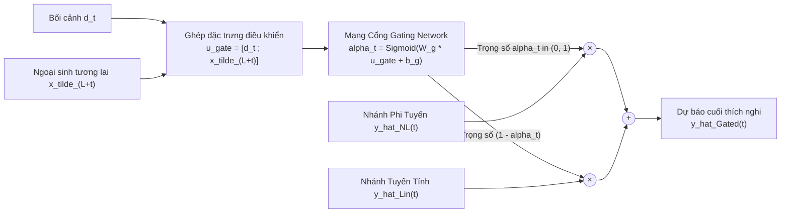

# SLIDE 03 (PHẦN 3): ĐỀ XUẤT CẢI TIẾN CƠ CHẾ KẾT HỢP NHÁNH PHI TUYẾN & TUYẾN TÍNH

> **Mục tiêu Slide 03 (Phần 3):** Trả lời trực tiếp câu hỏi hướng nghiên cứu tiếp: ***"Có thể cải tiến cơ chế kết hợp nhánh phi tuyến (`Temporal Decoder`) và nhánh tuyến tính (`Global Residual`) để nâng cao độ chính xác không?"*** — Đưa ra **2 giả thuyết cải tiến khả thi** kèm công thức, mã nguồn PyTorch và kế hoạch kiểm chứng thực nghiệm.

---

## 🖼️ Hình Ảnh & Sơ Đồ Minh Họa Đưa Lên Slide




---

## 📋 Nội Dung Cụ Thể Trình Bày Trên Slide (Hiển thị cho khán giả)

### 1. Hướng nghiên cứu tiếp: Vì sao có thể cải tiến phép cộng `out += residual_out`?
Trong TiDE gốc (`models.py#L214`), hai nhánh luôn cộng cứng theo tỷ lệ $1 : 1$. Tuy nhiên trong thực tế, chuỗi thời gian có **sự chuyển đổi chế độ theo thời gian**: lúc vận động ổn định (tuyến tính trội hơn) và lúc xảy ra sự kiện đột biến (ngoại sinh phi tuyến trội hơn). Do đó, **hoàn toàn có thể nâng cao độ chính xác** bằng cơ chế hợp nhất thích nghi (Adaptive Fusion).

### 2. Giả thuyết 1: Cổng Hợp Nhất Thích Nghi Theo Thời Gian (Adaptive Gated Fusion)
* **Ý tưởng:** Bổ sung một Mạng Cổng siêu nhẹ tính hệ số $\alpha_t^{(i)} \in (0, 1)$ cho từng bước thời gian tương lai $t$ dựa trên $\big[d_t^{(i)} ; \tilde{x}_{L+t}^{(i)}\big]$:

$$
\alpha_t^{(i)} = \sigma\Big( W_g \cdot \big[ d_t^{(i)} \; ; \; \tilde{x}_{L+t}^{(i)} \big] + b_g \Big)
$$

$$
\hat{y}_{\text{Gated}, L+t}^{(i)} = \alpha_t^{(i)} \cdot \hat{y}_{\text{NL}, L+t}^{(i)} + \big(1 - \alpha_t^{(i)}\big) \cdot \hat{y}_{\text{Lin}, L+t}^{(i)}
$$

* *(Hoặc biến thể giữ nguyên xương sống tuyến tính: $\hat{y}_{\text{Lin}, L+t}^{(i)} + \alpha_t^{(i)} \cdot \hat{y}_{\text{NL}, L+t}^{(i)}$).*
* **Ưu điểm kỳ vọng:** Khi chuỗi yên tĩnh, $\alpha_t \to 0$ ưu tiên nhánh tuyến tính chống nhiễu; khi có sự kiện ngoại sinh mạnh (ngày lễ, Type A event), $\alpha_t \to 1$ khuếch đại Temporal Decoder. Chi phí cực rẻ: với $p=16, \tilde{r}=4$ chỉ tốn thêm đúng **$21$ tham số**!

```python
# Code PyTorch thay thế dòng 265 của simulate_forward_pass.py
class AdaptiveGatedTiDEHead(nn.Module):
    def __init__(self, p: int, r_tilde: int):
        super().__init__()
        self.gate_proj = nn.Linear(p + r_tilde, 1)  # Chỉ tốn p + r_tilde + 1 params
        self.sigmoid = nn.Sigmoid()

    def forward(self, temp_in, y_hat_nl, y_hat_lin):
        alpha = self.sigmoid(self.gate_proj(temp_in)).squeeze(-1)  # [B, H]
        return alpha * y_hat_nl + (1.0 - alpha) * y_hat_lin
```

### 3. Giả thuyết 2: Tách Xu Hướng Kiểu DLinear Cho Nhánh Tuyến Tính (Trend-Aware Dual-Stream)
* **Ý tưởng:** Dùng bộ lọc `Moving Average` ($k = 25$) tách chuỗi quá khứ $y_{1:L}^{(i)}$ thành thành phần mượt $y_{\text{trend}}^{(i)}$ và phần dư $y_{\text{rem}}^{(i)}$ trước khi chiếu qua hai lớp Linear độc lập, kết hợp trọng số học được theo thực thể/horizon $\gamma \in \mathbb{R}^{1 \times H}$:

$$
\hat{y}_{\text{final}}^{(i)} = \big(W_{\text{trend}} y_{\text{trend}}^{(i)} + W_{\text{rem}} y_{\text{rem}}^{(i)} + b\big) + \sigma(\gamma) \odot \hat{y}_{\text{NL}}^{(i)}
$$

### 4. Thiết kế kiểm chứng thực nghiệm (Experimental Protocol)

| Hạng mục | Thiết lập kiểm chứng đề xuất |
| :--- | :--- |
| **Datasets** | `Electricity`, `Semi-synthetic Electricity (Type A/B events)` & `ETTh1 / Traffic` ($H \in \{96, 192, 336, 720\}$). |
| **Mô hình đối chứng** | (1) TiDE Gốc (`y_nl + y_lin`) vs (2) TiDE + `AdaptiveGatedTiDEHead` vs (3) TiDE + `Trend-Aware Dual-Stream`. |
| **Chỉ số đo lường** | So sánh **MSE / MAE** (trung bình 5 seed), thời gian train/epoch ($< 5\%$ sai khác) và **trực quan hóa giá trị cổng $\alpha_t$** trong suốt chu kỳ sự kiện Type A. |

---

## 🔗 Vị Trí Mã Nguồn Tham Chiếu Cho Slide 03 (Điểm Thay Thế Hợp Nhất)
* **Repo gốc Google Research (`models.py`):**
  * Thay thế phép cộng cứng `out += residual_out`: [models.py#L214](https://github.com/google-research/google-research/blob/master/tide/models.py#L214)
  * Tiền xử lý tách Trend trước `self.linear(past_ts)`: [models.py#L203](https://github.com/google-research/google-research/blob/master/tide/models.py#L203)
* **Code PyTorch mô phỏng trong dự án (`simulate_forward_pass.py`):**
  * Điểm tích hợp `AdaptiveGatedTiDEHead` thay cho `y_hat_norm = y_hat_nl + y_hat_lin`: [simulate_forward_pass.py#L265](../../../simulate_forward_pass.py#L265)

---

## 🎙️ Kịch Bản Lời Nói Thuyết Trình (Speaker Notes)

> *"Cuối cùng ở Phần 3, để trả lời trực tiếp câu hỏi mở của đề tài: **Có thể cải tiến cơ chế kết hợp giữa nhánh phi tuyến và nhánh tuyến tính để nâng cao độ chính xác không?** Câu trả lời chắc chắn là **CÓ**.*
>
> *Như đã phân tích ở Phần 2, dòng code `out += residual_out` hiện tại ép cả hai nhánh cộng với tỷ lệ cứng 1:1 ở mọi thời điểm. Em xin đề xuất 2 giả thuyết cải tiến có thể kiểm chứng ngay bằng thực nghiệm:*
>
> *1. **Adaptive Gated Fusion (Cổng hợp nhất thích nghi theo thời gian):** Ta thêm một tầng Linear nhỏ kết hợp hàm Sigmoid để sinh ra trọng số $\alpha_t \in (0, 1)$ cho từng mốc tương lai dựa trên chính $[d_t ; \tilde{x}_{L+t}]$. Khi chuỗi đang biến động bình thường, $\alpha_t$ hạ xuống để ưu tiên nhánh tuyến tính chống nhiễu; còn khi phát hiện sự kiện đột biến như Type A hoặc ngày lễ, cổng tự động mở $\alpha_t \to 1$ để ưu tiên Temporal Decoder. Đặc biệt, mạng cổng này chỉ tốn thêm đúng **21 tham số**, tốc độ tính toán gần như không đổi.*
>
> *2. **Trend-Aware Dual-Stream:** Tách $y_{1:L}$ thành Trend và Seasonal bằng Moving Average đúng theo tinh thần DLinear trước khi đưa vào `Global Linear Skip`, tránh để nhiễu gai làm lệch đường nền tuyến tính.*
>
> *Bên dưới là thiết kế thí nghiệm đối chứng (Ablation Study) kèm đồ thị theo dõi giá trị $\alpha_t$ mà nhóm hoàn toàn có thể chạy kiểm chứng ngay trên bộ dữ liệu thực tế. Cảm ơn thầy cô và các bạn đã lắng nghe!"*
