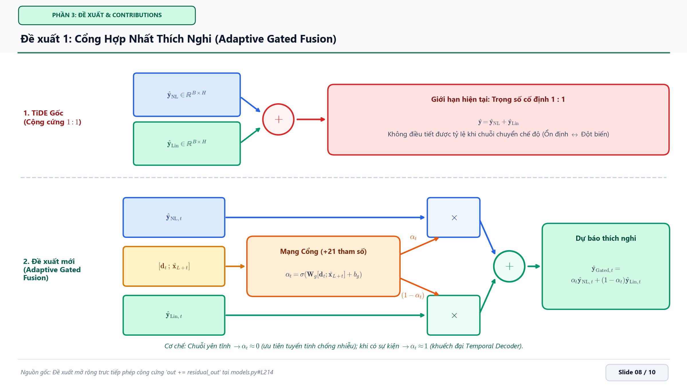
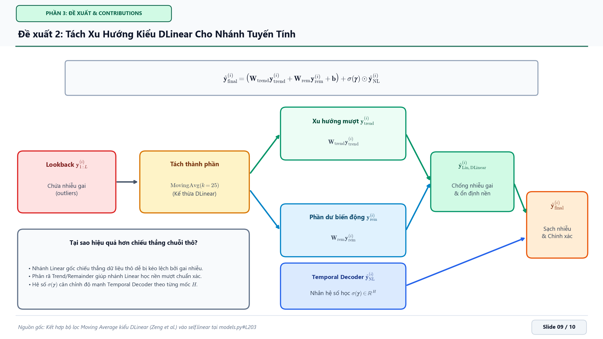
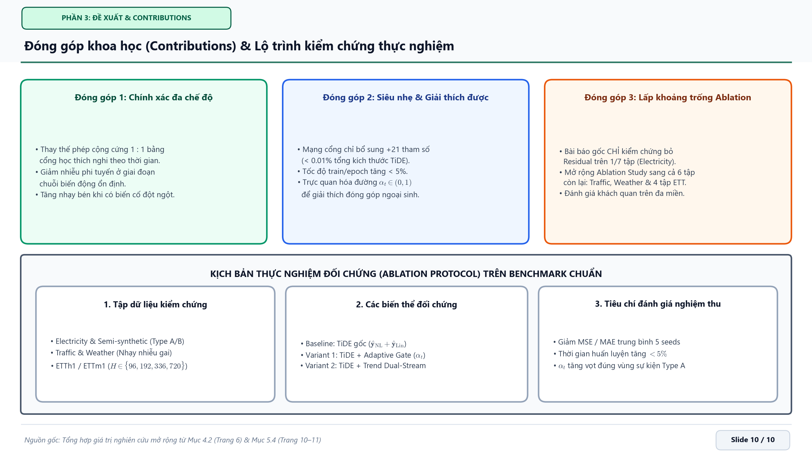
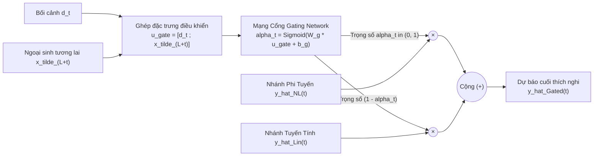

# SLIDE 03 (PHẦN 3): ĐỀ XUẤT CẢI TIẾN CƠ CHẾ KẾT HỢP NHÁNH PHI TUYẾN & TUYẾN TÍNH

> [!NOTE]
> **Mục tiêu Slide 03 (Phần 3):** Trả lời trực tiếp câu hỏi hướng nghiên cứu tiếp: ***"Có thể cải tiến cơ chế kết hợp nhánh phi tuyến (`Temporal Decoder`) và nhánh tuyến tính (`Global Residual`) để nâng cao độ chính xác không?"*** — Đưa ra **2 giả thuyết cải tiến khả thi** kèm phương trình toán học, mã nguồn PyTorch và kế hoạch kiểm chứng thực nghiệm.

---

## 🖼️ Hình Ảnh & Sơ Đồ Minh Họa Đưa Lên Slide

### 3.1. Slide 08 / 10 — Đề xuất 1: Cổng Hợp Nhất Thích Nghi (*Adaptive Gated Fusion*) vs Cộng cứng `1:1`



### 3.2. Slide 09 / 10 — Đề xuất 2: Tách Xu Hướng Kiểu DLinear (*Trend-Aware Dual-Stream*)



### 3.3. Slide 10 / 10 — Đóng Góp Khoa Học (Contributions) & Lộ Trình Thực Nghiệm



### 3.4. Sơ đồ khối Mermaid (Hiển thị trực tiếp trên GitHub)



---

## 📋 Nội Dung Cụ Thể Trình Bày Trên Slide (Hiển thị cho khán giả)

### 1. Hướng nghiên cứu tiếp: Vì sao có thể cải tiến phép cộng `out += residual_out`?

Trong TiDE gốc (`models.py#L214`), hai nhánh luôn cộng cứng theo tỷ lệ $1 : 1$. Tuy nhiên trong thực tế, chuỗi thời gian có **sự chuyển đổi chế độ theo thời gian**: lúc vận động ổn định (tuyến tính trội hơn) và lúc xảy ra sự kiện đột biến (ngoại sinh phi tuyến trội hơn). Do đó, **hoàn toàn có thể nâng cao độ chính xác** bằng cơ chế hợp nhất thích nghi (*Adaptive Fusion*).

### 2. Giả thuyết 1: Cổng Hợp Nhất Thích Nghi Theo Thời Gian (Adaptive Gated Fusion)

**2.1. Ý tưởng & Công thức toán học:**

Thay vì cộng cứng $1:1$, ta bổ sung một **Mạng Cổng siêu nhẹ** tính hệ số điều tiết $\alpha_t^{(i)} \in (0, 1)$ cho từng bước thời gian tương lai $t \in [H]$ dựa trên $\big[\mathbf{d}_t^{(i)} ; \tilde{\mathbf{x}}_{L+t}^{(i)}\big]$:

$$
\alpha_t^{(i)} = \sigma\Big( \mathbf{W}_g \cdot \big[ \mathbf{d}_t^{(i)} \; ; \; \tilde{\mathbf{x}}_{L+t}^{(i)} \big] + b_g \Big) \in (0, 1)
$$

$$
\hat{\mathbf{y}}_{\mathrm{Gated}, L+t}^{(i)} = \alpha_t^{(i)} \cdot \hat{\mathbf{y}}_{\mathrm{NL}, L+t}^{(i)} + \big(1 - \alpha_t^{(i)}\big) \cdot \hat{\mathbf{y}}_{\mathrm{Lin}, L+t}^{(i)}
$$

*(Hoặc biến thể giữ nguyên xương sống tuyến tính: $\hat{\mathbf{y}}_{\mathrm{Lin}, L+t}^{(i)} + \alpha_t^{(i)} \cdot \hat{\mathbf{y}}_{\mathrm{NL}, L+t}^{(i)}$).*

**2.2. Lợi ích & Chi phí triển khai:**

* Khi chuỗi yên tĩnh: $\alpha_t \to 0$ ưu tiên nhánh tuyến tính chống nhiễu; khi có sự kiện ngoại sinh mạnh (ngày lễ, sự kiện Type A): $\alpha_t \to 1$ khuếch đại đóng góp của Temporal Decoder.
* Chi phí cực rẻ: với `p = 16`, `r_tilde = 4`, lớp cổng chỉ tốn thêm đúng **$21$ tham số**, tốc độ tính toán gần như không đổi.

```python
# Code PyTorch thay thế dòng 265 của simulate_forward_pass.py
class AdaptiveGatedTiDEHead(nn.Module):
    def __init__(self, p: int, r_tilde: int):
        super().__init__()
        self.gate_proj = nn.Linear(p + r_tilde, 1)  # Chỉ tốn p + r_tilde + 1 params
        self.sigmoid = nn.Sigmoid()

    def forward(self, temp_in, y_hat_nl, y_hat_lin):
        alpha = self.sigmoid(self.gate_proj(temp_in)).squeeze(-1)  # [B, H]
        return alpha * y_hat_nl + (1.0 - alpha) * y_hat_lin
```

### 3. Giả thuyết 2: Tách Xu Hướng Kiểu DLinear Cho Nhánh Tuyến Tính (Trend-Aware Dual-Stream)

Dùng bộ lọc `Moving Average` ($k = 25$) tách chuỗi quá khứ $\mathbf{y}_{1:L}^{(i)}$ thành thành phần mượt $\mathbf{y}_{\mathrm{trend}}^{(i)}$ và phần dư $\mathbf{y}_{\mathrm{rem}}^{(i)}$ trước khi chiếu qua hai lớp Linear độc lập, kết hợp trọng số học được theo horizon $\boldsymbol{\gamma} \in \mathbb{R}^{1 \times H}$:

$$
\hat{\mathbf{y}}_{\mathrm{final}}^{(i)} = \big(\mathbf{W}_{\mathrm{trend}} \mathbf{y}_{\mathrm{trend}}^{(i)} + \mathbf{W}_{\mathrm{rem}} \mathbf{y}_{\mathrm{rem}}^{(i)} + \mathbf{b}\big) + \sigma(\boldsymbol{\gamma}) \odot \hat{\mathbf{y}}_{\mathrm{NL}}^{(i)}
$$

### 4. Đóng góp khoa học (Contributions) & Thiết kế kiểm chứng thực nghiệm

**3 Đóng góp kỳ vọng chính (Contributions):**

1. **Cải thiện độ chính xác trên chuỗi đa chế độ (*Regime-Switching*):** Khắc phục phép cộng cứng `1:1`, giảm nhiễu phi tuyến ở giai đoạn ổn định và khuếch đại nhạy bén khi có biến cố ngoại sinh.
2. **Siêu nhẹ & Có khả năng giải thích (*Lightweight & Interpretable*):** Mạng cổng chỉ bổ sung **$21$ tham số** (`< 0.01%` mô hình) nhưng cho phép vẽ đồ thị biến thiên $\alpha_t \in (0, 1)$ để giải thích trực quan lúc nào mô hình dựa vào lịch sử tuyến tính, lúc nào dựa vào sự kiện ngoại sinh.
3. **Lấp khoảng trống Ablation của bài báo gốc:** Mở rộng kiểm chứng sang cả **6 tập dữ liệu còn lại** (`Traffic`, `Weather`, `ETTh1/2`, `ETTm1/2`) thay vì chỉ dừng lại ở `1/7` tập (`Electricity`) như trong Figure 5 của bài báo gốc.

| Hạng mục | Thiết lập kiểm chứng đề xuất |
| :--- | :--- |
| **Datasets** | `Electricity`, `Semi-synthetic Electricity (Type A/B events)` & `ETTh1 / Traffic` (`H = 96, 192, 336, 720`). |
| **Mô hình đối chứng** | (1) TiDE Gốc (`y_nl + y_lin`) vs (2) TiDE + `AdaptiveGatedTiDEHead` vs (3) TiDE + `Trend-Aware Dual-Stream`. |
| **Chỉ số đo lường** | So sánh **MSE / MAE** (trung bình 5 seed), thời gian train/epoch (`< 5%` sai khác) và **trực quan hóa giá trị cổng $\alpha_t$** trong suốt chu kỳ sự kiện Type A. |

---

## 🎙️ Kịch Bản Lời Nói Thuyết Trình (Speaker Notes)

> "Cuối cùng ở Phần 3, để trả lời trực tiếp câu hỏi mở của đề tài: **Có thể cải tiến cơ chế kết hợp giữa nhánh phi tuyến và nhánh tuyến tính để nâng cao độ chính xác không?** Câu trả lời chắc chắn là **CÓ**.
>
> Như đã phân tích ở Phần 2, dòng code `out += residual_out` hiện tại ép cả hai nhánh cộng với tỷ lệ cứng 1:1 ở mọi thời điểm. Em xin đề xuất 2 giả thuyết cải tiến có thể kiểm chứng ngay bằng thực nghiệm:
>
> 1. **Adaptive Gated Fusion (Cổng hợp nhất thích nghi theo thời gian):** Ta thêm một tầng Linear nhỏ kết hợp hàm Sigmoid để sinh ra trọng số $\alpha_t \in (0, 1)$ cho từng mốc tương lai dựa trên chính $[\mathbf{d}_t ; \tilde{\mathbf{x}}_{L+t}]$. Khi chuỗi đang biến động bình thường, $\alpha_t$ hạ xuống để ưu tiên nhánh tuyến tính chống nhiễu; còn khi phát hiện sự kiện đột biến như Type A hoặc ngày lễ, cổng tự động mở $\alpha_t \to 1$ để ưu tiên Temporal Decoder. Đặc biệt, mạng cổng này chỉ tốn thêm đúng **21 tham số**, tốc độ tính toán gần như không đổi.
>
> 2. **Trend-Aware Dual-Stream:** Tách $\mathbf{y}_{1:L}$ thành Trend và Seasonal bằng Moving Average đúng theo tinh thần DLinear trước khi đưa vào `Global Linear Skip`, tránh để nhiễu gai làm lệch đường nền tuyến tính.
>
> Bên dưới là thiết kế thí nghiệm đối chứng (Ablation Study) kèm đồ thị theo dõi giá trị $\alpha_t$ mà nhóm hoàn toàn có thể chạy kiểm chứng ngay trên bộ dữ liệu thực tế. Cảm ơn thầy cô và các bạn đã lắng nghe!"

---

> 📌 **Footer (Vị trí gốc đối chiếu trên Bài báo & Mã nguồn):**  
> **Bài báo:** Kế thừa từ **Mục 4.2 Decoding (Trang 6)** & **Mục 5.4 Ablation Study (Trang 10–11)** | **Điểm tích hợp code gốc:** [`google-research/tide/models.py#L203`](https://github.com/google-research/google-research/blob/master/tide/models.py#L203) & [`#L214`](https://github.com/google-research/google-research/blob/master/tide/models.py#L214) | **Điểm tích hợp dự án:** [`simulate_forward_pass.py#L265`](../../../simulate_forward_pass.py#L265)
