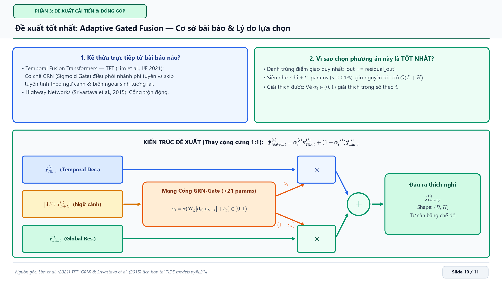
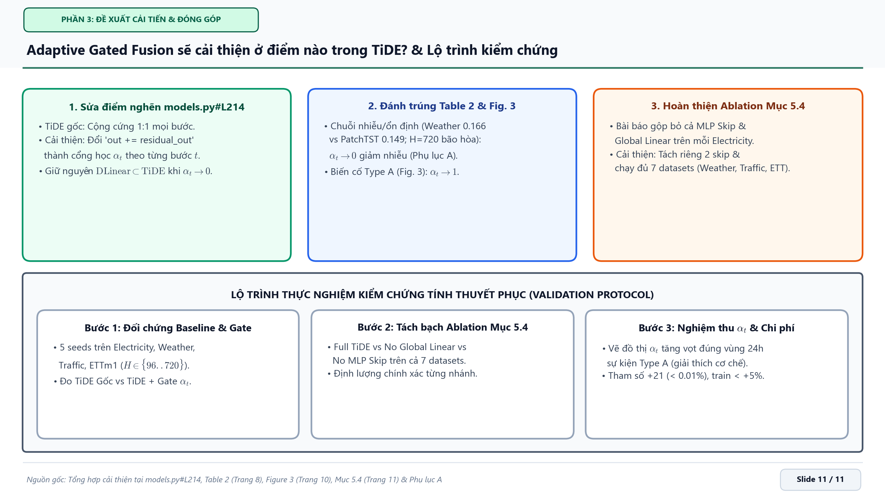
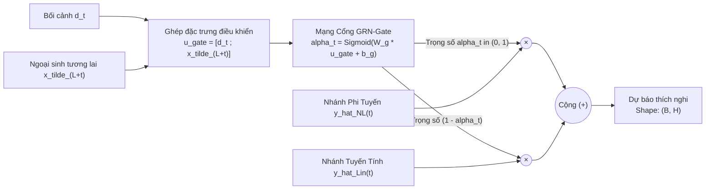

# SLIDE 03 (PHẦN 3): ĐỀ XUẤT TỐT NHẤT (ADAPTIVE GATED FUSION) & ĐIỂM CẢI THIỆN TRONG TiDE

> [!NOTE]
> **Mục tiêu Phần 3 (Slides 10–11):** Trả lời câu hỏi *"Có thể cải tiến cơ chế kết hợp nhánh phi tuyến (`Temporal Decoder`) và nhánh tuyến tính (`Global Residual`) không?"* bằng **1 đề xuất tối ưu nhất (`Adaptive Gated Fusion`)** — nêu rõ **kế thừa từ bài báo nào**, **vì sao chọn là phương án tốt nhất**, **nó cải thiện trực tiếp ở điểm nào trong TiDE**, kèm lộ trình kiểm chứng thực nghiệm.

---

## 🖼️ Hình Ảnh & Sơ Đồ Minh Họa Đưa Lên Slide

### 3.1. Slide 10 / 11 — Đề xuất tốt nhất: *Adaptive Gated Fusion* (Cơ sở bài báo & Lý do lựa chọn)



### 3.2. Slide 11 / 11 — Adaptive Gated Fusion cải thiện ở điểm nào trong TiDE? & Lộ trình kiểm chứng



### 3.3. Sơ đồ khối Mermaid (Hiển thị trực tiếp trên GitHub)



---

## 📋 Nội Dung Cụ Thể Trình Bày Trên Slide (Hiển thị cho khán giả)

### 1. Kế thừa từ bài báo nào & Vì sao chọn phương án này là TỐT NHẤT?

* **Kế thừa trực tiếp từ bài báo nền tảng:**
  * **Lim et al. (2021), *Temporal Fusion Transformers for Interpretable Multi-horizon Time Series Forecasting* (TFT — *IJF*):** Cơ chế **Gated Residual Network (GRN)** dùng cổng Sigmoid điều tiết giữa đường tắt tuyến tính (*linear skip*) và nhánh xử lý phi tuyến dựa trên ngữ cảnh + biến ngoại sinh tương lai.
  * **Srivastava et al. (2015), *Highway Networks*:** Nguyên lý cổng học động $\alpha_t \in (0, 1)$ cân bằng luồng phi tuyến và kết nối tắt.
* **Vì sao chọn Adaptive Gated Fusion là phương án tốt nhất (thay vì thêm nhiều nhánh tách chuỗi cồng kềnh)?**
  1. **Đánh trúng điểm giao duy nhất của 2 cơ chế trình bày:** Tác động trực tiếp tại lệnh `out += residual_out` (`models.py#L214`) mà không làm thay đổi kiến trúc Encoder/Decoder bên dưới.
  2. **Siêu nhẹ & bảo toàn tốc độ $O(L+H)$:** Chỉ bổ sung đúng **$21$ tham số** (`< 0.01%` tổng kích thước TiDE), giữ trọn ưu thế nhanh hơn Transformer $5\text{–}10\times$ (Mục 5.3).
  3. **Bổ sung khả năng giải thích (*Interpretable*):** Vẽ đường biến thiên $\alpha_t \in (0, 1)$ để giải thích mô hình ưu tiên tuyến tính hay ngoại sinh tại từng mốc giờ $t$.

### 2. Công thức toán học & Code tích hợp trực tiếp tại `models.py#L214`

$$
\alpha_t^{(i)} = \sigma\Big( \mathbf{W}_g \cdot \big[ \mathbf{d}_t^{(i)} \; ; \; \tilde{\mathbf{x}}_{L+t}^{(i)} \big] + b_g \Big) \in (0, 1)
$$

$$
\hat{\mathbf{y}}_{\mathrm{Gated}, L+t}^{(i)} = \alpha_t^{(i)} \cdot \hat{\mathbf{y}}_{\mathrm{NL}, L+t}^{(i)} + \big(1 - \alpha_t^{(i)}\big) \cdot \hat{\mathbf{y}}_{\mathrm{Lin}, L+t}^{(i)}
$$

```python
# Thay thế trực tiếp dòng 265 trong simulate_forward_pass.py (tương ứng models.py#L214)
class AdaptiveGatedTiDEHead(nn.Module):
    def __init__(self, p: int, r_tilde: int):
        super().__init__()
        self.gate_proj = nn.Linear(p + r_tilde, 1)  # Chỉ tốn p + r_tilde + 1 params (= 21 khi p=16, r_tilde=4)
        self.sigmoid = nn.Sigmoid()

    def forward(self, temp_in, y_hat_nl, y_hat_lin):
        alpha = self.sigmoid(self.gate_proj(temp_in)).squeeze(-1)  # Shape: (B, H)
        return alpha * y_hat_nl + (1.0 - alpha) * y_hat_lin        # Shape: (B, H)
```

### 3. Đề xuất này cải thiện ở ĐIỂM NÀO trong TiDE? & Lộ trình kiểm chứng

1. **Sửa điểm nghẽn cộng cứng `1:1` tại `models.py#L214`:** Thay thế `out += residual_out` bằng cổng học động theo từng bước tương lai $t \in [H]$, vẫn giữ nguyên hoàn toàn tính chất $\mathrm{DLinear} \subset \mathrm{TiDE}$ khi $\alpha_t \to 0$.
2. **Đánh trúng các điểm yếu được ghi nhận trong Bài báo (Table 2, Figure 3 & Phụ lục A):**
   * *Chuỗi nhiễu cao / ổn định (`Weather H=96`: TiDE `0.166` thua PatchTST `0.149`; vùng bão hòa `Electricity H=720`: `0.196` vs `0.196`):* Cổng đẩy $\alpha_t \to 0$ giúp hạ phương sai nhiễu từ nhánh phi tuyến và tận dụng tính tối ưu tuyến tính đã chứng minh ở **Phụ lục A**.
   * *Biến cố ngoại sinh đột ngột (`Electricity Type A/B`, **Figure 3 Trang 10**):* Nhờ $\tilde{\mathbf{x}}_{L+t}$ truyền thẳng vào cổng, $\alpha_t \to 1$ khuếch đại tức thì dự báo của Temporal Decoder.
3. **Hoàn thiện lỗ hổng Ablation tại Mục 5.4 (Trang 11):** Tác giả mới gộp chung bỏ cả `MLP ResidualBlock Skip` và `Global Linear Residual` trên mỗi `Electricity`. Nhóm sẽ **tách bạch riêng từng cơ chế skip** và mở rộng kiểm chứng đủ **7 datasets** (`Weather`, `Traffic`, `4 ETT`, `Electricity`).

| Bước kiểm chứng | Mục tiêu xuất phát từ Bài báo | Tiêu chí thuyết phục & Nghiệm thu |
| :--- | :--- | :--- |
| **Bước 1: Đối chứng Baseline & Gate** | Sửa `models.py#L214` & điểm yếu `Table 2` (`Weather`). | Chạy 5 seeds trên `Electricity`, `Weather`, `Traffic`, `ETTm1` ($H \in \{96..720\}$); so sánh MSE/MAE. |
| **Bước 2: Tách bạch Ablation Mục 5.4** | Mục 5.4 chưa tách `Global Linear` khỏi `MLP Skip` & thiếu 6/7 tập. | Chạy `Full TiDE` vs `No Global Linear` vs `No MLP Skip` trên cả **7 datasets**. |
| **Bước 3: Nghiệm thu $\alpha_t$ & Chi phí** | Kiểm chứng giải thích được & tốc độ $O(L+H)$ (**Mục 5.3**). | Đồ thị $\alpha_t$ tăng vọt đúng vùng `24h` Type A; tham số `+21` (`< 0.01%`), train `< +5%`. |

---

## 🎙️ Kịch Bản Lời Nói Thuyết Trình (Speaker Notes)

> "Ở Phần 3, để trả lời câu hỏi nghiên cứu: *'Có thể cải tiến cơ chế kết hợp nhánh phi tuyến và nhánh tuyến tính trong TiDE không?'*, em chọn **1 giải pháp tối ưu và gọn nhẹ nhất**: **Adaptive Gated Fusion** trên Slide 10–11.
>
> **Về nguồn gốc bài báo:** Ý tưởng này kế thừa trực tiếp từ cơ chế **Gated Residual Network (GRN)** trong bài báo kinh điển *Temporal Fusion Transformers (TFT)* của Lim et al. (2021) — nơi cổng Sigmoid điều tiết giữa nhánh tuyến tính bỏ qua và nhánh phi tuyến xử lý biến ngoại sinh tương lai.
>
> **Vì sao chọn phương án này là tốt nhất?** Vì nó đánh thẳng vào đúng điểm giao `out += residual_out` tại `models.py#L214`, chỉ tốn thêm **21 tham số** (`< 0.01%`), giữ nguyên tốc độ $O(L+H)$ của TiDE trong Mục 5.3 và cho phép vẽ đồ thị trọng số $\alpha_t$ để giải thích mô hình.
>
> **Và nó sẽ cải thiện TiDE ở đúng 3 điểm cụ thể trên Slide 11:** Thứ nhất là thay thế phép cộng cứng `1:1`; thứ hai là khắc phục các tập nhiều nhiễu hoặc tầm xa mà TiDE đang yếu thế tại Table 2 (`Weather`, `ETTm1`) và Table 5 (`H=720`) nhờ triệt nhiễu phi tuyến ($\alpha_t \to 0$) theo Phụ lục A, trong khi vẫn nhạy bén ở sự kiện Type A (Figure 3) khi $\alpha_t \to 1$; thứ ba là tách bạch và hoàn thiện thí nghiệm Ablation Mục 5.4 lên đủ cả 7 datasets!"

---

> 📌 **Footer (Vị trí gốc đối chiếu trên Bài báo & Mã nguồn):**  
> **Bài báo:** Kế thừa từ **Lim et al. (2021) TFT (GRN)** tích hợp vào **TiDE Mục 4.2, Table 2 (Trang 8), Figure 3 (Trang 10), Mục 5.4 (Trang 11) & Phụ lục A** | **Mã nguồn:** [`models.py#L214`](https://github.com/google-research/google-research/blob/master/tide/models.py#L214) & [`simulate_forward_pass.py#L265`](../../../simulate_forward_pass.py#L265)
