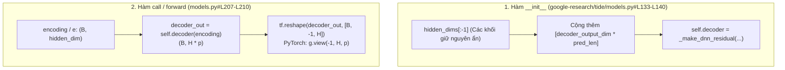

# SLIDE 03: SOURCE CODE & CƠ CHẾ SINH PHI TỰ QUY (NON-AUTOREGRESSIVE)

> **Mục tiêu Slide 03:** Đối chiếu trực tiếp từng dòng code PyTorch hiện thực trong repository gốc Google Research và chứng minh cơ chế **One-shot song song** giúp TiDE tạo biểu diễn cho toàn bộ Horizon mà không cần dự báo tuần tự.

---

## 🖼️ Hình Ảnh & Sơ Đồ Minh Họa Đưa Lên Slide


### Sơ đồ đối chiếu luồng code khởi tạo và thực thi (Google Research & PyTorch dự án):



---

## 📋 Nội Dung Cụ Thể Trình Bày Trên Slide (Hiển thị cho khán giả)

### 1. Source code chính thức trong Repository gốc Google Research (TensorFlow/Keras)
* **Link file gốc:** [`google-research/google-research/blob/master/tide/models.py`](https://github.com/google-research/google-research/blob/master/tide/models.py)

```python
# Trích từ models.py dòng 133-140 (Khởi tạo Dense Decoder trong TideModel.__init__)
self.decoder = _make_dnn_residual(
    model_config.get('hidden_dims')[:-1]
    + [
        model_config.get('decoder_output_dim') * self.pred_len,
    ],
    layer_norm=layer_norm,
    dropout_rate=dropout_rate,
)

# Trích từ models.py dòng 207-210 (Thực thi giải mã và Reshape trong TideModel.call)
decoder_out = self.decoder(encoding)
decoder_out = tf.reshape(
    decoder_out, [bsize, -1, self.pred_len]
)  # shape: [batch, decoder_output_dim (p), horizon (H)]
```

### 2. Source code PyTorch tương đương trong dự án (`simulate_forward_pass.py`)
* **Khởi tạo tầng Dense Decoder (`__init__`):** [simulate_forward_pass.py#L115-L126](../../../simulate_forward_pass.py#L115-L126)
* **Giải nén & Unflatten (`forward_with_logging`):** [simulate_forward_pass.py#L214-L225](../../../simulate_forward_pass.py#L214-L225)

```python
# Trích từ simulate_forward_pass.py dòng 217-218
g = self.dense_decoder(e)                      # [B, H * p]
D = g.view(-1, self.H, self.p)                 # [B, H, p]
```

### 3. Cơ chế tạo toàn bộ Horizon KHÔNG cần dự báo tuần tự (Non-Autoregressive)

| Tiêu chí | Mô hình sinh tuần tự (LSTM / Informer cũ) | Dense Decoder của TiDE (One-shot) |
| :--- | :--- | :--- |
| **Cách sinh kết quả** | Dự báo $\hat{y}_1$, lấy $\hat{y}_1$ làm đầu vào đoán $\hat{y}_2$, lặp lại $H$ lần. | **Xuất 1 lần duy nhất (One-shot):** Tính đồng thời cả $H$ vector $d_1 \dots d_H$. |
| **Hiện tượng lan truyền lỗi** | **Tích lũy sai số (Error Accumulation):** Bước đầu sai sẽ kéo theo toàn bộ tương lai trượt theo. | **Độc lập hoàn toàn:** Mỗi $d_t$ được giải mã trực tiếp từ $e^{(i)}$, triệt tiêu sai số dây chuyền. |
| **Độ trễ phần cứng** | Phải chạy vòng lặp tuần tự $O(H)$ bước, nghẽn luồng GPU. | **Tối đa hóa song song GPU**, độ phức tạp tuần tự chỉ còn $O(1)$. |

---

## 🔗 Vị Trí Mã Nguồn Tham Chiếu Cho Slide 03
* **Repo gốc Google Research (`models.py`):**
  * Khởi tạo `self.decoder`: [models.py#L133-L140](https://github.com/google-research/google-research/blob/master/tide/models.py#L133-L140)
  * Thực thi `self.decoder(encoding)` & `tf.reshape`: [models.py#L207-L210](https://github.com/google-research/google-research/blob/master/tide/models.py#L207-L210)
  * Hàm dựng chuỗi `_make_dnn_residual`: [models.py#L64-L81](https://github.com/google-research/google-research/blob/master/tide/models.py#L64-L81)
* **Code PyTorch mô phỏng trong dự án:**
  * Khởi tạo & `forward` Dense Decoder: [simulate_forward_pass.py#L115-L126](../../../simulate_forward_pass.py#L115-L126) và [simulate_forward_pass.py#L214-L225](../../../simulate_forward_pass.py#L214-L225)

---

## 🎙️ Kịch Bản Lời Nói Thuyết Trình (Speaker Notes)

> *"Chuyển sang phần Source Code trích trực tiếp từ file `models.py` trong repo gốc Google Research và bản PyTorch của dự án mình: Toàn bộ khối Dense Decoder chỉ gói gọn trong vài dòng lệnh cực kỳ súc tích.*
>
> *Trong repo gốc TensorFlow (dòng 133–140), hàm `_make_dnn_residual` nhận danh sách số chiều `hidden_dims[:-1] + [decoder_output_dim * self.pred_len]` để tự động dựng $n_d$ khối `MLPResidual` và mở rộng khối cuối ra $H \times p$. Đến hàm `call` (dòng 207–210), chỉ cần `decoder_out = self.decoder(encoding)` rồi `tf.reshape(decoder_out, [bsize, -1, self.pred_len])` (tương đương `D = g.view(-1, H, p)` trong code PyTorch dòng 217–218).*
>
> *Nhìn vào hình so sánh bên trên, đây chính là lý do TiDE đánh bại tốc độ của các mô hình cũ. Nếu các mô hình Autoregressive như LSTM phải dùng vòng lặp `for t in range(H)`—đoán xong bước 1 mới dùng nó làm đầu vào đoán bước 2, vừa chậm GPU vừa bị sai số dây chuyền—thì Dense Decoder của TiDE làm một phép chiếu ma trận **bắn một phát trúng toàn bộ $H$ bước (One-shot)**. Cả $96$ hay $720$ vector tương lai được sinh ra đồng thời, độc lập hoàn toàn với sai số của nhau."*
