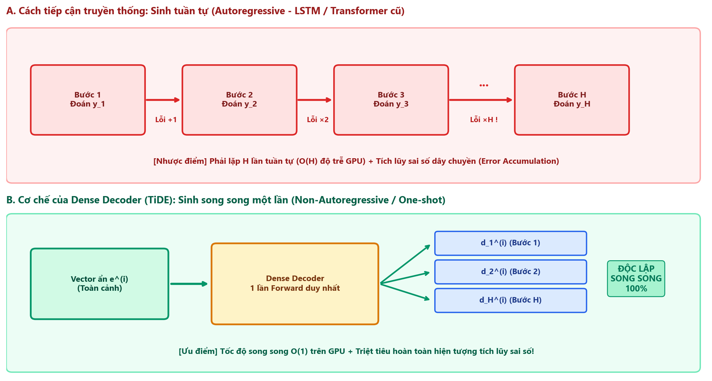
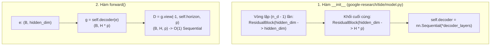

# SLIDE 03: SOURCE CODE & CƠ CHẾ SINH PHI TỰ QUY (NON-AUTOREGRESSIVE)

> **Mục tiêu Slide 03:** Đối chiếu trực tiếp từng dòng code PyTorch hiện thực trong repository gốc Google Research và chứng minh cơ chế **One-shot song song** giúp TiDE tạo biểu diễn cho toàn bộ Horizon mà không cần dự báo tuần tự.

---

## 🖼️ Hình Ảnh & Sơ Đồ Minh Họa Đưa Lên Slide



### Sơ đồ đối chiếu luồng code khởi tạo và thực thi PyTorch:



---

## 📋 Nội Dung Cụ Thể Trình Bày Trên Slide (Hiển thị cho khán giả)

### 1. Source code tương ứng trong Repository gốc (`google-research/tide/model.py`)

```python
# --- TRONG HÀM KHỞI TẠO __init__ ---
decoder_layers = []
# 1. Các khối trung gian giữ nguyên không gian ẩn
for i in range(self.num_decoder_layers - 1):
    decoder_layers.append(
        ResidualBlock(
            in_dim=self.hidden_dim,
            hidden_dim=self.hidden_dim,
            out_dim=self.hidden_dim,
            dropout=self.dropout
        )
    )
# 2. Khối cuối cùng chiếu mở rộng ra kích thước H * p
decoder_layers.append(
    ResidualBlock(
        in_dim=self.hidden_dim,
        hidden_dim=self.hidden_dim,
        out_dim=self.horizon * self.decoder_output_dim,
        dropout=self.dropout
    )
)
self.decoder = nn.Sequential(*decoder_layers)

# --- TRONG HÀM THỰC THI forward ---
g = self.decoder(e)                                         # [B, H * p]
D = g.view(-1, self.horizon, self.decoder_output_dim)       # [B, H, p]
```

* *(Tham chiếu đối chiếu trong dự án: file [`simulate_forward_pass.py`](../../../simulate_forward_pass.py#L214-L226) dòng 214–226).*

### 2. Cơ chế tạo toàn bộ Horizon KHÔNG cần dự báo tuần tự (Non-Autoregressive)

| Tiêu chí | Mô hình sinh tuần tự (LSTM / Informer cũ) | Dense Decoder của TiDE (One-shot) |
| :--- | :--- | :--- |
| **Cách sinh kết quả** | Dự báo $\hat{y}_1$, lấy $\hat{y}_1$ làm đầu vào đoán $\hat{y}_2$, lặp lại $H$ lần. | **Xuất 1 lần duy nhất (One-shot):** Tính đồng thời cả $H$ vector $d_1 \dots d_H$. |
| **Hiện tượng lan truyền lỗi** | **Tích lũy sai số (Error Accumulation):** Bước đầu sai sẽ kéo theo toàn bộ tương lai trượt theo. | **Độc lập hoàn toàn:** Mỗi $d_t$ được giải mã trực tiếp từ $e^{(i)}$, triệt tiêu sai số dây chuyền. |
| **Độ trễ phần cứng** | Phải chạy vòng lặp tuần tự $O(H)$ bước, nghẽn luồng GPU. | **Tối đa hóa song song GPU**, độ phức tạp tuần tự chỉ còn $O(1)$. |

---

## 🎙️ Kịch Bản Lời Nói Thuyết Trình (Speaker Notes)

> *"Chuyển sang phần Source Code trích từ repo gốc Google Research và file `simulate_forward_pass.py` của dự án mình: Các bạn có thể thấy toàn bộ khối Dense Decoder chỉ gọn gàng trong chưa đầy 20 dòng PyTorch.*
>
> *Trong `__init__`, vòng lặp chạy $n_d - 1$ lần để tạo các khối `ResidualBlock` có đầu ra bằng `hidden_dim`. Riêng khối cuối cùng được đẩy ra ngoài vòng lặp để đặt `out_dim = horizon * decoder_output_dim` ($H \times p$). Đến lúc `forward`, chỉ cần đúng 2 dòng lệnh: `g = self.decoder(e)` và `D = g.view(-1, H, p)`.*
>
> *Nhìn vào hình so sánh bên trên, đây chính là lý do TiDE đánh bại tốc độ của các mô hình cũ. Nếu các mô hình Autoregressive như LSTM phải dùng vòng lặp `for t in range(H)`—đoán xong bước 1 mới dùng nó làm đầu vào đoán bước 2, vừa chậm GPU vừa bị sai số dây chuyền—thì Dense Decoder của TiDE làm một phép chiếu ma trận **bắn một phát trúng toàn bộ $H$ bước (One-shot)**. Cả $96$ hay $720$ vector tương lai được sinh ra đồng thời, độc lập hoàn toàn với sai số của nhau."*
