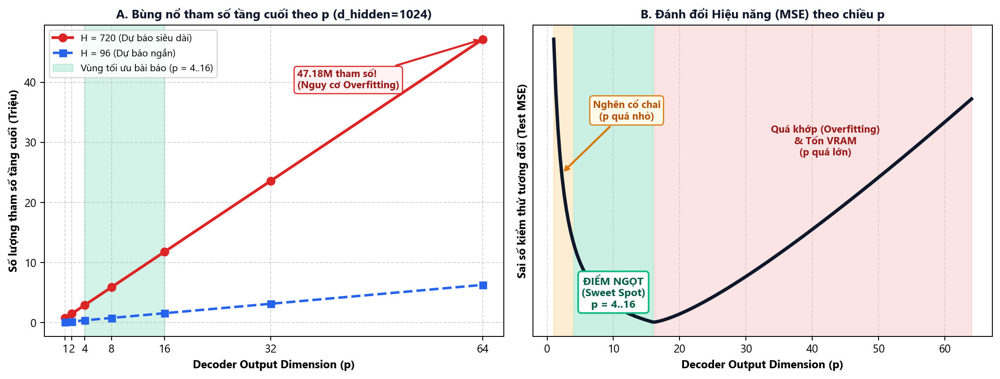
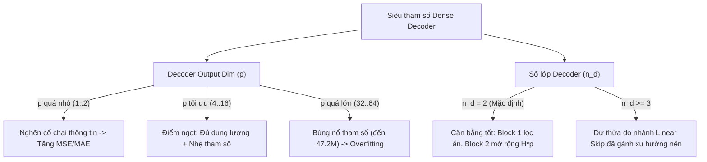

# SLIDE 04: PHÂN TÍCH ẢNH HƯỞNG SIÊU THAM SỐ ($p$, $n_d$) & GIỚI HẠN TIỀM ẨN

> **Mục tiêu Slide 04:** Phân tích định lượng tác động của chiều đặc trưng đầu ra $p$ và số lớp giải mã $n_d$ lên độ chính xác lẫn tài nguyên mô hình, đồng thời chỉ rõ 3 giới hạn tiềm ẩn cốt lõi của Dense Decoder.

---

## 🖼️ Hình Ảnh & Sơ Đồ Minh Họa Đưa Lên Slide

### Sơ đồ phân tích tác động của $p$ và $n_d$ tới hiệu năng mô hình:

---

## 📋 Nội Dung Cụ Thể Trình Bày Trên Slide (Hiển thị cho khán giả)

### 1. Ảnh hưởng của Decoder Output Dimension ($p$)
Tham số $p$ kiểm soát băng thông thông tin truyền từ bối cảnh quá khứ sang từng mốc tương lai:

* **Nếu $p$ quá nhỏ ($p = 1, 2$):** Xảy ra **Nghẽn cổ chai thông tin (Information Bottleneck)**. Vector $d_t$ không đủ số chiều để mã hóa đồng thời biên độ, pha dao động và tương tác phi tuyến $\implies$ sai số dự báo tăng cao.
* **Nếu $p$ quá lớn ($p = 32, 64$):** Xảy ra **Bùng nổ tham số (Parameter Explosion)** ở ma trận ngõ ra $W \in \mathbb{R}^{(H \cdot p) \times d_{\text{hidden}}}$. Với dự báo dài hạn $H = 720$, $d_{\text{hidden}} = 1024$ và $p = 64$:

$$
\text{Số tham số tầng cuối} = (720 \times 64) \times 1024 \approx \mathbf{47.18 \text{ triệu tham số}}
$$

Hậu quả là mô hình cực kỳ tốn VRAM và rất dễ bị học vẹt (**Overfitting**) trên tập dữ liệu vừa và nhỏ.
* **Khoảng tối ưu thực nghiệm (Paper Table 8):** $p \in [4, 16]$ đạt điểm cân bằng hoàn hảo nhất giữa MSE/MAE và kích thước mô hình.

### 2. Ảnh hưởng của số lớp Decoder ($n_d$)
* **$n_d = 1$:** Chỉ dùng 1 khối vừa xử lý phi tuyến vừa chiếu sang $H \times p$. Phù hợp khi chuỗi thời gian mang tính tuyến tính thuần túy, dữ liệu ít nhiễu.
* **$n_d = 2$ (Khuyến nghị chuẩn):** Khối 1 tinh chỉnh sâu biểu diễn ẩn ($1024 \to 1024$), khối 2 chuyên biệt hóa nhiệm vụ giải nén ($1024 \to H \times p$).
* **$n_d \ge 3$:** Độ chính xác hầu như **bão hòa** và không cải thiện thêm. Lý do vì TiDE sở hữu nhánh **Global Linear Skip** song song đã đảm nhận phần xu hướng tuyến tính lớn, nên phần giải mã phi tuyến không cần mạng quá sâu.

### 3. Các giới hạn tiềm ẩn cần lưu ý
1. **Cố định khoảng dự báo (Fixed Horizon):** Một khi đã huấn luyện với $H = 96$, kích thước ma trận $W$ bị khóa cứng, không thể linh hoạt dự báo $H = 120$ hay $H = 192$ lúc suy luận mà không train lại.
2. **Bùng nổ tham số khi Horizon siêu dài:** Với $H \ge 720$, ngay cả khi $p = 16$, riêng tầng cuối vẫn ngốn $\approx 11.8\text{M}$ tham số (chiếm tỷ trọng lớn nhất trong toàn mô hình).
3. **Thiếu ràng buộc liên tục giữa các bước liền kề:** Sau `view(-1, H, p)`, các vector $d_t$ và $d_{t+1}$ không có cơ chế trao đổi thông tin cục bộ trực tiếp, có nguy cơ gây nhiễu gợn sóng trên chuỗi dự báo nếu thiếu nhánh tuyến tính phụ trợ.

---

## 🎙️ Kịch Bản Lời Nói Thuyết Trình (Speaker Notes)

> *"Đi vào phân tích sâu về mặt hiệu năng và thực nghiệm: Có hai siêu tham số quyết định trực tiếp sức mạnh của Dense Decoder là $p$ và $n_d$.*
>
> *Đầu tiên là $p$ — chiều của mỗi vector $d_t$. Nhìn lên hai biểu đồ: nếu chọn $p$ quá nhỏ như 1 hoặc 2, mô hình bị nghẽn cổ chai thông tin và dự báo kém hẳn đi. Nhưng ngược lại, nếu tăng $p$ lên 32 hay 64 ở bài toán dự báo dài $H=720$, số tham số chỉ riêng ở tầng Linear cuối cùng lập tức vọt lên **47.18 triệu tham số**! Điều này làm phình to VRAM và đẩy mô hình vào tình trạng quá khớp (Overfitting). Do đó, bài báo khuyến nghị chọn $p$ nằm trong vùng điểm ngọt màu xanh từ **4 đến 16**.*
>
> *Thứ hai là số lớp $n_d$: Thực nghiệm cho thấy chỉ cần $n_d = 2$ là đủ tối ưu. Tăng lên 3 hay 4 lớp không giúp mô hình thông minh hơn vì phần xu hướng vĩ mô đã có nhánh Linear Skip gánh hộ rồi.*
>
> *Tuy nhiên, chính từ bảng phân tích này ta nhìn thấy 3 giới hạn tiềm ẩn lớn nhất của Dense Decoder: thứ nhất là bị khóa cứng Horizon $H$; thứ hai là ma trận tầng cuối quá nặng khi $H=720$ (dù $p=16$ vẫn tốn tới 11.8 triệu tham số); và thứ ba là các lát cắt $d_t, d_{t+1}$ đứng độc lập thiếu độ mượt thời gian. Đó là tiền đề cho đề xuất cải tiến của em ở Slide cuối cùng."*
