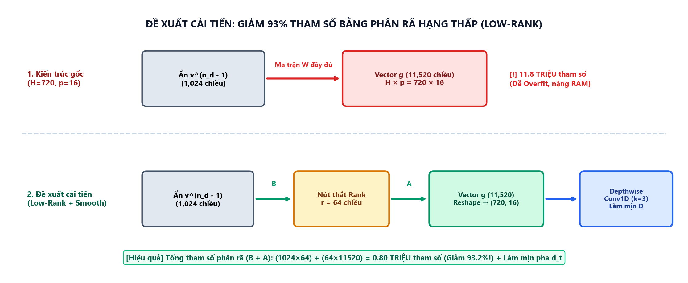

# SLIDE 05: ĐỀ XUẤT GIẢ THUYẾT CẢI TIẾN KIỂM CHỨNG THỰC NGHIỆM

> **Mục tiêu Slide 05:** Đề xuất 2 giả thuyết cải tiến kỹ thuật cụ thể nhằm giải quyết trực tiếp bài toán **bùng nổ tham số ($11.8\text{M}$ params khi $H=720$)** và **thiếu liên kết mượt thời gian giữa các vector $d_t$**, kèm thiết kế kịch bản thực nghiệm kiểm chứng rõ ràng.

---

## 🖼️ Hình Ảnh & Sơ Đồ Minh Họa Đưa Lên Slide



### Sơ đồ kiến trúc khối Dense Decoder cải tiến (Low-Rank + Temporal Smoothing):


---

## 📋 Nội Dung Cụ Thể Trình Bày Trên Slide (Hiển thị cho khán giả)

### 1. Giả thuyết 1: Phân rã Ma trận Ngõ ra theo Hạng Thấp (Low-Rank Factorized Projection)
* **Vấn đề nhắm tới:** Ma trận tầng cuối khối $n_d$ có kích thước $W \in \mathbb{R}^{(H \cdot p) \times d_{\text{hidden}}}$. Với $H=720, p=16, d_{\text{hidden}}=1024$, tầng này ngốn **$11.8\text{ triệu tham số}$**.
* **Cơ chế cải tiến:** Thay vì học ma trận đầy đủ $W$, ta phân rã thành tích 2 ma trận hạng thấp với nút thắt $r_{\text{rank}} = 64$:

$$
W \approx A \times B, \quad \text{với } B \in \mathbb{R}^{r_{\text{rank}} \times d_{\text{hidden}}}, \; A \in \mathbb{R}^{(H \cdot p) \times r_{\text{rank}}}
$$

* **Tác động định lượng:**
  * Tham số gốc: $1024 \times 11,520 = \mathbf{11,796,480}$ tham số.
  * Tham số sau phân rã: $(1024 \times 64) + (64 \times 11,520) = \mathbf{802,816}$ tham số (**giảm tới $93.2\%$ tham số!**).
  * **Giả thuyết khoa học:** Các chuỗi thời gian dài có độ tương quan cao giữa các bước tương lai lân cận nên ma trận chiếu vốn có hạng hiệu dụng thấp (*low intrinsic rank*); phân rã hạng thấp giúp nén mô hình mà không làm giảm MSE, đồng thời chống Overfitting trên tập dữ liệu nhỏ.

### 2. Giả thuyết 2: Làm mịn cục bộ qua Tích chập 1D (Temporal-Smoothed Decoder)
* **Vấn đề nhắm tới:** Các vector $d_t$ và $d_{t+1}$ sau phép `Reshape` bị tách rời độc lập, dễ tạo dao động răng cưa ở các chuỗi có biến thiên nhanh.
* **Cơ chế cải tiến:** Áp dụng một lớp tích chập nhẹ `Depthwise Conv1D` (chỉ tốn $3 \times p = 48$ tham số) dọc theo trục $H$:

$$
D_{\text{smooth}} = \text{DepthwiseConv1D}\big(D, \; \text{kernel\_size}=3, \; \text{padding}=1\big)
$$

* **Giả thuyết khoa học:** Cho phép mỗi lát cắt $d_t$ trao đổi thông tin cục bộ với hai bước lân cận $d_{t-1}$ và $d_{t+1}$, giúp giảm nhiễu tần số cao và tăng độ trơn mượt của đường dự báo.

### 3. Thiết kế kiểm chứng thực nghiệm (Experimental Protocol)

```python
# Mã nguồn PyTorch đề xuất tích hợp vào khối cuối Dense Decoder
self.low_rank_proj = nn.Sequential(
    nn.Linear(hidden_dim, 64, bias=False),          # Ma trận B
    nn.Linear(64, horizon * decoder_output_dim)     # Ma trận A
)
self.temporal_smooth = nn.Conv1d(
    in_channels=p, out_channels=p, kernel_size=3, padding=1, groups=p
)
```

| Hạng mục kiểm chứng | Thiết lập đối chứng (Ablation Study) |
| :--- | :--- |
| **Tập dữ liệu thử nghiệm** | `Electricity` (chu kỳ mượt) & `Traffic` (nhạy cảm pha cao) với Horizon $H \in \{96, 336, 720\}$. |
| **Biến thể so sánh** | (1) TiDE Gốc vs (2) TiDE + Low-Rank ($r=64$) vs (3) TiDE + Low-Rank + Depthwise Conv1D. |
| **Chỉ số đo lường** | Sai số dự báo (**MSE / MAE**), tổng số tham số (**Params**), VRAM tiêu thụ và độ trơn đường dự báo. |

---

## 🎙️ Kịch Bản Lời Nói Thuyết Trình (Speaker Notes)

> *"Để hoàn thiện phần trình bày theo yêu cầu nghiên cứu thực nghiệm, dựa trên hai giới hạn vừa tìm ra ở Slide 4, em xin đề xuất hai giả thuyết cải tiến có thể kiểm chứng ngay bằng code PyTorch.*
>
> *Giả thuyết thứ nhất mang tên **Phân rã hạng thấp (Low-Rank Factorization)** cho tầng ngõ ra cuối cùng. Khi dự báo 720 bước, ma trận đầy đủ tốn gần 11.8 triệu tham số. Ta chèn một lớp nút thắt nhỏ 64 chiều ở giữa để tách ma trận $W$ thành tích của $A \times B$. Kết quả là số tham số rớt từ 11.8 triệu xuống chỉ còn **0.8 triệu tham số—tức giảm 93.2%**! Về mặt toán học, do các bước thời gian tương lai gần nhau có sự tương quan cao, ma trận giải nén không cần đầy đủ hạng, nên việc nén hạng thấp vừa giúp tiết kiệm bộ nhớ vừa đóng vai trò điều hòa chống Overfitting.*
>
> *Giả thuyết thứ hai là dùng thêm một lớp **Depthwise Conv1D kernel 3** ngay sau phép Reshape, chỉ tốn thêm vỏn vẹn 48 tham số, để các vector $d_t$ trao đổi ngữ cảnh nhẹ với hai bước liền kề $d_{t-1}$ và $d_{t+1}$, giúp đường dự báo trơn mượt hơn.*
>
> *Cuối cùng là bảng thiết kế thí nghiệm đối chứng (Ablation Study) trên 2 tập Electricity và Traffic mà nhóm hoàn toàn có thể cài đặt và đo đạc ngay trong giai đoạn huấn luyện sắp tới. Em xin kết thúc phần trình bày về Dense Decoder tại đây, cảm ơn thầy cô và các bạn đã lắng nghe!"*
