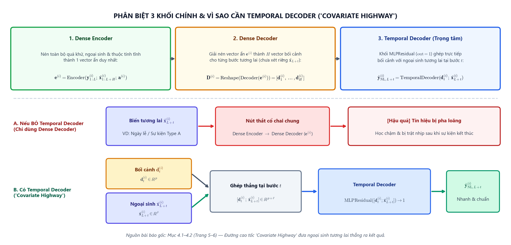
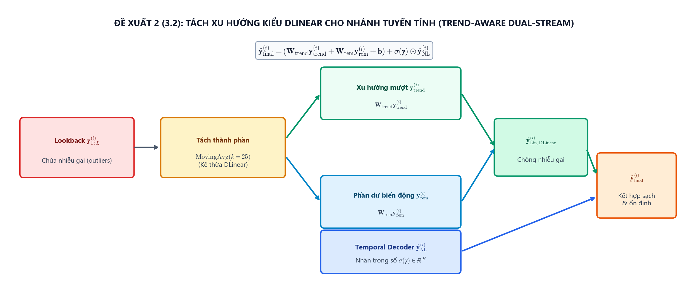
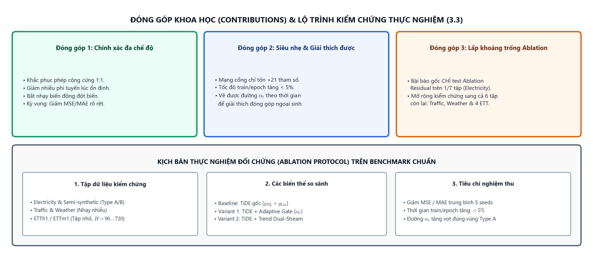

# 🖼️ THƯ VIỆN ẢNH TRÌNH CHIẾU THEO TỪNG NỘI DUNG SLIDE

> [!NOTE]
> File này tổng hợp **10 hình ảnh minh họa độ phân giải cao (PNG)** xếp đúng **1-đối-1 với từng mục nội dung trong 3 Slide**:
> * **Ưu tiên ảnh trích trực tiếp từ bài báo gốc** (Figure 1 Trang 5, Figure 3 Trang 10, Figure 5 / Table 5 Trang 11).
> * **Chỉ thiết kế sơ đồ bổ trợ** khi bài báo không có hình minh họa riêng (sử dụng phương trình toán LaTeX chuẩn mực và ghi rõ nguồn gốc ở cuối mỗi mục).

---

## 📖 PHẦN 1: LÝ THUYẾT & TOÁN HỌC ([`slide_01_phan_1_ly_thuyet_va_toan_hoc.md`](./slide_01_phan_1_ly_thuyet_va_toan_hoc.md))

### 1.1. Định vị hai cơ chế trên Figure 1 gốc (Trang 5)
* **Nguồn gốc:** Trích trực tiếp **Figure 1 (Trang 5)** bài báo gốc. Khoanh rõ đúng 2 khối trình bày: `Global Residual Connection` (xanh lá) và `Temporal Decoder` (xanh dương).

---

### 1.2. Tách 3 Card riêng biệt (Dense Encoder • Dense Decoder • Temporal Decoder) & Cơ chế "Covariate Highway"
* **Nguồn gốc:** Diễn giải **Mục 4.1–4.2 (Trang 5–6)**. Tách 3 khối thành 3 thẻ riêng kèm phương trình toán chuẩn để giải thích vì sao bỏ `Temporal Decoder` sẽ làm tín hiệu ngoại sinh tương lai bị pha loãng qua nút thắt chung.

---

### 1.3. Luồng song song hai cơ chế & Phương trình tổng hợp dự báo cuối cùng
* **Nguồn gốc:** Trực quan hóa **Mục 4.2 Decoding (Trang 6)** với phương trình chuẩn $\hat{\mathbf{y}}_{L+1:L+H}^{(i)} = \mathrm{TemporalDecoder}(\mathbf{d}_t^{(i)}; \tilde{\mathbf{x}}_{L+t}^{(i)}) + \mathbf{W}_{\mathrm{res}}\mathbf{y}_{1:L}^{(i)}$.

---

### 1.4. Chứng minh toán học mối liên hệ với DLinear & Luồng kích thước Tensor
* **Nguồn gốc:** Diễn giải nhận định *"a purely linear model like (Zeng et al., 2023) is always a subclass of our model"* tại **Mục 4.2 (Trang 6)** & cấu hình **Table 8**.

---

## 💻 PHẦN 2: SOURCE CODE & PHÂN TÍCH ABLATION STUDY ([`slide_02_phan_2_source_code_va_phan_tich.md`](./slide_02_phan_2_source_code_va_phan_tich.md))

### 2.1. Show nguyên đoạn Code gốc (`models.py`) & Ánh xạ thẳng ra Phương trình Toán học
* **Nguồn gốc:** Repo chính thức Google Research [`tide/models.py#L141-L214`](https://github.com/google-research/google-research/blob/master/tide/models.py#L141-L214) & [`simulate_forward_pass.py#L228-L266`](../../../simulate_forward_pass.py#L228-L266).

---

### 2.2. Ablation Study 1: Vai trò Temporal Decoder (Ảnh gốc từ bài báo)
* **Nguồn gốc:** Trích trực tiếp **Figure 3 — Mục 5.4 Ablation Study (Trang 10–11)** bài báo gốc kèm thẻ chú thích ngắn gọn.

---

### 2.3. Ablation Study 2: Vai trò Residual Connections (Ảnh gốc từ bài báo — `Electricity`)
* **Nguồn gốc:** Trích trực tiếp **Figure 5 / Table 5 — Mục 5.4 Ablation Study (Trang 11)** bài báo gốc (Tác giả chỉ thực nghiệm bỏ Residual trên 1/7 tập đại diện là `Electricity`).

---

## 💡 PHẦN 3: ĐỀ XUẤT CẢI TIẾN & CONTRIBUTIONS ([`slide_03_phan_3_de_xuat_cai_tien.md`](./slide_03_phan_3_de_xuat_cai_tien.md))

### 3.1. Đề xuất 1 — Cổng Hợp Nhất Thích Nghi (*Adaptive Gated Fusion*) vs Cộng cứng `1:1`
* **Nguồn gốc:** Mở rộng trực tiếp từ dòng tổng hợp `out += residual_out` tại [`models.py#L214`](https://github.com/google-research/google-research/blob/master/tide/models.py#L214).

---

### 3.2. Đề xuất 2 — Tách Xu Hướng Kiểu DLinear Cho Nhánh Tuyến Tính (*Trend-Aware Dual-Stream*)
* **Nguồn gốc:** Kết hợp bộ lọc `MovingAvg(k=25)` kiểu DLinear để bảo vệ nhánh `self.linear` ([`models.py#L203`](https://github.com/google-research/google-research/blob/master/tide/models.py#L203)) khỏi nhiễu gai *outliers*.

---

### 3.3. Đóng góp khoa học (Contributions) & Lộ trình kiểm chứng thực nghiệm
* **Nguồn gốc:** Tổng hợp 3 đóng góp khoa học kỳ vọng (Chính xác đa chế độ • Siêu nhẹ +21 params & Giải thích được • Lấp khoảng trống 6/7 dataset chưa chạy Ablation) kèm kịch bản Ablation Protocol.

