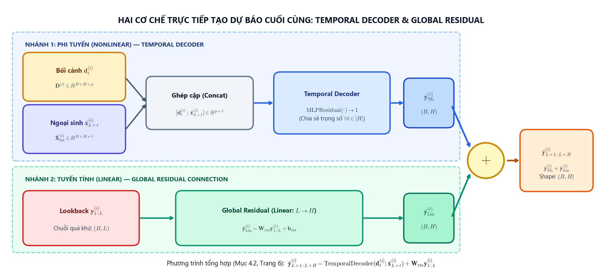

# 🖼️ THƯ VIỆN ẢNH TRÌNH CHIẾU THEO TỪNG NỘI DUNG SLIDE

> [!NOTE]
> File này tổng hợp **8 hình ảnh minh họa độ phân giải cao (PNG)** xếp đúng **1-đối-1 với từng mục nội dung trong 3 Slide**:
> * **Ưu tiên ảnh trích trực tiếp từ bài báo gốc** (Figure 1 Trang 5, Figure 3 Trang 10, Figure 5 / Table 5 Trang 11).
> * **Chỉ thiết kế sơ đồ bổ trợ** khi bài báo không có hình minh họa riêng (sử dụng phương trình toán LaTeX chuẩn mực và ghi rõ nguồn gốc ở cuối mỗi mục).

---

## 📖 PHẦN 1: LÝ THUYẾT & TOÁN HỌC ([`slide_01_phan_1_ly_thuyet_va_toan_hoc.md`](./slide_01_phan_1_ly_thuyet_va_toan_hoc.md))

### 1.1. Định vị phạm vi thuyết trình trên Figure 1 gốc (KHÔNG nói phần bên dưới)
* **Nguồn gốc:** Trích **Figure 1 (Trang 5)** bài báo gốc. Ảnh khoanh rõ **2 khối trên cùng** (`Temporal Decoder` + `Global Residual Connection`) là phạm vi mình trình bày; phần bên dưới (`Dense Encoder`, `Dense Decoder`) là của thành viên trước.

---

### 1.2. Định nghĩa rõ Dense Encoder / Dense Decoder / Temporal Decoder & Cơ chế "Covariate Highway"
* **Nguồn gốc:** Diễn giải **Mục 4.2 Decoding (Trang 6)** (bài báo không có hình tách riêng bước này). Định nghĩa rõ 3 khối để giải thích vì sao bỏ Temporal Decoder sẽ làm tín hiệu ngoại sinh tương lai bị pha loãng qua nút thắt cổ chai chung.

---

### 1.3. Luồng song song hai cơ chế & Phương trình tổng hợp dự báo cuối cùng
* **Nguồn gốc:** Trực quan hóa **Mục 4.2 Decoding (Trang 6)** với phương trình chuẩn $\hat{\mathbf{y}}_{L+1:L+H}^{(i)} = \mathrm{TemporalDecoder}(\mathbf{d}_t^{(i)}; \tilde{\mathbf{x}}_{L+t}^{(i)}) + \mathbf{W}_{\mathrm{res}}\mathbf{y}_{1:L}^{(i)}$.

---

### 1.4. Chứng minh toán học mối liên hệ với DLinear & Luồng kích thước Tensor
* **Nguồn gốc:** Diễn giải nhận định *"a purely linear model like (Zeng et al., 2023) is always a subclass of our model"* tại **Mục 4.2 (Trang 6)** & cấu hình **Table 8**.

---

## 💻 PHẦN 2: SOURCE CODE & PHÂN TÍCH ABLATION STUDY ([`slide_02_phan_2_source_code_va_phan_tich.md`](./slide_02_phan_2_source_code_va_phan_tich.md))

### 2.1. Bản đồ đối chiếu Source Code (`models.py` gốc vs PyTorch dự án)
* **Nguồn gốc:** Repo chính thức Google Research [`tide/models.py#L141-L214`](https://github.com/google-research/google-research/blob/master/tide/models.py#L141-L214) & [`simulate_forward_pass.py#L128-L266`](../../../simulate_forward_pass.py#L128-L266).

---

### 2.2. Ablation Study 1: Vai trò Temporal Decoder (Ảnh gốc từ bài báo)
* **Nguồn gốc:** Trích trực tiếp **Figure 3 — Mục 5.4 Ablation Study (Trang 10–11)** bài báo gốc.

---

### 2.3. Ablation Study 2: Vai trò Residual Connections (Ảnh gốc từ bài báo)
* **Nguồn gốc:** Trích trực tiếp **Figure 5 / Table 5 — Mục 5.4 Ablation Study (Trang 11)** bài báo gốc.

---

## 💡 PHẦN 3: ĐỀ XUẤT CẢI TIẾN ([`slide_03_phan_3_de_xuat_cai_tien.md`](./slide_03_phan_3_de_xuat_cai_tien.md))

### 3.1. Cải tiến cơ chế kết hợp: Adaptive Gated Fusion vs Cộng cứng `1:1`
* **Nguồn gốc:** Đề xuất mở rộng trực tiếp từ dòng tổng hợp `out += residual_out` tại [`models.py#L214`](https://github.com/google-research/google-research/blob/master/tide/models.py#L214).

