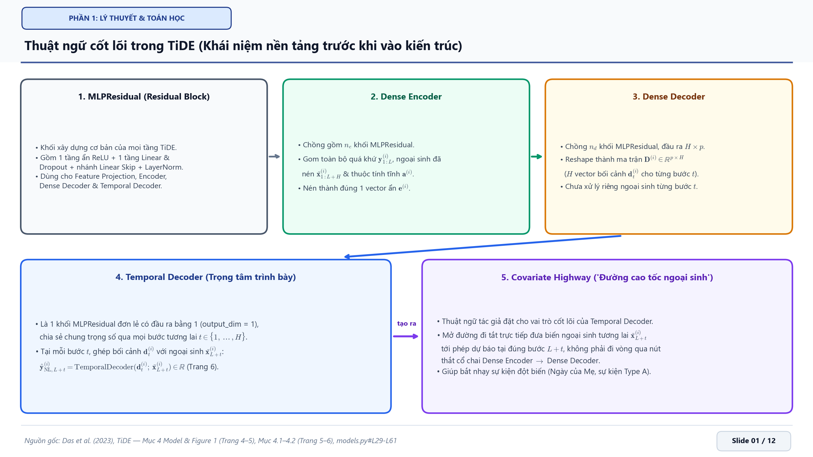
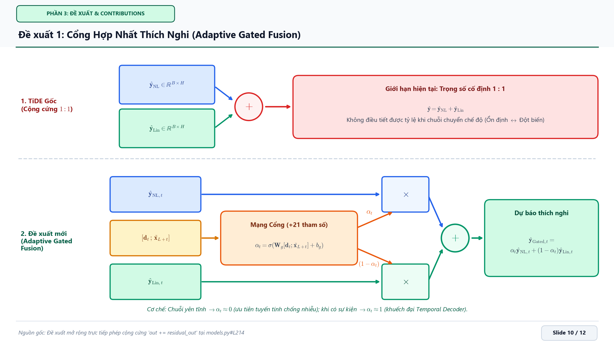
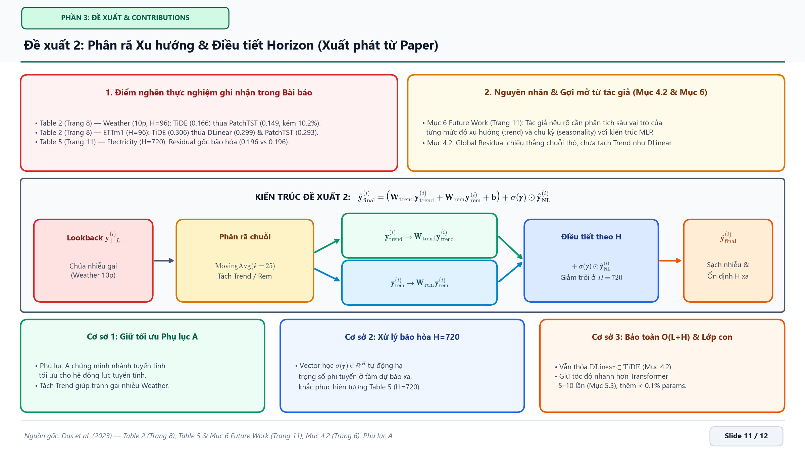
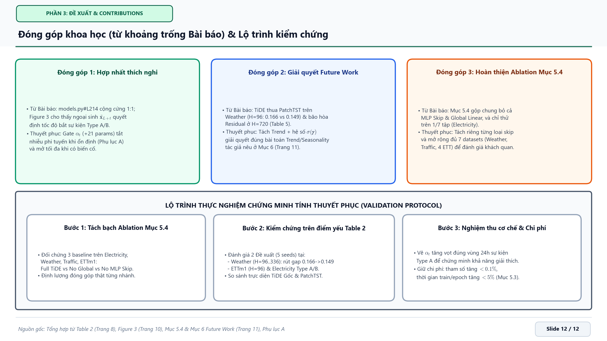

# 🖼️ THƯ VIỆN ẢNH TRÌNH CHIẾU THEO TỪNG NỘI DUNG SLIDE

> [!NOTE]
> File này tổng hợp **12 Slide trình chiếu chuẩn Seminar 16:9 đồng bộ** (180 DPI, đánh số từ **Slide 01 / 12** đến **Slide 12 / 12**, đồng nhất bảng màu, font chữ, cỡ Header/Body/Card và Footer trích nguồn) xếp đúng **1-đối-1 theo từng mục nội dung**.
> 
> 🎙️ **Kịch bản lời nói thuyết trình tương ứng:** Xem tại [**`script_thuyet_trinh_tung_slide.md`**](./script_thuyet_trinh_tung_slide.md).

---

## 📖 PHẦN 1: LÝ THUYẾT & TOÁN HỌC ([`slide_01_phan_1_ly_thuyet_va_toan_hoc.md`](./slide_01_phan_1_ly_thuyet_va_toan_hoc.md))

### Slide 01 / 12 (1.0) — Bảng thuật ngữ cốt lõi trong TiDE (`MLPResidual`, `Dense Encoder`, `Dense Decoder`, `Temporal Decoder`, `Covariate Highway`)
* **Nguồn gốc:** Trích **Mục 4 Model & Figure 1 (Trang 4–5)**, **Mục 4.1–4.2 (Trang 5–6)** và [`models.py#L29-L61`](https://github.com/google-research/google-research/blob/master/tide/models.py#L29-L61). Giải thích 5 thuật ngữ nền tảng trước khi đi sâu vào kiến trúc.

---

### Slide 02 / 12 (1.1) — Định vị hai cơ chế trên Figure 1 gốc (Trang 5)
* **Nguồn gốc:** Trích trực tiếp **Figure 1 (Trang 5)** bài báo gốc. Khoanh rõ đúng 2 khối trình bày: `Global Residual Connection` (xanh lá) và `Temporal Decoder` (xanh dương).

---

### Slide 03 / 12 (1.2) — Tách 3 Card riêng biệt (Dense Encoder • Dense Decoder • Temporal Decoder) & Cơ chế "Covariate Highway"
* **Nguồn gốc:** Diễn giải **Mục 4.1–4.2 (Trang 5–6)**. Tách 3 khối thành 3 thẻ riêng kèm phương trình toán chuẩn để giải thích vì sao bỏ `Temporal Decoder` sẽ làm tín hiệu ngoại sinh tương lai bị pha loãng qua nút thắt chung.

---

### Slide 04 / 12 (1.3) — Luồng song song hai cơ chế & Phương trình tổng hợp dự báo cuối cùng
* **Nguồn gốc:** Trực quan hóa **Mục 4.2 Decoding (Trang 6)** với phương trình chuẩn $\hat{\mathbf{y}}_{L+1:L+H}^{(i)} = \mathrm{TemporalDecoder}(\mathbf{d}_t^{(i)}; \tilde{\mathbf{x}}_{L+t}^{(i)}) + \mathbf{W}_{\mathrm{res}}\mathbf{y}_{1:L}^{(i)}$.

---

### Slide 05 / 12 (1.4) — Chứng minh toán học mối liên hệ với DLinear & Luồng kích thước Tensor
* **Nguồn gốc:** Diễn giải nhận định *"a purely linear model like (Zeng et al., 2023) is always a subclass of our model"* tại **Mục 4.2 (Trang 6)** & cấu hình smoke test.

---

## 💻 PHẦN 2: SOURCE CODE, HYPERPARAMETERS & ABLATION STUDY ([`slide_02_phan_2_source_code_va_phan_tich.md`](./slide_02_phan_2_source_code_va_phan_tich.md))

### Slide 06 / 12 (2.1) — Source code chính thức (`models.py`) & Ánh xạ thẳng ra Phương trình Toán học
* **Nguồn gốc:** Repo chính thức Google Research [`tide/models.py#L141-L214`](https://github.com/google-research/google-research/blob/master/tide/models.py#L141-L214) & [`simulate_forward_pass.py#L228-L266`](../../../simulate_forward_pass.py#L228-L266).

---

### Slide 07 / 12 (2.2) — Cấu hình Siêu tham số (Hyperparameters) trên 7 Benchmark Datasets
* **Nguồn gốc:** Trích trực tiếp **Table 8 (Trang 21)** & **Phụ lục B.3 / Table 7 (Trang 20)** — làm rõ `decoderOutputDim` ($p$), `temporalDecoderHidden`, `temporalWidth` ($\tilde{r}=4$), `batchSize=512` và quy luật chọn cho 7 tập dữ liệu.

---

### Slide 08 / 12 (2.3) — Ablation Study 1: Vai trò Temporal Decoder (Ảnh gốc từ bài báo)
* **Nguồn gốc:** Trích trực tiếp **Figure 3 — Mục 5.4 Ablation Study (Trang 10–11)** bài báo gốc kèm 3 thẻ phân tích ngắn gọn.

---

### Slide 09 / 12 (2.4) — Ablation Study 2: Vai trò Residual Connections (Ảnh gốc từ bài báo — `Electricity`)
* **Nguồn gốc:** Trích trực tiếp **Figure 5 / Table 5 — Mục 5.4 Ablation Study (Trang 11)** bài báo gốc (Tác giả chỉ thực nghiệm bỏ Residual trên 1/7 tập đại diện là `Electricity`).

---

## 💡 PHẦN 3: ĐỀ XUẤT CẢI TIẾN & CONTRIBUTIONS ([`slide_03_phan_3_de_xuat_cai_tien.md`](./slide_03_phan_3_de_xuat_cai_tien.md))

### Slide 10 / 12 (3.1) — Đề xuất 1: Cổng Hợp Nhất Thích Nghi (*Adaptive Gated Fusion*) vs Cộng cứng `1:1`
* **Nguồn gốc:** Mở rộng trực tiếp từ dòng tổng hợp `out += residual_out` tại [`models.py#L214`](https://github.com/google-research/google-research/blob/master/tide/models.py#L214).

---

### Slide 11 / 12 (3.2) — Đề xuất 2: Phân rã Xu hướng & Điều tiết Horizon (Xuất phát từ Table 2, Table 5 & Mục 6 Future Work)
* **Nguồn gốc:** Xuất phát từ các điểm yếu thực nghiệm tại **Table 2 (Trang 8: Weather `0.166` vs PatchTST `0.149`, ETTm1 `0.306`)**, hiện tượng bão hòa ở $H=720$ tại **Table 5 (Trang 11)** và định hướng Trend/Seasonality tại **Mục 6 (Trang 11)**, kết hợp chứng minh tối ưu tuyến tính (**Phụ lục A**).

---

### Slide 12 / 12 (3.3) — Đóng góp khoa học (Xuất phát từ khoảng trống Bài báo) & Lộ trình kiểm chứng
* **Nguồn gốc:** Khắc phục cộng cứng `1:1` (`models.py#L214`), giải quyết Future Work Mục 6 (`Weather`/`ETTm1`/`H=720`), tách bạch `Global Linear` vs `MLP Skip` trên đủ 7 datasets (**Mục 5.4, Trang 11**) kèm lộ trình kiểm chứng thuyết phục.

