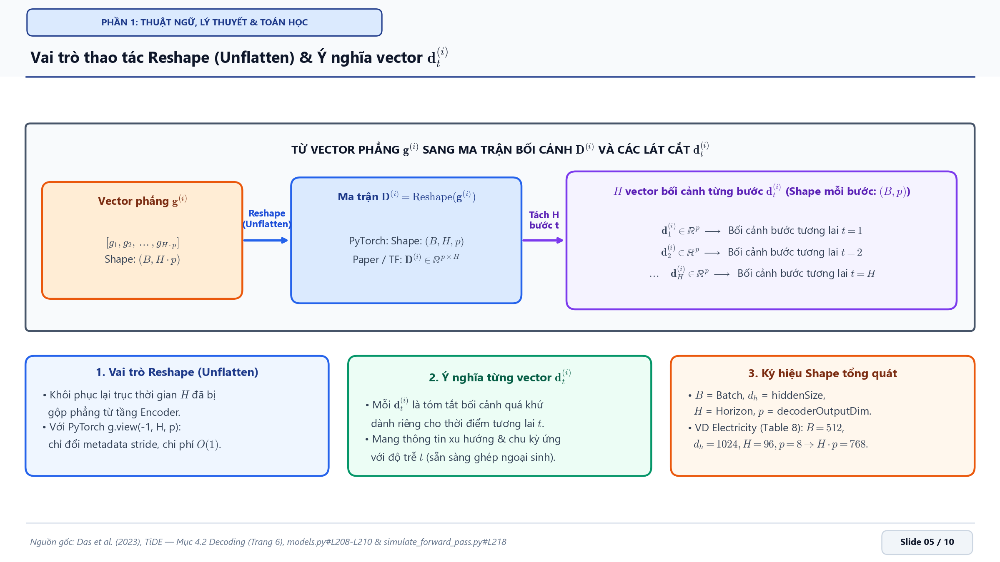
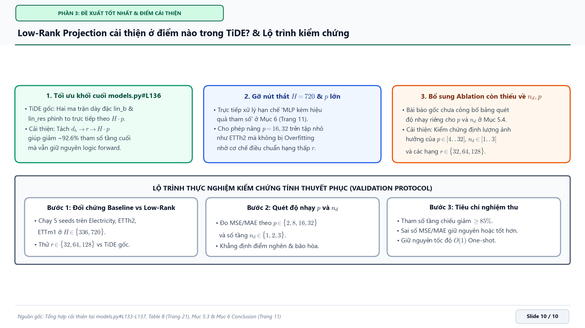

# Gallery Toàn Bộ 10 Slide Hình Ảnh Thuyết Trình — Khối Dense Decoder

Mọi slide bên dưới được xuất tự động ở chuẩn màn hình rộng 16:9 (**`13.333 × 7.5 in`, 180 DPI**), tuân thủ cơ chế **Zero-Dead-Space Auto-Fit** trong [`rule_slide.md`](./rule_slide.md) và tập trung **100% đúng scope Dense Decoder**.

---

## Phần 1: Thuật Ngữ, Kiến Trúc & Toán Học (Slide 01 – 05)

### Slide 01 / 10: Thuật ngữ cốt lõi cho Dense Decoder (Nền tảng)

### Slide 02 / 10: Vị trí khối Dense Decoder & Unflatten trên Figure 1

### Slide 03 / 10: Cách Dense Decoder tạo biểu diễn toàn horizon (One-Shot vs Tuần tự)

### Slide 04 / 10: Kiến trúc $n_d$ Residual Blocks & Chuyển $\mathbf{e}^{(i)}$ thành $\mathbf{g}^{(i)}$

### Slide 05 / 10: Vai trò thao tác Reshape (Unflatten) & Ý nghĩa vector $\mathbf{d}_t^{(i)}$

---

## Phần 2: Source Code, Hyperparameter & Phân Tích (Slide 06 – 08)

### Slide 06 / 10: Source Code chính thức (`models.py`) & PyTorch

### Slide 07 / 10: Cấu hình Siêu tham số Dense Decoder trên 7 Benchmark Datasets (Table 7 & 8)

### Slide 08 / 10: Phân tích ảnh hưởng của $p$, số lớp $n_d$ & Giới hạn khi $H$ dài

---

## Phần 3: Đề Xuất Tốt Nhất & Lộ Trình Kiểm Chứng (Slide 09 – 10)

### Slide 09 / 10: Đề xuất tốt nhất — Low-Rank Dense Decoder Projection

### Slide 10 / 10: Điểm cải thiện cụ thể trong TiDE & Validation Protocol

