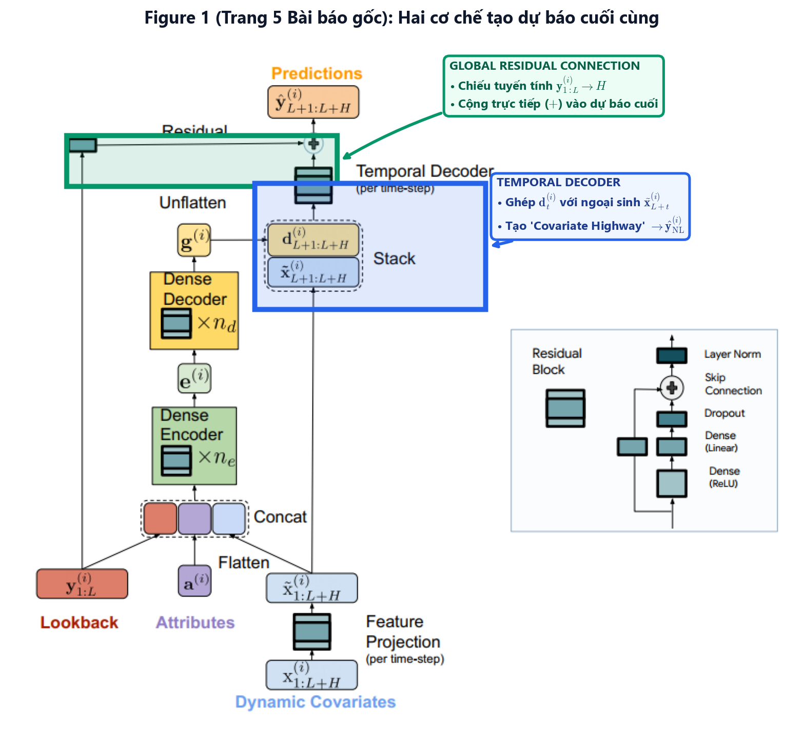
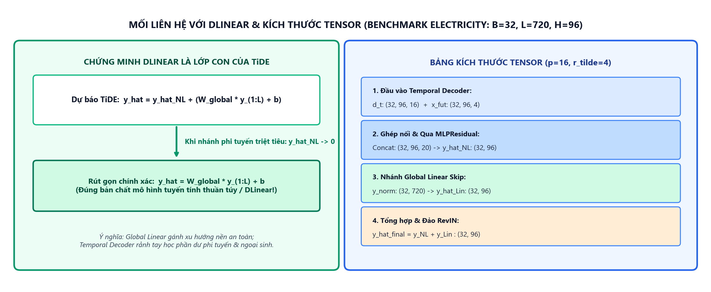
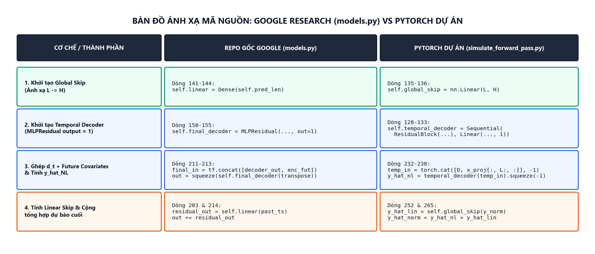
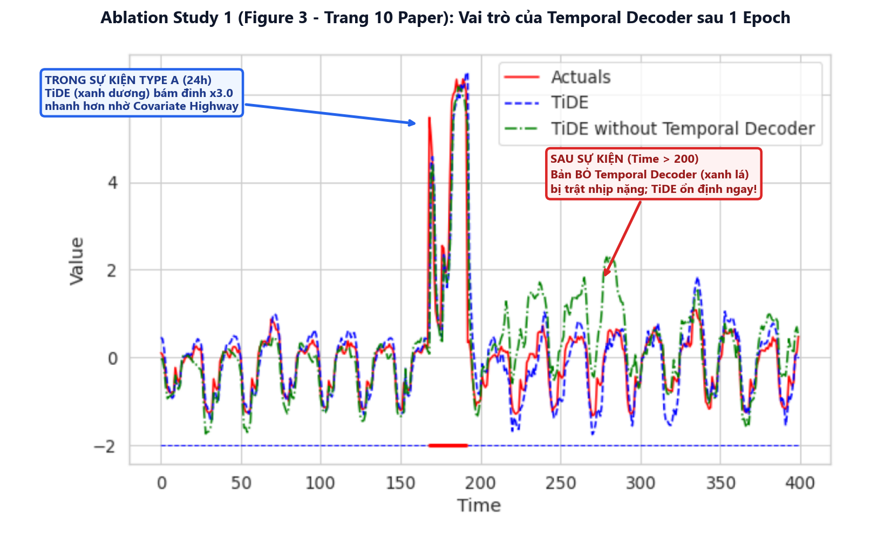
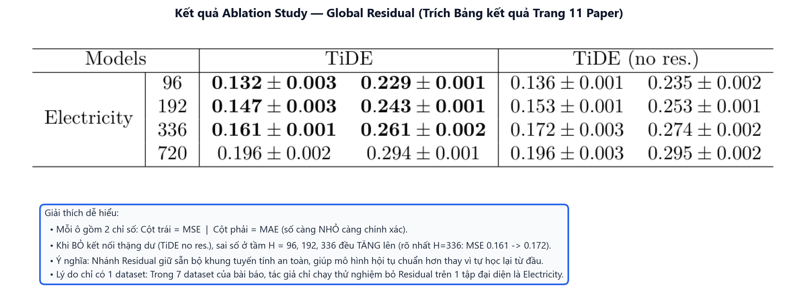
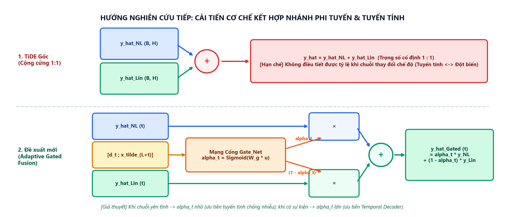

# 🖼️ THƯ VIỆN ẢNH TRÌNH CHIẾU THEO TỪNG NỘI DUNG SLIDE

> [!NOTE]
> File này tổng hợp **toàn bộ 8 hình ảnh minh họa độ phân giải cao (PNG)**, sắp xếp tương ứng **1-đối-1 với từng mục nội dung** trong bộ 3 phần Slide (`slide_01` $\to$ `slide_03`), giúp bạn xem nhanh, tải về hoặc kéo thả trực tiếp vào từng trang PowerPoint / Canva / Google Slides.

---

## 📖 PHẦN 1: LÝ THUYẾT & TOÁN HỌC ([`slide_01_phan_1_ly_thuyet_va_toan_hoc.md`](./slide_01_phan_1_ly_thuyet_va_toan_hoc.md))

### 1.1. Định vị hai cơ chế trên sơ đồ kiến trúc gốc (Figure 1 — Google Research)
* **Tương ứng nội dung Slide:** Giới thiệu vị trí khối `Temporal Decoder` (xanh dương) và nhánh `Global Residual Connection` (xanh lá) ở đầu ra của kiến trúc TiDE.

---

### 1.2. Cơ chế Temporal Decoder ("Covariate Highway") & Lý do không dùng thẳng Dense Decoder
* **Tương ứng nội dung Slide:** Giải thích cách ghép cặp vector bối cảnh $d_t^{(i)}$ với ngoại sinh tương lai $\tilde{x}_{L+t}^{(i)}$ và lý do mở đường cao tốc tránh làm mờ tín hiệu sự kiện đột biến qua nút thắt Encoder–Decoder.

---

### 1.3. Luồng song song Temporal Decoder + Global Residual & Tổng hợp dự báo cuối cùng
* **Tương ứng nội dung Slide:** Trực quan hóa cách `Global Residual` chiếu thẳng lookback $y_{1:L}^{(i)}$ sang horizon $H$ và cộng trực tiếp hai nhánh ($\hat{y}_{\text{NL}} + \hat{y}_{\text{Lin}}$).

---

### 1.4. Mối liên hệ với DLinear & Bảng kích thước Tensor (Benchmark `Electricity`)
* **Tương ứng nội dung Slide:** Chứng minh **DLinear là lớp con nghiêm ngặt của TiDE** khi $\hat{y}_{\text{NL}} \to 0$, cùng kích thước Tensor cụ thể (`B = 32`, `L = 720`, `H = 96`, `p = 16`, `r_tilde = 4`).

---

## 💻 PHẦN 2: SOURCE CODE & PHÂN TÍCH ABLATION STUDY ([`slide_02_phan_2_source_code_va_phan_tich.md`](./slide_02_phan_2_source_code_va_phan_tich.md))

### 2.1. Bản đồ đối chiếu Source Code (Repo gốc `models.py` vs PyTorch `simulate_forward_pass.py`)
* **Tương ứng nội dung Slide:** Ánh xạ từng dòng code cụ thể trong [`google-research/tide/models.py`](https://github.com/google-research/google-research/blob/master/tide/models.py) (`#L141-L155`, `#L203`, `#L211-L214`) sang phiên bản PyTorch của dự án.

---

### 2.2. Ablation Study 1 (Figure 3 — Trang 10 Paper): Vai trò của Temporal Decoder
* **Tương ứng nội dung Slide:** Thí nghiệm bán tổng hợp trên tập Electricity với sự kiện Type A (biên độ tăng $3\times$ trong $24\text{h}$) sau đúng **1 Epoch** — chứng minh bản bỏ Temporal Decoder bị trật nhịp nặng sau sự kiện (`Time > 200`).

---

### 2.3. Ablation Study 2 (Table 5 — Trang 11 Paper): Vai trò của Global Residual
* **Tương ứng nội dung Slide:** Biểu đồ so sánh sai số MSE & MAE (trung bình 5 lần chạy trên tập Electricity) giữa `TiDE` đầy đủ và `TiDE (no res.)` qua các tầm dự báo `H = 96, 192, 336, 720`.

---

## 💡 PHẦN 3: ĐỀ XUẤT CẢI TIẾN ([`slide_03_phan_3_de_xuat_cai_tien.md`](./slide_03_phan_3_de_xuat_cai_tien.md))

### 3.1. Cải tiến cơ chế kết hợp: Adaptive Gated Fusion vs Cộng cứng 1:1
* **Tương ứng nội dung Slide:** Đề xuất mạng cổng siêu nhẹ ($21$ tham số) sinh hệ số $\alpha_t \in (0, 1)$ điều tiết linh hoạt tỷ trọng giữa nhánh phi tuyến $\hat{y}_{\text{NL}}$ và nhánh tuyến tính $\hat{y}_{\text{Lin}}$ theo chế độ chuỗi thời gian.

