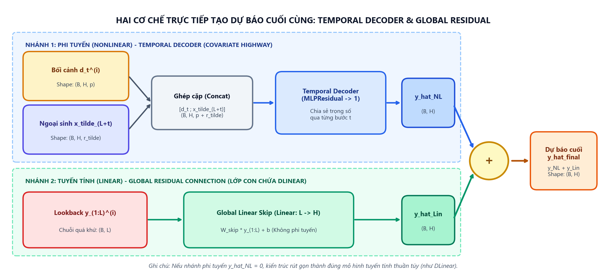
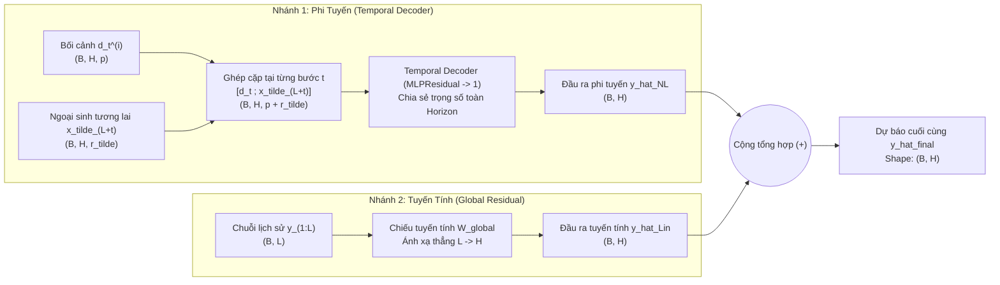

# PHẦN 1: LÝ THUYẾT & TOÁN HỌC — TEMPORAL DECODER VÀ GLOBAL RESIDUAL CONNECTION

> **Trọng tâm Phần 1 (Đáp ứng Yêu cầu 1 & 2 của Hội đồng):**  
> Giải phẫu nguyên lý lý thuyết, lý do thiết kế kiến trúc, công thức toán học và kích thước Tensor cho **hai cơ chế trực tiếp tạo ra dự báo cuối cùng** trong TiDE: **Temporal Decoder** (nhánh phi tuyến) và **Global Residual Connection** (nhánh tuyến tính), cùng mối liên hệ với **DLinear**.

---

## 🖼️ Sơ Đồ Kiến Trúc Hai Nhánh Song Song Tạo Dự Báo Cuối Cùng

---

## 1. 📖 Cơ Chế 1: Temporal Decoder & "Covariate Highway"

### 1.1. Cách Temporal Decoder kết hợp $d_t^{(i)}$ với Future Covariates tại thời điểm tương ứng
Sau khi `Dense Decoder` tạo ra ma trận bối cảnh $D^{(i)} \in \mathbb{R}^{H \times p}$ (mỗi hàng $d_t^{(i)} \in \mathbb{R}^p$ là vector bối cảnh riêng cho thời điểm tương lai $L + t$), **Temporal Decoder** lấy từng lát cắt $d_t^{(i)}$ ghép nối (concatenate) trực tiếp với vector biến ngoại sinh tương lai đã chiếu giảm chiều $\tilde{x}_{L+t}^{(i)} \in \mathbb{R}^{\tilde{r}}$ tại **đúng thời điểm $L + t$ tương ứng**, rồi đưa qua một khối `ResidualBlock` có đầu ra kích thước bằng $1$:

$$
\hat{y}_{\text{NL}, L+t}^{(i)} = \text{TemporalDecoder}\Big(\big[ d_t^{(i)} \; ; \; \tilde{x}_{L+t}^{(i)} \big]\Big) \in \mathbb{R}, \quad \forall t \in \{1, 2, \dots, H\}
$$

* **Cấu tạo bên trong Temporal Decoder:** Là đúng một khối `MLPResidual` (`ResidualBlock`) với:
  * Số chiều đầu vào: $p + \tilde{r}$.
  * Số chiều tầng ẩn nội bộ: `temporalDecoderHidden` (ký hiệu $d_{\text{temp}}$, thường bằng 64 hoặc 128).
  * Số chiều đầu ra: $1$ (trả về đúng một giá trị vô hướng cho mỗi bước thời gian $t$).
* **Chia sẻ trọng số toàn thời gian (Weight Sharing):** Cùng một khối Temporal Decoder được áp dụng đồng thời (song song hóa theo trục $H$) cho mọi bước thời gian $t = 1 \dots H$.

### 1.2. Vì sao TiDE bổ sung Temporal Decoder thay vì dùng trực tiếp đầu ra Dense Decoder?
Nếu dừng lại ở `Dense Decoder`, mô hình sẽ vướng hai hạn chế nghiêm trọng mà **Temporal Decoder** sinh ra để giải quyết (gọi là **"Covariate Highway"** — *Làn đường cao tốc cho biến ngoại sinh*):

1. **Tránh thất lạc tín hiệu sự kiện đột biến qua nút thắt Encoder–Decoder:**
   * Ở nhánh Encoder, toàn bộ $L + H$ bước biến ngoại sinh bị nén chung với chuỗi $y$ vào một vector ẩn $e^{(i)}$ duy nhất. Khi đi qua lớp nút thắt này, các tín hiệu cục bộ rất mạnh tại một thời điểm cụ thể (ví dụ trong bán lẻ: *Ngày của Mẹ*, ngày giảm giá *Black Friday*, hoặc sự kiện thời tiết cực đoan ở đúng ngày $L+t$) dễ bị làm mờ hoặc mất thời gian học rất lâu.
   * Temporal Decoder mở một **đường dẫn trực tiếp (highway)** từ $\tilde{x}_{L+t}^{(i)}$ thẳng tới phép dự đoán $\hat{y}_{L+t}^{(i)}$ tại đúng thời điểm đó.
2. **Tách biệt bối cảnh tổng thể và tác nhân kích hoạt cục bộ:**
   * `Dense Decoder` ($d_t^{(i)}$) chịu trách nhiệm duy trì bức tranh tổng thể về xu hướng và quán tính từ quá khứ.
   * `Temporal Decoder` chịu trách nhiệm điều chỉnh phi tuyến giá trị dự báo ngay lập tức dựa trên các yếu tố kích hoạt mới nhất biết trước ở tương lai ($\tilde{x}_{L+t}^{(i)}$), giúp mô hình hội tụ nhanh vượt trội (chỉ cần 1 epoch trong thực nghiệm kiểm chứng).

---

## 2. 📐 Cơ Chế 2: Global Residual Connection & Mối Liên Hệ Với DLinear

### 2.1. Cách Global Residual Connection ánh xạ tuyến tính Lookback thành Horizon
Song song với toàn bộ hệ thống mạng sâu (Encoder $\to$ Dense Decoder $\to$ Temporal Decoder), TiDE thiết lập một nhánh tắt tuyến tính toàn cục (**Global Linear Skip / Global Residual Connection**) đi thẳng từ chuỗi lịch sử đầu vào $y_{1:L}^{(i)}$ (đã chuẩn hóa nếu bật RevIN) sang không gian dự báo độ dài $H$:

$$
\hat{y}_{\text{Lin}, L+1:L+H}^{(i)} = W_{\text{global}} \cdot y_{1:L}^{(i)} + b_{\text{global}} \in \mathbb{R}^H
$$

Trong đó:
* $y_{1:L}^{(i)} \in \mathbb{R}^L$: Chuỗi mục tiêu quá khứ.
* $W_{\text{global}} \in \mathbb{R}^{H \times L}$ và $b_{\text{global}} \in \mathbb{R}^H$: Ma trận trọng số và vector độ lệch của một tầng tuyến tính thuần túy duy nhất (**không có ReLU, không có Dropout, không có LayerNorm**).

### 2.2. Cách tổng hợp đầu ra Nonlinear và Linear tạo dự báo cuối cùng
Dự báo chuẩn hóa tại mỗi bước tương lai $L + t$ được tổng hợp bằng phép cộng thặng dư trực tiếp giữa **nhánh phi tuyến** (từ Temporal Decoder) và **nhánh tuyến tính** (từ Global Residual Connection):

$$
\hat{y}_{\text{norm}, L+1:L+H}^{(i)} = \underbrace{\hat{y}_{\text{NL}, L+1:L+H}^{(i)}}_{\text{Temporal Decoder (Phi tuyến)}} + \underbrace{\hat{y}_{\text{Lin}, L+1:L+H}^{(i)}}_{\text{Global Residual (Tuyến tính)}}
$$

Nếu mô hình có sử dụng RevIN (Reversible Instance Normalization), kết quả cuối cùng được hoàn nguyên về thang đo vật lý gốc bằng giá trị trung bình $\mu^{(i)}$ và độ lệch chuẩn $\sigma^{(i)}$ của chuỗi quá khứ:

$$
\hat{y}_{\text{final}, L+1:L+H}^{(i)} = \hat{y}_{\text{norm}, L+1:L+H}^{(i)} \cdot \sigma^{(i)} + \mu^{(i)}
$$

### 2.3. Mối liên hệ giữa Global Residual Connection với DLinear (Zeng et al., 2023)
* **DLinear là gì?** Bài báo *Are Transformers Effective for Time Series Forecasting?* (Zeng et al., 2023) chứng minh rằng chỉ một phép ánh xạ tuyến tính đơn giản từ $L$ bước quá khứ sang $H$ bước tương lai (trên hai thành phần Trend và Seasonal) đã đủ đánh bại hàng loạt mô hình Transformer phức tạp.
* **Sự kế thừa toán học trong TiDE:** Theo Mục 4.2 của bài báo TiDE (Trang 6): *"This ensures that a purely linear model like the one in (Zeng et al., 2023) is always a subclass of our model."*
  * **Chứng minh trực quan:** Nếu trọng số của toàn bộ nhánh phi tuyến (`Temporal Decoder`) hội tụ về $0$ (tức $\hat{y}_{\text{NL}} \equiv 0$), kiến trúc TiDE tự động rút gọn thành chính xác phép chiếu tuyến tính thuần túy $\hat{y} = W_{\text{global}} y_{1:L} + b_{\text{global}}$.
  * **Ý nghĩa thiết kế:** Nhánh tuyến tính đóng vai trò "xương sống an toàn" gánh vác toàn bộ quy luật tuyến tính mạnh (xu hướng nền, chu kỳ cơ bản), giúp nhánh mạng sâu phi tuyến (`Encoder + Decoder + Temporal Decoder`) hoàn toàn rảnh tay tập trung học **phần dư phi tuyến và tương tác biến ngoại sinh** — giải thích tại sao TiDE luôn ổn định và không bao giờ tệ hơn mô hình tuyến tính thuần túy.

---

## 3. 📊 Bảng Kích Thước Tensor Đầu Vào & Đầu Ra (Cấu Hình Thực Nghiệm Electricity)
Với cấu hình chuẩn benchmark `Electricity` ($B = 32$, $L = 720$, $H = 96$, $p = 16$, $\tilde{r} = 4$, `temporal_hidden` $= 64$):

| Thành phần | Tensor đầu vào | Tensor trung gian / Phép toán | Tensor đầu ra |
| :--- | :--- | :--- | :--- |
| **Temporal Decoder** | $d_t$: `(32, 96, 16)` $\tilde{x}_{L+1:L+H}$: `(32, 96, 4)` | `torch.cat([D, x_future], dim=-1)` $\to$ `(32, 96, 20)` | $\hat{y}_{\text{NL}}$: `(32, 96, 1)` $\xrightarrow{\text{squeeze}}$ `(32, 96)` |
| **Global Linear Skip** | $y_{\text{norm}}$: `(32, 720)` | Phép chiếu tuyến tính `nn.Linear(720, 96)` | $\hat{y}_{\text{Lin}}$: `(32, 96)` |
| **Tổng hợp cuối cùng** | $\hat{y}_{\text{NL}}$: `(32, 96)` $\hat{y}_{\text{Lin}}$: `(32, 96)` | Cộng theo phần tử: $\hat{y}_{\text{NL}} + \hat{y}_{\text{Lin}}$ (+ Đảo RevIN) | $\hat{y}_{\text{final}}$: **`(32, 96)`** |
