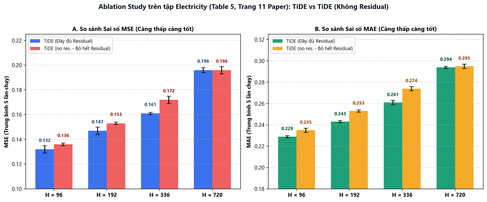

# PHẦN 2: SOURCE CODE & PHÂN TÍCH (KÈM ABLATION STUDY) — TEMPORAL DECODER VÀ GLOBAL RESIDUAL

> **Trọng tâm Phần 2 (Đáp ứng Yêu cầu 3 & 4 của Hội đồng):**  
> Xác định chính xác vị trí mã nguồn hiện thực trong **Repository gốc Google Research (`models.py`)** và bản **PyTorch trong dự án**; sau đó phân tích sâu vai trò của **Temporal Decoder** và **Global Residual** thông qua hai thí nghiệm **Ablation Study** chính thức từ bài báo (Mục 5.4, Trang 10–11) cùng các giới hạn tiềm ẩn.

---

## 1. 💻 Source Code Hiện Thực Trong Repository Gốc & Dự Án

### 1.1. Repository gốc chính thức Google Research (TensorFlow / Keras)
* **Link file gốc:** [`google-research/google-research/blob/master/tide/models.py`](https://github.com/google-research/google-research/blob/master/tide/models.py)

```python
# --- A. KHỞI TẠO TRONG TideModel.__init__ ---

# 1. Global Residual Connection (Dòng 141-144)
# Ánh xạ tuyến tính trực tiếp từ lookback (L) sang horizon (pred_len = H)
self.linear = tf.keras.layers.Dense(
    self.pred_len,
    activation=None,
)

# 2. Temporal Decoder (Dòng 150-155)
# Khối MLPResidual có output_dim = 1 chia sẻ cho mọi bước thời gian
self.final_decoder = MLPResidual(
    hidden_dim=model_config.get('final_decoder_hidden'),
    output_dim=1,
    layer_norm=layer_norm,
    dropout_rate=dropout_rate,
)
```

```python
# --- B. LUỒNG THỰC THI TRONG TideModel.call ---

# 1. Tính nhánh tuyến tính từ chuỗi lịch sử (Dòng 203)
residual_out = self.linear(past_ts)                      # Shape: [B, H]

# 2. Ghép cặp d_t (decoder_out) và future covariates (enc_fut) tại từng bước t (Dòng 211)
# decoder_out: [B, p, H], enc_fut: [B, r_tilde, H] -> final_in: [B, p + r_tilde, H]
final_in = tf.concat([decoder_out, enc_fut], axis=1)

# 3. Đưa qua Temporal Decoder (chuyển trục H lên trước để xử lý song song theo từng time-step) (Dòng 212-213)
out = self.final_decoder(tf.transpose(final_in, (0, 2, 1)))  # Shape: [B, H, 1]
out = tf.squeeze(out, axis=-1)                               # Shape: [B, H]

# 4. Cộng tổng hợp nhánh phi tuyến và nhánh tuyến tính (Dòng 214)
out += residual_out                                          # Shape: [B, H]
```

### 1.2. Bản triển khai PyTorch trong dự án (`simulate_forward_pass.py` & `test_tensor_shapes.py`)

* **Khởi tạo lớp trong `__init__`:** [`simulate_forward_pass.py#L128-L136`](../../../simulate_forward_pass.py#L128-L136)
* **Thực thi Forward Pass:** [`simulate_forward_pass.py#L228-L266`](../../../simulate_forward_pass.py#L228-L266)
* **Kiểm thử Tensor Shape:** [`test_tensor_shapes.py#L117-L135`](../../sprint-1/test_tensor_shapes.py#L117-L135)

```python
# Trích từ simulate_forward_pass.py dòng 232-265
# 1. Cắt lát biến ngoại sinh tương lai từ bước L đến L+H: [B, H, r_tilde]
x_proj_future = x_proj[:, self.L :, :]

# 2. Ghép cặp d_t và x_tilde_{L+t} theo chiều đặc trưng cuối: [B, H, p + r_tilde]
temp_in = torch.cat([D, x_proj_future], dim=-1)

# 3. Chạy Temporal Decoder sinh thành phần phi tuyến: [B, H]
y_hat_nl = self.temporal_decoder(temp_in).squeeze(-1)

# 4. Chạy nhánh Global Linear Skip trực tiếp từ y_norm: [B, H]
y_hat_lin = self.global_skip(y_norm)

# 5. Tổng hợp đầu ra cuối (trước bước giải chuẩn hóa RevIN)
y_hat_norm = y_hat_nl + y_hat_lin
```

### 📍 Bảng tổng hợp vị trí dòng code chính xác
| Thành phần | Repo gốc Google Research (`models.py`) | Code PyTorch dự án (`simulate_forward_pass.py`) |
| :--- | :--- | :--- |
| **Khởi tạo Temporal Decoder** | [`models.py#L150-L155`](https://github.com/google-research/google-research/blob/master/tide/models.py#L150-L155) | [`simulate_forward_pass.py#L128-L133`](../../../simulate_forward_pass.py#L128-L133) |
| **Ghép $d_t$ + Future Covariates & Chạy TD** | [`models.py#L211-L213`](https://github.com/google-research/google-research/blob/master/tide/models.py#L211-L213) | [`simulate_forward_pass.py#L232-L238`](../../../simulate_forward_pass.py#L232-L238) |
| **Khởi tạo Global Residual (`Dense(H)`)** | [`models.py#L141-L144`](https://github.com/google-research/google-research/blob/master/tide/models.py#L141-L144) | [`simulate_forward_pass.py#L135-L136`](../../../simulate_forward_pass.py#L135-L136) |
| **Tính Linear Skip & Cộng tổng hợp (`+=`)** | [`models.py#L203`](https://github.com/google-research/google-research/blob/master/tide/models.py#L203) & [`models.py#L214`](https://github.com/google-research/google-research/blob/master/tide/models.py#L214) | [`simulate_forward_pass.py#L252-L266`](../../../simulate_forward_pass.py#L252-L266) |

---

## 2. 🔬 Phân Tích Vai Trò Qua Ablation Study (Mục 5.4 Bài Báo Gốc)

Nhóm tác giả Google Research thực hiện **2 thí nghiệm bóc tách (Ablation Study)** độc lập để chứng minh định lượng vai trò không thể thay thế của hai cơ chế này:

### 2.1. Ablation Study 1: Vai trò của Temporal Decoder (Trang 10–11, Figure 3)
* **Thiết kế thí nghiệm bán tổng hợp (Semi-synthetic Electricity):**
  * Tạo tập dữ liệu biến đổi từ `Electricity`, bổ sung 2 loại sự kiện đột biến kéo dài liên tục **24 giờ** trên $80\%$ chuỗi:
    * **Sự kiện Loại A (Type A):** Nhân giá trị chuỗi lên hệ số ngẫu nhiên trong đoạn $[3.0, 3.2]$, đi kèm 4 biến ngoại sinh nhiễu lấy mẫu từ phân phối chuẩn có trung bình $[1.0, 2.0, 2.0, 1.0]$ (phương sai $0.1$).
    * **Sự kiện Loại B (Type B):** Giảm giá trị chuỗi đi hệ số trong đoạn $[2.0, 2.2]$ kèm 4 biến ngoại sinh báo hiệu tương ứng.
  * Huấn luyện hai phiên bản **TiDE có Temporal Decoder** và **TiDE không có Temporal Decoder** chỉ sau **đúng 1 Epoch**.

* **Kết quả quan sát (Figure 3 trong Paper):**
  1. **Trong thời gian xảy ra sự kiện Type A:** Mô hình **có Temporal Decoder** bắt kịp biên độ nhảy vọt nhanh hơn nhờ đường dẫn cao tốc nối trực tiếp từ các biến ngoại sinh chỉ báo sự kiện tới dự báo.
  2. **Ngay sau khi sự kiện kết thúc (Phát hiện quan trọng nhất):** Mô hình **không có Temporal Decoder bị trật nhịp nghiêm trọng (thrown off)** ở các bước thời gian sau sự kiện. Lý do là vì thiếu Temporal Decoder, phần `Dense Encoder` chưa kịp điều chỉnh lại toàn bộ vector bối cảnh quá khứ để nhận ra biến động vừa rồi chỉ là một sự kiện tạm thời chứ không phải sự thay đổi nền dài hạn. Ngược lại, **TiDE có Temporal Decoder gần như miễn nhiễm với hiện tượng trật nhịp này** ngay từ Epoch đầu tiên.

### 2.2. Ablation Study 2: Vai trò của Global Residual & Residual Connections (Trang 11, Table 5)



Tác giả so sánh mô hình **TiDE đầy đủ** với mô hình **TiDE (no res.)** (loại bỏ toàn bộ các kết nối thặng dư, bao gồm cả Global Linear Residual Connection và nhánh Skip trong Residual Block) trên tập benchmark `Electricity` (trung bình **5 lần chạy** kèm sai số chuẩn):

| Horizon ($H$) | TiDE (Đầy đủ) — **MSE** | TiDE (no res.) — **MSE** | TiDE (Đầy đủ) — **MAE** | TiDE (no res.) — **MAE** | Mức độ sụt giảm khi bỏ Residual |
| :---: | :---: | :---: | :---: | :---: | :--- |
| **96** | $\mathbf{0.132 \pm 0.003}$ | $0.136 \pm 0.001$ | $\mathbf{0.229 \pm 0.001}$ | $0.235 \pm 0.002$ | Sụt giảm có ý nghĩa thống kê |
| **192** | $\mathbf{0.147 \pm 0.003}$ | $0.153 \pm 0.001$ | $\mathbf{0.243 \pm 0.001}$ | $0.253 \pm 0.001$ | Sụt giảm rõ rệt ($+0.006$ MSE / $+0.010$ MAE) |
| **336** | $\mathbf{0.161 \pm 0.001}$ | $0.172 \pm 0.003$ | $\mathbf{0.261 \pm 0.002}$ | $0.274 \pm 0.002$ | **Sụt giảm mạnh nhất** ($+0.011$ MSE / $+0.013$ MAE) |
| **720** | $0.196 \pm 0.002$ | $0.196 \pm 0.003$ | $\mathbf{0.294 \pm 0.001}$ | $0.295 \pm 0.002$ | Tiệm cận nhau ở tầm siêu dài |

* **Nhận xét chuyên sâu từ số liệu Table 5:**
  * Tại các tầm dự báo $H = 96 \to 336$, việc bỏ Residual Connections làm hiệu năng giảm có ý nghĩa thống kê rõ rệt.
  * Điều này chứng minh thực nghiệm cho định lý tại Phụ lục A của bài báo: Trong các hệ thống động lực học có thành phần tuyến tính mạnh (Linear Dynamical System), nhánh **Global Residual** giúp mô hình hội tụ nhanh về tốc độ tối ưu mà không bắt mạng MLP sâu phải tự học lại phép ánh xạ đồng nhất từ con số không.

---

## 3. ⚠️ Các Giới Hạn Tiềm Ẩn Trong Cơ Chế Tổng Hợp Hiện Tại

Dù đạt hiệu quả cao, cơ chế tổng hợp `out += residual_out` ($\hat{y} = \hat{y}_{\text{NL}} + \hat{y}_{\text{Lin}}$) của TiDE gốc vẫn tồn tại **3 giới hạn tiềm ẩn** quan trọng:

1. **Phép cộng cứng tỷ lệ 1 : 1 bất biến theo thời gian (Static Equal-Weight Summation):**
   * Tại mọi mốc thời gian $t$ và mọi chuỗi $i$, TiDE luôn cộng trực tiếp $\hat{y}_{\text{NL}}$ và $\hat{y}_{\text{Lin}}$ với hệ số mặc định bằng `1.0`.
   * Trong giai đoạn chuỗi vận động hoàn toàn theo quy luật tuyến tính ổn định, nhánh phi tuyến (`Temporal Decoder`) vẫn tham gia đóng góp với trọng số ngang bằng, có nguy cơ **cộng thêm nhiễu quá khớp (nonlinear noise)** vào kết quả tuyến tính vốn đã rất tốt. Ngược lại, ở các thời điểm đột biến mạnh, nhánh tuyến tính cứng có thể kìm hãm phản ứng của Temporal Decoder.
2. **Thiếu cơ chế điều tiết theo ngữ cảnh thực thể (Lack of Instance-Adaptive Mixing):**
   * Trong cùng một bộ dữ liệu (như bán lẻ M5 hoặc lưới điện 321 hộ), có chuỗi mang tính chu kỳ tuyến tính rất đều đặn, nhưng có chuỗi lại phụ thuộc cực mạnh vào biến ngoại sinh phi tuyến. Một phép cộng cố định không cho phép mô hình tự cân bằng tỷ trọng giữa "tuyến tính" và "phi tuyến" cho từng loại thực thể.
3. **Chưa tách bạch tần số tín hiệu trước nhánh Global Linear Skip:**
   * Khác với **DLinear** (vốn dùng Moving Average tách chuỗi $y_{1:L}$ thành *Trend* và *Seasonal* trước khi đưa qua 2 lớp Linear riêng biệt), Global Linear Skip của TiDE chiếu thẳng trực tiếp toàn bộ $y_{1:L}$ thô sang $H$, nên dễ bị ảnh hưởng nếu chuỗi quá khứ chứa các xung nhiễu đột ngột (outliers/spikes) chưa được lọc mượt.
