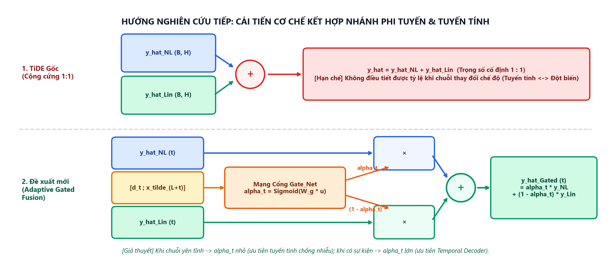
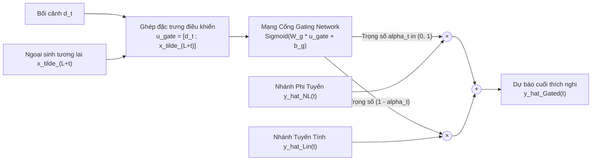

# PHẦN 3: ĐỀ XUẤT CẢI TIẾN CƠ CHẾ KẾT HỢP NHÁNH PHI TUYẾN & TUYẾN TÍNH

> **Trọng tâm Phần 3 (Đáp ứng Yêu cầu 5 của Hội đồng & Câu hỏi Hướng nghiên cứu tiếp):**  
> Trả lời trực tiếp câu hỏi: ***"Có thể cải tiến cơ chế kết hợp nhánh phi tuyến (`Temporal Decoder`) và nhánh tuyến tính (`Global Residual`) để nâng cao độ chính xác không?"***  
> Đưa ra **2 giả thuyết cải tiến khoa học** thay thế phép cộng cứng `1:1` hiện tại, kèm công thức toán học, mã nguồn PyTorch và thiết kế thực nghiệm đối chứng chi tiết.

---

## 🖼️ Sơ Đồ So Sánh: Cộng Cứng 1:1 (TiDE Gốc) vs Cổng Hợp Nhất Thích Nghi (Đề Xuất)





---

## 1. 💡 Câu Trả Lời Cho Hướng Nghiên Cứu Tiếp: "Có Thể Cải Tiến Không?"

**Câu trả lời là CÓ.** Trong TiDE gốc, dòng code `out += residual_out` ([`models.py#L214`](https://github.com/google-research/google-research/blob/master/tide/models.py#L214)) áp đặt phép cộng tuyến tính có trọng số cố định $1:1$ cho mọi thời điểm $t$ và mọi thực thể $i$. Cơ chế này bỏ qua hai đặc tính thực tế của chuỗi thời gian:
1. **Tính biến thiên chế độ theo thời gian (Regime Switching):** Có những giai đoạn chuỗi biến động rất đều theo xu hướng tuyến tính (ví dụ ban đêm hoặc ngày thường), nhưng lại có những giai đoạn chịu tác động phi tuyến cực mạnh từ ngoại sinh (ví dụ giờ cao điểm, ngày lễ, sự kiện Type A).
2. **Sự nhiễu loạn ở vùng tín hiệu thô:** Nhánh tuyến tính `Global Residual` chiếu thẳng chuỗi thô $y_{1:L}$ có thể mang theo nhiễu xung đột ngột từ quá khứ nếu chuỗi chưa được tách xu hướng mượt trước đó.

Dưới đây là **2 giả thuyết cải tiến khả thi** giải quyết trực tiếp hai vấn đề trên:

---

## 2. 🚀 Giả Thuyết 1: Cơ Chế Cổng Hợp Nhất Thích Nghi Theo Thời Gian (Time-Varying Adaptive Gated Fusion)

### 2.1. Ý tưởng & Công thức toán học
Thay vì cộng cứng với tỷ lệ $1:1$, ta bổ sung một **Mạng Cổng nhẹ (Gating Network)** sinh ra hệ số điều tiết $\alpha_t^{(i)} \in (0, 1)$ cho **từng bước thời gian tương lai $t \in [1, H]$** dựa trên vector bối cảnh $d_t^{(i)}$ và ngoại sinh tương lai $\tilde{x}_{L+t}^{(i)}$:

$$
\alpha_t^{(i)} = \sigma\Big( W_g \cdot \big[ d_t^{(i)} \; ; \; \tilde{x}_{L+t}^{(i)} \big] + b_g \Big) \in (0, 1)
$$

Trong đó $\sigma(\cdot)$ là hàm kích hoạt Sigmoid, $W_g \in \mathbb{R}^{1 \times (p + \tilde{r})}$. Giá trị dự báo cuối cùng được hợp nhất có trọng số động:

$$
\hat{y}_{\text{Gated}, L+t}^{(i)} = \alpha_t^{(i)} \cdot \hat{y}_{\text{NL}, L+t}^{(i)} + \big(1 - \alpha_t^{(i)}\big) \cdot \hat{y}_{\text{Lin}, L+t}^{(i)}
$$

*(Hoặc biến thể giữ nguyên xương sống DLinear làm gốc: $\hat{y}_{L+t}^{(i)} = \hat{y}_{\text{Lin}, L+t}^{(i)} + \alpha_t^{(i)} \cdot \hat{y}_{\text{NL}, L+t}^{(i)}$, đảm bảo mô hình vẫn giữ `Global Linear Skip` nguyên vẹn khi $\alpha_t \to 0$).*

### 2.2. Cơ chế hoạt động & Lý do kỳ vọng nâng cao độ chính xác
* **Khi không có sự kiện bất thường:** Hệ thống hạ $\alpha_t^{(i)}$ xuống thấp, trao quyền ưu tiên cho nhánh tuyến tính `Global Residual`, giúp đường dự báo ổn định và tránh bị mạng MLP học vẹt vào nhiễu ngẫu nhiên.
* **Khi xuất hiện tín hiệu ngoại sinh mạnh (ngày lễ, đột biến Type A):** Mạng cổng nhận diện sự thay đổi từ $\tilde{x}_{L+t}^{(i)}$ và đẩy $\alpha_t^{(i)} \to 1$, khuếch đại đóng góp của `Temporal Decoder` đúng vào khung giờ sự kiện.
* **Chi phí tham số cực nhỏ:** Với $p=16, \tilde{r}=4$, lớp cổng chỉ tốn thêm đúng $20 + 1 = \mathbf{21\text{ tham số}}$, gần như không làm chậm tốc độ huấn luyện hay suy luận.

### 2.3. Mã nguồn PyTorch đề xuất tích hợp ngay vào `simulate_forward_pass.py`

```python
class AdaptiveGatedTiDEHead(nn.Module):
    """Cải tiến thay thế phép cộng cứng y_hat_nl + y_hat_lin (Giả thuyết 1)."""
    def __init__(self, p: int, r_tilde: int):
        super().__init__()
        # Chỉ tốn (p + r_tilde + 1) tham số, chia sẻ cho toàn Horizon H
        self.gate_proj = nn.Linear(p + r_tilde, 1)
        self.sigmoid = nn.Sigmoid()

    def forward(
        self,
        temp_in: torch.Tensor,     # [B, H, p + r_tilde]
        y_hat_nl: torch.Tensor,    # [B, H] từ Temporal Decoder
        y_hat_lin: torch.Tensor    # [B, H] từ Global Linear Skip
    ) -> torch.Tensor:
        # Tính cổng thích nghi theo từng bước t: alpha shape [B, H]
        alpha = self.sigmoid(self.gate_proj(temp_in)).squeeze(-1)
        # Hợp nhất thích nghi hai nhánh
        return alpha * y_hat_nl + (1.0 - alpha) * y_hat_lin
```

---

## 3. 🚀 Giả Thuyết 2: Tách Xu Hướng Cho Nhánh Tuyến Tính Kết Hợp Trọng Số Kênh (Trend-Aware Dual-Stream Mixing)

### 3.1. Ý tưởng & Công thức toán học
Kế thừa trực tiếp ưu điểm cốt lõi của **DLinear**: Trước khi đưa chuỗi $y_{1:L}^{(i)}$ vào nhánh `Global Linear Skip`, ta tách chuỗi quá khứ thành **thành phần xu hướng mượt (Trend)** $y_{\text{trend}}^{(i)}$ bằng bộ lọc trượt trung bình (`Moving Average` cửa sổ $k = 25$) và **thành phần dao động dư (Seasonal/Residual)** $y_{\text{rem}}^{(i)} = y_{1:L}^{(i)} - y_{\text{trend}}^{(i)}$:

$$
\hat{y}_{\text{Lin}}^{(i)} = W_{\text{trend}} \cdot y_{\text{trend}}^{(i)} + W_{\text{rem}} \cdot y_{\text{rem}}^{(i)} + b
$$

Sau đó hợp nhất với nhánh `Temporal Decoder` bằng một vector hệ số học được theo thực thể/horizon $\gamma \in \mathbb{R}^{1 \times H}$ (hoặc theo từng thực thể chuỗi `ts_emb`):

$$
\hat{y}_{\text{final}}^{(i)} = \hat{y}_{\text{Lin}}^{(i)} + \text{Sigmoid}(\gamma) \odot \hat{y}_{\text{NL}}^{(i)}
$$

### 3.2. Lý do kỳ vọng nâng cao độ chính xác
* Giảm tác động của nhiễu gai (outliers) trong lookback lên ma trận chiếu tuyến tính $W_{\text{global}}$.
* Phân công rành mạch: `Global Linear` nắm giữ xu hướng vĩ mô mượt và chu kỳ chính tắc; `Temporal Decoder` chỉ cần điều chỉnh độ lệch phi tuyến bằng trọng số $\text{Sigmoid}(\gamma)$ tối ưu riêng cho từng mốc tầm xa $H$.

---

## 4. 🧪 Kịch Bản Thực Nghiệm Kiểm Chứng (Experimental Verification Plan)

Để kiểm chứng khách quan hai giả thuyết trên, ta thiết lập thí nghiệm đối chứng trên chính các benchmark của bài báo gốc:

| Thành phần thực nghiệm | Thiết lập chuẩn (Theo Section 5.1 & 5.4 của Paper TiDE) |
| :--- | :--- |
| **Tập dữ liệu kiểm chứng** | 1. **Electricity** (321 chuỗi, chu kỳ đều, tuyến tính mạnh).<br>2. **Semi-synthetic Electricity (Type A / Type B events)** (kiểm tra khả năng thích nghi sự kiện ngoại sinh).<br>3. **ETTh1 / Traffic** (tập nhỏ & dữ liệu có biến động đột biến). |
| **Các biến thể so sánh** | • **Baseline:** TiDE gốc (`out = y_nl + y_lin`).<br>• **Variant A (H1):** TiDE + `AdaptiveGatedTiDEHead` ($\alpha_t \cdot y_{\text{NL}} + (1 - \alpha_t) \cdot y_{\text{Lin}}$).<br>• **Variant B (H1-Res):** TiDE + Residual Gate ($y_{\text{Lin}} + \alpha_t \cdot y_{\text{NL}}$).<br>• **Variant C (H2):** TiDE + Trend-Decomposed Global Skip + Instance Mixing. |
| **Độ đo đánh giá** | • Độ chính xác dự báo: **MSE**, **MAE** qua các Horizon $H \in \{96, 192, 336, 720\}$ (trung bình 5 seed).<br>• Khả năng giải thích (Interpretability): Vẽ đồ thị biến thiên giá trị cổng $\alpha_t$ trước, trong và sau khi xảy ra sự kiện Type A để chứng minh cổng thực sự tự động mở rộng khi có biến động phi tuyến. |
| **Tiêu chí bác bỏ / chấp nhận** | Giả thuyết được chấp nhận nếu biến thể cải tiến đạt **MSE/MAE thấp hơn có ý nghĩa thống kê** (đặc biệt ở tập có sự kiện ngoại sinh hoặc tập nhiễu cao) trong khi thời gian train mỗi epoch tăng **$< 5\%$**. |
