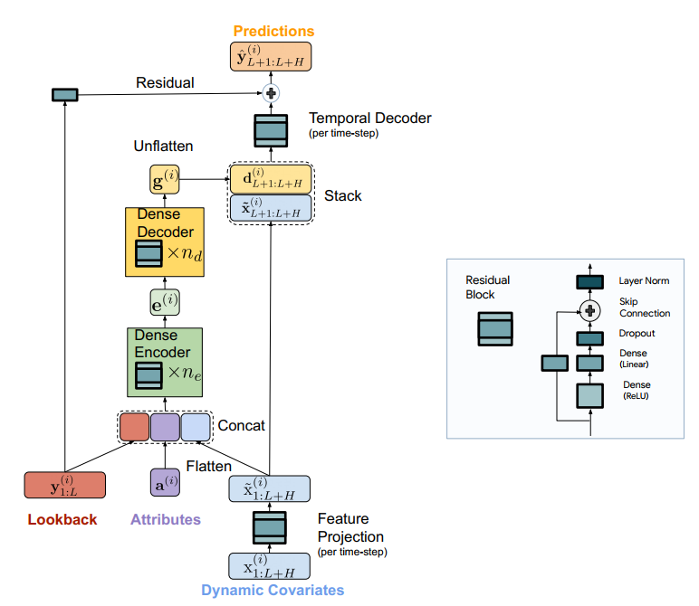
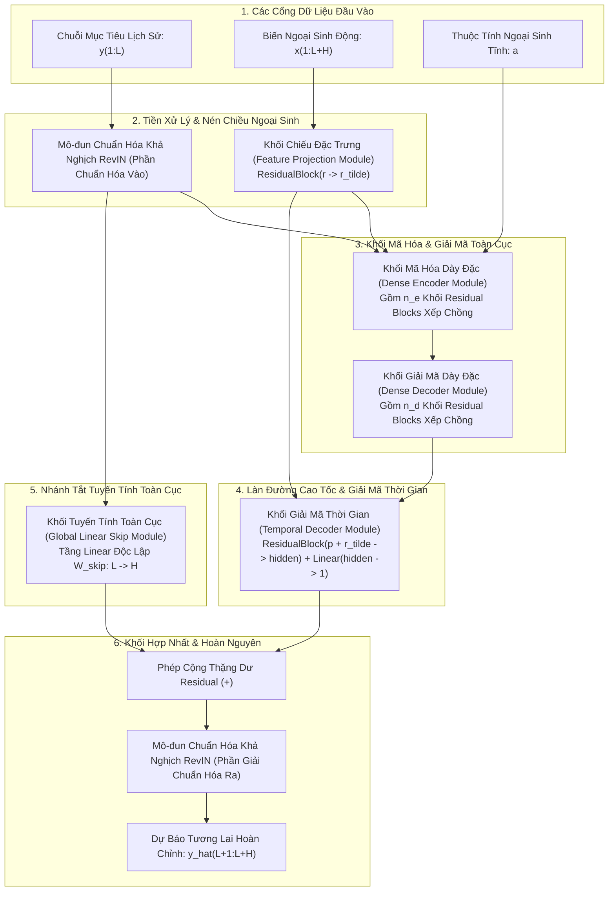
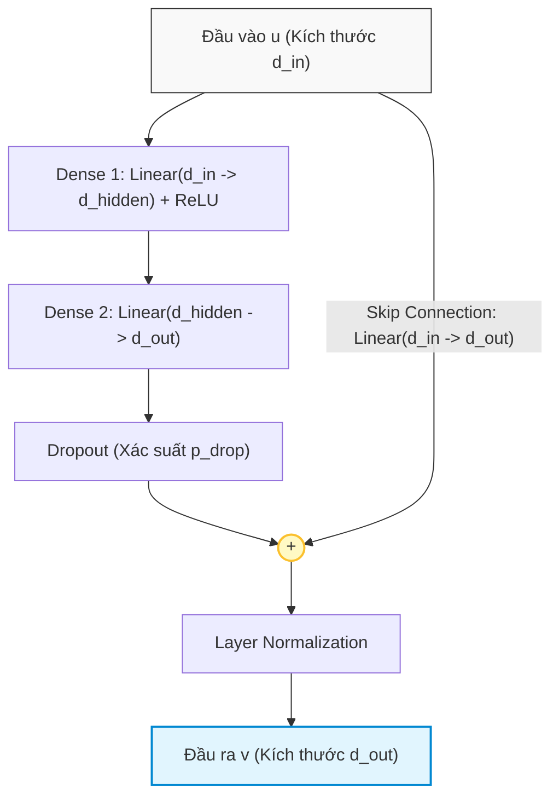

# PHẦN 1: SƠ ĐỒ KIẾN TRÚC TỔNG THỂ & GIẢI PHẪU KẾT CẤU TĨNH CỦA TiDE (STATIC ARCHITECTURE)

> [!NOTE]
> **Điều hướng tài liệu**: [🏠 Trang Chủ](../../README.md) • [📋 Sprint 1 README](./README.md) • [📜 Yêu Cầu Sprint](./requirement.md) • [📊 Checklist Tiến Độ](./checklist.md) • [🛡️ Tự Kiểm Chứng](./05_self_verification.md) • [➡️ Phần 2: Forward Pass](./02_forward_pass_walkthrough.md)  
> 👤 **Người thực hiện:** Hiệu  
> 🤖 **Trợ lý kỹ thuật:** Antigravity  
> 📄 **Tài liệu tham chiếu:** *Long-term Forecasting with TiDE: Time-series Dense Encoder* (Google Research, 2023) - Figure 1 & Section 4

---

## 🧭 Tôn Chỉ Thiết Kế: Bản Vẽ Kết Cấu Tĩnh (Static Blueprint)

Trong kỹ thuật phần mềm và Học sâu (Deep Learning):
* **Phần 1 (Tài liệu này)** đóng vai trò như **Bản vẽ thiết kế kết cấu phần cứng tĩnh**: Trả lời câu hỏi *"Mô hình gồm những linh kiện/mô-đun nào, bên trong từng linh kiện cấu tạo ra sao, ma trận trọng số có kích thước thế nào, và chúng được đấu nối với nhau ra sao trên không gian?"* (Tương ứng với hàm khởi tạo **`def __init__(self, ...):`** trong PyTorch).
* **Phần 2 ([02_forward_pass_walkthrough.md](./02_forward_pass_walkthrough.md))** đóng vai trò như **Quy trình vận hành động của dây chuyền sản xuất**: Trả lời câu hỏi *"Dữ liệu và Tensor di chuyển qua các linh kiện theo thứ tự nào, hình dạng tensor (shape) biến đổi ra sao qua từng dòng code?"* (Tương ứng với hàm thực thi **`def forward(self, y, x, a):`** trong PyTorch).

---

## 1. Sơ Đồ Kiến Trúc Gốc Của TiDE (Figure 1 từ Google Research)

Dưới đây là hình ảnh kiến trúc chính thức trích xuất trực tiếp từ **Trang 5 (Figure 1)** của bài báo khoa học gốc:

  

*Hình 1: Tổng quan sơ đồ kiến trúc của mô hình TiDE (Time-series Dense Encoder) gồm 5 khối mô-đun chính và cấu trúc chi tiết của khối cơ sở Residual Block (khung bên phải).*

---

### Sơ Đồ Khối Kiến Trúc Tổng Thể (Topology Sơ Đồ Khối)

---

## 2. Giải Phẫu Cấu Tạo Chi Tiết Từng Mô-Đun Tĩnh (Static Module Anatomy)

Toàn bộ mô hình TiDE được cấu thành từ **7 mô-đun tĩnh độc lập**. Dưới đây là giải phẫu chi tiết cấu trúc phần cứng, các lớp nơ-ron con và ma trận trọng số bên trong từng mô-đun:

---

### 🧩 Mô-Đun 1: Khối Nơ-ron Thặng Dư Cơ Sở (Residual Block - Khung Bên Phải Hình 1)

Nhóm tác giả khẳng định: **Khối Residual Block là viên gạch cơ sở duy nhất** được dùng để xây dựng nên toàn bộ các thành phần phức tạp của TiDE (Feature Projection, Encoder, Decoder, Temporal Decoder).

#### Cấu Tạo Nội Tại Của Khối:
1. **Nhánh Biến Đổi Phi Tuyến (Nonlinear Branch):**
   * **Tầng Tuyến Tính 1 (Dense 1):** Ma trận trọng số $W_1 \in \mathbb{R}^{d_{\text{hidden}} \times d_{\text{in}}}$, vector bias $b_1 \in \mathbb{R}^{d_{\text{hidden}}}$. Ánh xạ từ số chiều đầu vào $d_{\text{in}}$ lên không gian ẩn nội bộ $d_{\text{hidden}}$.
   * **Hàm Kích Hoạt Phi Tuyến ReLU:** Áp dụng phép cắt $\max(0, z)$ tạo tính phi tuyến và tính thưa thớt (sparsity) cho biểu diễn đặc trưng.
   * **Tầng Tuyến Tính 2 (Dense 2):** Ma trận trọng số $W_2 \in \mathbb{R}^{d_{\text{out}} \times d_{\text{hidden}}}$, vector bias $b_2 \in \mathbb{R}^{d_{\text{out}}}$. Ánh xạ từ không gian ẩn sang số chiều đầu ra mong muốn $d_{\text{out}}$.
   * **Tầng Dropout:** Ngắt ngẫu nhiên các kết nối với tỷ lệ $p_{\text{drop}} \in [0.1, 0.5]$ trong quá trình huấn luyện nhằm triệt tiêu hiện tượng nơ-ron đồng phụ thuộc (*co-adaptation*).
2. **Nhánh Tắt Bảo Tồn Tín Hiệu (Residual Skip Connection):**
   * Nếu $d_{\text{in}} \ne d_{\text{out}}$: Một ma trận chiếu tuyến tính $W_{\text{skip}} \in \mathbb{R}^{d_{\text{out}} \times d_{\text{in}}}$ (và bias $b_{\text{skip}}$) để đồng bộ số chiều.
   * Nếu $d_{\text{in}} = d_{\text{out}}$: Đường dẫn tắt danh tính trực tiếp (`nn.Identity()`), không tốn bất kỳ tham số nào.
3. **Phép Cộng Thặng Dư & Chuẩn Hóa Tầng (Addition & Layer Norm):**
   * Nút cộng tròn `(+)` thực hiện phép cộng dồn vector: $z = F(u) + \text{Skip}(u)$.
   * Lớp **Layer Normalization** có 2 tham số học được là scale $\gamma \in \mathbb{R}^{d_{\text{out}}}$ và shift $\beta \in \mathbb{R}^{d_{\text{out}}}$:
     $$
     v = \text{LayerNorm}(z) = \frac{z - \mathbb{E}[z]}{\sqrt{\text{Var}[z] + \epsilon}} \odot \gamma + \beta
     $$

---

### 🧩 Mô-Đun 2: Khối Chiếu Giảm Chiều Ngoại Sinh (Feature Projection Module)

* **Vị trí trong kiến trúc:** Đứng độc lập ở cổng tiếp nhận biến ngoại sinh động $x_{1:L+H}$.
* **Cấu tạo phần cứng:** Đúng **$1$ khối Residual Block cơ sở** với tham số cấu hình:
  * Số chiều đầu vào: $d_{\text{in}} = r$ (Số lượng biến ngoại sinh động thô ban đầu, ví dụ $r=7$ trên Electricity).
  * Số chiều đầu ra: $d_{\text{out}} = \tilde{r}$ (`temporalWidth`, ví dụ $\tilde{r}=4$).
  * Số chiều ẩn nội bộ: $d_{\text{hidden}} = \text{hiddenSize}$ (ví dụ $1024$).
* **Đặc tính kiến trúc cốt lõi:**
  * **Chia sẻ trọng số toàn thời gian (Time-Distributed Weight Sharing):** Cùng một khối nơ-ron này được áp dụng lặp đi lặp lại cho từng bước thời gian $t \in \{1, \dots, L+H\}$.
  * Bản chất tương đương một phép tích chập 1 chiều có kích thước bộ lọc bằng 1 ($1 \times 1\text{ Conv1D}$).
  * Giúp giảm kích thước lưu trữ tham số tới hơn $80\%$ mà không phụ thuộc vào độ dài cửa sổ $L+H$.

---

### 🧩 Mô-Đun 3: Khối Mã Hóa Dày Đặc (Dense Encoder Module)

* **Vị trí trong kiến trúc:** Trung tâm xử lý thông tin lịch sử và ngoại sinh toàn cục.
* **Cấu tạo phần cứng:** Gồm chuỗi **$n_e$ khối Residual Blocks xếp chồng liên tiếp** (`numEncoderLayers`, thường bằng $1$ hoặc $2$):
  * **Khối Encoder 1 (Cổng vào):** 
    * Số chiều đầu vào: $d_{\text{enc}} = L + (L+H)\tilde{r} + p_{\text{static}}$ (ví dụ: $720 + 816 \times 4 + 0 = 3,984$).
    * Số chiều đầu ra: $d_{\text{hidden}}$ (ví dụ $1024$).
  * **Khối Encoder $2 \dots n_e$ (Các khối ẩn tiếp theo):**
    * Số chiều đầu vào: $d_{\text{hidden}}$ ($1024$).
    * Số chiều đầu ra: $d_{\text{hidden}}$ ($1024$).
* **Nhiệm vụ kiến trúc:** Nén toàn bộ siêu vector bối cảnh $3,984$ chiều thành một vector bối cảnh ẩn duy nhất $e \in \mathbb{R}^{d_{\text{hidden}}}$.

---

### 🧩 Mô-Đun 4: Khối Giải Mã Dày Đặc (Dense Decoder Module)

* **Vị trí trong kiến trúc:** Nối tiếp ngay sau Dense Encoder.
* **Cấu tạo phần cứng:** Gồm chuỗi **$n_d$ khối Residual Blocks xếp chồng liên tiếp** (`numDecoderLayers`, thường bằng $1$ hoặc $2$):
  * **Khối Decoder $1 \dots (n_d - 1)$:**
    * Số chiều đầu vào: $d_{\text{hidden}}$ ($1024$).
    * Số chiều đầu ra: $d_{\text{hidden}}$ ($1024$).
  * **Khối Decoder cuối cùng ($n_d$ - Cổng ra bối cảnh tương lai):**
    * Số chiều đầu vào: $d_{\text{hidden}}$ ($1024$).
    * Số chiều đầu ra: Đúng bằng tích $H \cdot p$ (`decoderOutputDim`, ví dụ $96 \times 8 = 768$).
* **Nhiệm vụ kiến trúc:** Giải nén vector ẩn $e$ thành vector bối cảnh phẳng $g \in \mathbb{R}^{H \cdot p}$, sẵn sàng để cắt thành $H$ lát cắt bối cảnh cho tương lai.

---

### 🧩 Mô-Đun 5: Khối Giải Mã Theo Thời Gian (Temporal Decoder Module)

* **Vị trí trong kiến trúc:** Nằm ở giai đoạn tổng hợp cuối cùng trước khi xuất kết quả phi tuyến.
* **Cấu tạo phần cứng:** Gồm **$1$ khối Residual Block** kết hợp với **$1$ tầng chiếu tuyến tính (Projection Layer)**:
  * **Khối Residual Block con:**
    * Số chiều đầu vào: $d_{\text{in}} = p + \tilde{r}$ (Bối cảnh $p$ ghép với ngoại sinh tương lai $\tilde{r}$, ví dụ $8 + 4 = 12$).
    * Số chiều đầu ra: $d_{\text{out}} = d_{\text{hidden}}$ (hoặc một số chiều ẩn trung gian $d_{\text{temp}}$, thường thiết lập bằng $p$ hoặc $\text{hiddenSize}$).
  * **Tầng Tuyến Tính Đầu Ra (Linear Output Layer):**
    * `nn.Linear(d_out, 1)`: Ánh xạ từ vector đặc trưng về đúng $1$ con số vô hướng duy nhất đại diện cho dự báo tại bước thời gian đó.
* **Đặc tính kiến trúc:** Chia sẻ trọng số cho toàn bộ $H$ bước thời gian tương lai, đảm bảo tính bất biến tịnh tiến theo thời gian.

---

### 🧩 Mô-Đun 6: Nhánh Tắt Tuyến Tính Toàn Cục (Global Linear Skip Connection Module)

* **Vị trí trong kiến trúc:** Đi song song, bắc cầu trực tiếp từ đầu vào chuỗi lịch sử $y_{1:L}$ sang đầu ra tương lai $\hat{y}_{L+1:L+H}$.
* **Cấu tạo phần cứng:** Đúng **$1$ tầng tuyến tính đơn lẻ (`nn.Linear`)**:
  * Ma trận trọng số: $W_{\text{skip}} \in \mathbb{R}^{H \times L}$ (ví dụ kích thước $96 \times 720$).
  * Vector bias: $b_{\text{skip}} \in \mathbb{R}^H$ (kích thước $96$).
  * Hoàn toàn không có hàm kích hoạt phi tuyến (No Activation), không có Dropout.
* **Vai trò chiến lược:** Đóng vai trò là một mô hình tuyến tính tự hồi quy thuần túy (tương tự như DLinear), gánh vác toàn bộ việc học xu hướng nền (trend) và quan hệ tuyến tính, giải phóng gánh nặng cho mạng MLP sâu.

---

### 🧩 Mô-Đun 7: Khối Chuẩn Hóa Thực Thể Khả Nghịch (RevIN Module)

* **Vị trí trong kiến trúc:** Đặt tại 2 cửa ngõ: Cổng vào (chuẩn hóa chuỗi lịch sử $y$) và Cổng ra (giải chuẩn hóa kết quả dự báo $\hat{y}$).
* **Cấu tạo phần cứng:**
  * Tham số học được (Affine parameters - tùy chọn): Scale $\gamma_{\text{revin}} \in \mathbb{R}^1$ và Bias $\beta_{\text{revin}} \in \mathbb{R}^1$.
  * Bộ nhớ đệm không học (Non-trainable Buffers): Thanh ghi lưu trữ tạm thời giá trị kỳ vọng $\mu$ và độ lệch chuẩn $\sigma$ của từng mẫu trong batch.

---

## 3. Bảng Tổng Hợp Tham Số & Khai Báo Trong `__init__()` (PyTorch Specification)

Dưới đây là bảng đặc tả cấu trúc phần cứng của toàn bộ mô hình TiDE khi được khởi tạo trong bộ nhớ GPU, tính toán trên bộ siêu tham số tiêu chuẩn của bộ dữ liệu **Electricity** ($L=720, H=96, r=7, \tilde{r}=4, p=8, d_{\text{hidden}}=1024, n_e=2, n_d=2$):

| Tên Mô-Đun / Lớp | Kiểu Lớp PyTorch | Kích Thước Trọng Số ($W$) | Kích Thước Bias ($b$) | Số Lượng Tham Số (Trainable Params) | Vai Trò Kiến Trúc |
|:---|:---|:---:|:---:|:---:|:---|
| **`feature_projection`** | `ResidualBlock` | Dense 1: $(1024, 7)$ Dense 2: $(4, 1024)$ Skip: $(4, 7)$ | $b_1: (1024)$ $b_2: (4)$ $b_{\text{skip}}: (4)$ | $\approx 12,324$ | Nén số chiều ngoại sinh $r=7 \to \tilde{r}=4$ độc lập từng bước thời gian. |
| **`encoder.block_0`** | `ResidualBlock` | Dense 1: $(1024, 3984)$ Dense 2: $(1024, 1024)$ Skip: $(1024, 3984)$ | $b_1: (1024)$ $b_2: (1024)$ $b_{\text{skip}}: (1024)$ | $\approx 9,216,000$ | Nhận siêu vector $3,984$ chiều, chiếu vào không gian ẩn $1024$. |
| **`encoder.block_1`** | `ResidualBlock` | Dense 1: $(1024, 1024)$ Dense 2: $(1024, 1024)$ Skip: Identity | $b_1: (1024)$ $b_2: (1024)$ Không có bias | $\approx 2,099,200$ | Trích xuất tương tác phi tuyến sâu giữa các thành phần bối cảnh. |
| **`decoder.block_0`** | `ResidualBlock` | Dense 1: $(1024, 1024)$ Dense 2: $(1024, 1024)$ Skip: Identity | $b_1: (1024)$ $b_2: (1024)$ Không có bias | $\approx 2,099,200$ | Tái cấu trúc thông tin tiềm ẩn của chuỗi. |
| **`decoder.block_1`** | `ResidualBlock` | Dense 1: $(1024, 1024)$ Dense 2: $(768, 1024)$ Skip: $(768, 1024)$ | $b_1: (1024)$ $b_2: (768)$ $b_{\text{skip}}: (768)$ | $\approx 2,624,000$ | Ánh xạ về không gian bối cảnh tương lai $H \cdot p = 96 \times 8 = 768$. |
| **`temporal_decoder`** | `ResidualBlock` + `Linear` | ResBlock: $(1024, 12) \dots$ Output Linear: $(1, 1024)$ | $b_{\text{res}} \dots$ $b_{\text{out}}: (1)$ | $\approx 100,000$ | Ghép bối cảnh $p$ với ngoại sinh tương lai $\tilde{x}$, dự báo phi tuyến $\hat{y}_{\text{NL}}$. |
| **`linear_skip`** | `nn.Linear` | $(96, 720)$ | $(96)$ | $96 \times 720 + 96 = \mathbf{69,216}$ | Nhánh tắt tuyến tính trực tiếp từ $L$ bước quá khứ sang $H$ bước tương lai. |
| **`revin`** | `RevIN` | $\gamma: (1)$ | $\beta: (1)$ | $2$ (hoặc $0$ nếu cố định) | Chuẩn hóa cục bộ và giải chuẩn hóa chống trôi phân phối. |
| **TỔNG CỘNG** | **Toàn Bộ TiDE** | — | — | $\mathbf{\approx 16.2\text{ Triệu Tham Số}}$ | Toàn bộ mô hình chạy thuần MLP siêu tốc $O(L + H)$. |

---

## 4. Bảng Tra Cứu Toàn Bộ Ký Hiệu Xuất Hiện Trong Hình 1 (Figure 1)

| Ký Hiệu Trong Hình | Tên Linh Kiện / Khối | Định Nghĩa Kiến Trúc | Số Chiều / Kích Thước Toán Học |
|:--- |:--- |:--- |:---:|
| **$y_{1:L}$** | **Lookback Series** | Cổng tiếp nhận chuỗi lịch sử mục tiêu $L$ bước quá khứ. | $\mathbb{R}^L$ |
| **$x_{1:L+H}$** | **Dynamic Covariates** | Cổng tiếp nhận ma trận ngoại sinh biến thiên theo thời gian. | $\mathbb{R}^{(L+H) \times r}$ |
| **$a$** | **Static Attributes** | Cổng tiếp nhận vector thuộc tính tĩnh không đổi theo thời gian. | $\mathbb{R}^{p_{\text{static}}}$ |
| **$\tilde{x}_{1:L+H}$** | **Projected Covariates** | Ngõ ra của khối Feature Projection sau khi nén đặc trưng. | $\mathbb{R}^{(L+H) \times \tilde{r}}$ |
| **$e$** | **Context Embedding** | Ngõ ra của khối Dense Encoder, biểu diễn trừu tượng toàn cục của chuỗi. | $\mathbb{R}^{d_{\text{hidden}}}$ |
| **$g$** | **Decoded Flat Vector** | Ngõ ra của khối Dense Decoder trước khi bẻ thành ma trận. | $\mathbb{R}^{H \cdot p}$ |
| **$d_{L+1:L+H}$** | **Decoded Matrix $D$** | Ma trận gồm $H$ hàng, mỗi hàng là một vector bối cảnh tương lai $d_t$. | $\mathbb{R}^{H \times p}$ |
| **$\tilde{x}_{L+1:L+H}$** | **Future Covariates** | Nhánh ngoại sinh tương lai đưa thẳng vào cổng Temporal Decoder. | $\mathbb{R}^{H \times \tilde{r}}$ |
| **$\hat{y}_{\text{NL}}$** | **Nonlinear Prediction** | Đầu ra dự báo của nhánh phi tuyến (từ Temporal Decoder). | $\mathbb{R}^H$ |
| **$\hat{y}_{\text{Lin}}$** | **Linear Prediction** | Đầu ra dự báo của nhánh tuyến tính (từ Global Linear Skip). | $\mathbb{R}^H$ |
| **$\hat{y}_{L+1:L+H}$** | **Final Prediction** | Kết quả dự báo tương lai cuối cùng xuất ra khỏi mô hình. | $\mathbb{R}^H$ |
| **$n_e, n_d$** | **Layer Counts** | Số lượng khối Residual Block xếp chồng trong Encoder và Decoder. | $1$ hoặc $2$ |

---

> [!IMPORTANT]
> **Chuyển giao sang Phần 2**:  
> Bạn vừa hoàn thành việc nắm vững **Bản vẽ thiết kế kết cấu tĩnh** của toàn bộ mô hình TiDE.  
> Để xem cách các tensor thực tế được bơm vào các cổng này, di chuyển qua từng tầng nơ-ron tuần tự theo thời gian và biến đổi hình dạng (shape) ra sao ở từng dòng code PyTorch, hãy chuyển tiếp sang:  
> 👉 **[PHẦN 2: GIẢI PHẪU DÒNG CHẢY DỮ LIỆU ĐỘNG FORWARD PASS (DYNAMIC RUNTIME EXECUTION)](./02_forward_pass_walkthrough.md)**.
