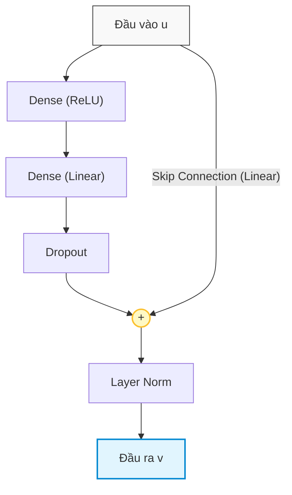

# PHẦN 1: SƠ ĐỒ KIẾN TRÚC GỐC & GIẢI PHẪU CHI TIẾT QUY TRÌNH HOẠT ĐỘNG CỦA TiDE

> [!NOTE]
> **Điều hướng tài liệu**: [🏠 Trang Chủ](../../README.md) • [📋 Sprint 1 README](./README.md) • [📜 Yêu Cầu Sprint](./requirement.md) • [📊 Checklist Tiến Độ](./checklist.md) • [🛡️ Tự Kiểm Chứng](./05_self_verification.md)  
> 👤 **Người thực hiện:** Hiệu  
> 🤖 **Trợ lý kỹ thuật:** Antigravity  
> 📄 **Tài liệu tham chiếu:** *Long-term Forecasting with TiDE: Time-series Dense Encoder* (Google Research, 2023) - Trang 5, Figure 1 & Section 4

---

## 1. Sơ Đồ Kiến Trúc Gốc Của TiDE (Figure 1 từ Google Research)

Dưới đây là hình ảnh kiến trúc chính thức trích xuất trực tiếp từ **Trang 5 (Figure 1)** của bài báo khoa học gốc:

<p align="center">
  
</p>

*Hình 1: Tổng quan sơ đồ kiến trúc luồng dữ liệu của mô hình TiDE (Time-series Dense Encoder) và cấu trúc chi tiết của khối Residual Block cơ sở (khung bên phải).*

---

## 2. Trái Tim Của Mô Hình: Cấu Tạo Khối Residual Block (Khung Bên Phải)

Trước khi đi sâu vào từng giai đoạn xử lý, nhóm tác giả Google Research khẳng định một nguyên lý cốt lõi: **TiDE hoàn toàn không sử dụng cơ chế Attention phức tạp hay mạng hồi quy tuần tự (RNN/LSTM), mà xây dựng toàn bộ mô hình dựa trên các khối Residual Block (Khối Thặng Dư) đa tầng xếp chồng**.

### 2.1. Sơ đồ khối Residual Block (Tiếng Việt Chuẩn)



```
              ┌─────────────────────────────────┐
              │           Layer Norm            │
              └────────────────┬────────────────┘
                               ▲
                              ( + ) <─── [Skip Connection (Linear)] ──┐
                               ▲                                      │
              ┌────────────────┴────────────────┐                     │
              │             Dropout             │                     │
              └────────────────▲────────────────┘                     │
                               │                                      │
              ┌────────────────┴────────────────┐                     │
              │         Dense (Linear)          │                     │
              └────────────────▲────────────────┘                     │
                               │                                      │
              ┌────────────────┴────────────────┐                     │
              │          Dense (ReLU)           │                     │
              └────────────────▲────────────────┘                     │
                               │                                      │
                        [ Đầu vào u ] ────────────────────────────────┘
```

### 2.2. Phân tích chi tiết 3 thành phần bên trong khối Residual Block

**Thành phần 1: Tuyến biến đổi phi tuyến chính (Main Nonlinear Branch):**

Tầng **Dense (ReLU)** chiếu tuyến tính từ không gian vector đầu vào $u \in \mathbb{R}^{d_{\text{in}}}$ lên không gian ẩn nội bộ $h \in \mathbb{R}^{d_{\text{hidden}}}$, sau đó kích hoạt phi tuyến qua hàm ReLU:

$$
\text{ReLU}(z) = \max(0, z)
$$

Thao tác này cho phép mô hình bẻ cong không gian, học được các quy luật phi tuyến tính phức tạp tiềm ẩn giữa các chuỗi dữ liệu.

Tiếp theo, tầng **Dense (Linear)** ánh xạ tuyến tính từ không gian ẩn $d_{\text{hidden}}$ sang số chiều đầu ra mong muốn $d_{\text{out}}$. Tầng này đóng vai trò tổng hợp các đặc trưng đã được kích hoạt.

Cuối cùng, tầng **Dropout** ngắt ngẫu nhiên một tỷ lệ kết nối (ví dụ $p_{\text{drop}} = 0.3 - 0.5$) trong quá trình huấn luyện nhằm triệt tiêu sự phụ thuộc đồng thích nghi (*co-adaptation*) giữa các nơ-ron, giúp mô hình có tính khái quát hóa cực cao và chống hiện tượng học vẹt (*overfitting*).

**Thành phần 2: Nhánh tắt bảo tồn tín hiệu (Residual Skip Connection):**

Ánh xạ trực tiếp từ vector đầu vào $u$ tới điểm cộng thặng dư. Nếu số chiều $d_{\text{in}} \ne d_{\text{out}}$, một ma trận chiếu tuyến tính $W_{\text{proj}}$ sẽ được áp dụng:

$$
u_{\text{skip}} = W_{\text{proj}} u
$$

Cơ chế Skip Connection đóng vai trò then chốt: tạo ra một "đường cao tốc" cho gradient lan truyền ngược mà không bị suy giảm theo cấp số nhân (*Vanishing Gradient*), cho phép huấn luyện các mạng MLP sâu từ 2 đến 4 tầng một cách ổn định tuyệt đối.

**Thành phần 3: Phép cộng thặng dư và Chuẩn hóa tầng (Addition & Layer Norm):**

Tại nút tròn `(+)`, mô hình thực hiện cộng trực tiếp vector kết quả của nhánh phi tuyến với vector của nhánh skip:

$$
v = \text{Dropout}\left(\text{Dense}_{\text{Linear}}(\text{ReLU}(\text{Dense}_{\text{ReLU}}(u)))\right) + u_{\text{skip}}
$$

Sau đó, lớp **Layer Normalization (Layer Norm)** chuẩn hóa giá trị trung bình về $0$ và phương sai về $1$ trên toàn bộ chiều đặc trưng của từng mẫu:

$$
\text{LayerNorm}(v) = \frac{v - \mathbb{E}[v]}{\sqrt{\text{Var}[v] + \epsilon}} \odot \gamma + \beta
$$

Kỹ thuật này giữ cho phân phối tín hiệu đầu ra của mỗi khối luôn nằm trong miền giá trị tối ưu, không bị trôi dạt phân phối nội tại (*Internal Covariate Shift*).

---

## 3. Giải Phẫu Chi Tiết Quy Trình Hoạt Động Theo Từng Giai Đoạn (8 Giai Đoạn)

Toàn bộ quy trình xử lý dữ liệu của TiDE từ dưới lên trên được chuẩn hóa thành **8 giai đoạn nối tiếp nhau**. Mỗi giai đoạn đều tuân thủ cấu trúc 3 phần chặt chẽ: **1. Input (Đầu vào)**, **2. Công thức xử lý**, và **3. Output (Đầu ra)**.

> [!NOTE]
> Các ví dụ tính toán kích thước tensor cụ thể dưới đây được lấy theo cấu hình chuẩn của bài báo (bộ dữ liệu Electricity):  
> Batch size `B = 32`, Chiều dài lịch sử `L = 720`, Cửa sổ dự báo `H = 96`, Số biến ngoại sinh động thô `r = 7`, Số chiều ngoại sinh nén `r_tilde = 4`, Kích thước bối cảnh giải mã `p = 8`, Kích thước ẩn `hidden_size = 1024`.

---

### 🟢 Giai Đoạn 1: Tiếp Nhận Dữ Liệu & Chuẩn Hóa Khả Nghịch (RevIN Normalization)

#### 📥 1. Input (Đầu vào)

Mô hình tiếp nhận 3 nguồn dữ liệu độc lập của chuỗi thời gian thứ $i$ trong một batch gồm `B = 32` mẫu:

* **Chuỗi lịch sử mục tiêu (Lookback Series):** Ký hiệu là $y_{1:L}^{(i)} \in \mathbb{R}^L$. Đây là dữ liệu quá khứ thực tế của đại lượng cần dự báo (ví dụ lượng điện tiêu thụ trong 720 giờ qua).  
  Kích thước tensor: `(B, L) = (32, 720)`
* **Biến ngoại sinh động toàn thời gian (Dynamic Covariates):** Ký hiệu là $x_{1:L+H}^{(i)} \in \mathbb{R}^{(L+H) \times r}$. Bao gồm các đặc trưng biến thiên theo thời gian đã biết trước cho cả quá khứ lẫn tương lai (ví dụ: giờ trong ngày, ngày trong tuần, tháng trong năm, cờ ngày lễ).  
  Kích thước tensor: `(B, L + H, r) = (32, 816, 7)`
* **Thuộc tính tĩnh (Static Attributes):** Ký hiệu là $a^{(i)} \in \mathbb{R}^{p_{\text{static}}}$. Đại diện cho các thông tin định danh không đổi theo thời gian của thực thể (ví dụ: mã khách hàng, loại hợp đồng, vị trí địa lý).  
  Kích thước tensor: `(B, p_static)` (với bài toán không có biến tĩnh, kích thước là `(32, 0)`).

#### ⚙️ 2. Công thức xử lý

Trong chuỗi thời gian thực tế, dữ liệu thường xuyên gặp hiện tượng thay đổi xu hướng, biến động biên độ theo mùa vụ, gây ra **trôi dạt phân phối (Distribution Shift)** giữa tập huấn luyện và thực tế. TiDE giải quyết triệt để vấn đề này bằng cơ chế **Chuẩn hóa Khả nghịch (Reversible Instance Normalization - RevIN)**.

**Bước 1: Tính toán kỳ vọng và độ lệch chuẩn của từng chuỗi:**

$$
\mu^{(i)} = \frac{1}{L} \sum_{t=1}^L y_t^{(i)}
$$

$$
\sigma^{(i)} = \sqrt{\frac{1}{L} \sum_{t=1}^L \left( y_t^{(i)} - \mu^{(i)} \right)^2 + \epsilon}
$$

*(Trong đó $\epsilon = 10^{-5}$ là hằng số cực nhỏ nhằm ngăn chặn lỗi chia cho 0).*

**Bước 2: Chuẩn hóa chuỗi thời gian về phân phối chuẩn:**

$$
y_{\text{norm}, t}^{(i)} = \frac{y_t^{(i)} - \mu^{(i)}}{\sigma^{(i)}} \quad \forall t \in \{1, 2, \dots, L\}
$$

**Ý nghĩa kỹ thuật:** Phép chuẩn hóa này được thực hiện độc lập trên từng chuỗi con (per-instance), giúp đưa mọi chuỗi về mức trung bình bằng 0 và độ biến thiên bằng 1. Hai giá trị thống kê $(\mu^{(i)}, \sigma^{(i)})$ được tách riêng và đưa vào bộ nhớ tạm để tái sử dụng ở Giai đoạn 8.

#### 📤 3. Output (Đầu ra)

* Chuỗi lịch sử đã được chuẩn hóa: $y_{\text{norm}, 1:L}^{(i)} \in \mathbb{R}^L$  
  Kích thước tensor: `(B, L) = (32, 720)`
* Bộ tham số thống kê lưu tạm thời: $\mu, \sigma \in \mathbb{R}^{B \times 1}$  
  Kích thước tensor: `(32, 1)`

---

### 🟢 Giai Đoạn 2: Chiếu Giảm Chiều Ngoại Sinh (Feature Projection per Time-Step)

#### 📥 1. Input (Đầu vào)

* Ma trận biến ngoại sinh động toàn thời gian từ quá khứ đến tương lai: $x_{1:L+H}^{(i)} \in \mathbb{R}^{(L+H) \times r}$  
  Kích thước tensor: `(B, L + H, r) = (32, 816, 7)`

#### ⚙️ 2. Công thức xử lý

Tại mỗi bước thời gian $t$, dữ liệu ngoại sinh có $r = 7$ đặc trưng. Nếu trải phẳng trực tiếp $(L+H) \times r = 816 \times 7 = 5,712$ chiều, mô hình sẽ gặp hiện tượng bùng nổ số lượng tham số (*Curse of Dimensionality*).

Do đó, TiDE áp dụng một khối Residual Block nhỏ (gọi là **Feature Projection**) để nén độc lập các đặc trưng tại từng bước thời gian:

$$
\tilde{x}_t^{(i)} = \text{ResidualBlock}_{\text{proj}}\left(x_t^{(i)}\right) \in \mathbb{R}^{\tilde{r}} \quad \forall t \in \{1, 2, \dots, L+H\}
$$

**Đặc điểm kiến trúc:**
* Số chiều được nén từ $r = 7$ xuống $\tilde{r} = 4$ (`temporalWidth = 4`).
* Phép biến đổi này chia sẻ trọng số (*weight-shared*) trên toàn bộ $L+H = 816$ bước thời gian, hoạt động tương tự như một mạng tích chập 1D với kích thước kernel bằng 1 ($1 \times 1$ Convolution).
* Giúp chắt lọc những tín hiệu tương quan cao nhất từ các biến ngoại sinh, loại bỏ nhiễu dư thừa trước khi đưa vào bộ mã hóa dày đặc.

#### 📤 3. Output (Đầu ra)

* Ma trận biến ngoại sinh đã được nén đặc trưng: $\tilde{x}_{1:L+H}^{(i)} \in \mathbb{R}^{(L+H) \times \tilde{r}}$  
  Kích thước tensor: `(B, L + H, r_tilde) = (32, 816, 4)`

---

### 🟢 Giai Đoạn 3: Trải Phẳng (Flatten) & Ghép Nối Không Gian (Concatenation)

#### 📥 1. Input (Đầu vào)

Gồm 3 thành phần thông tin độc lập đã được xử lý sơ bộ:
* Chuỗi lịch sử đã chuẩn hóa: $y_{\text{norm}, 1:L}^{(i)} \in \mathbb{R}^L$ với kích thước `(32, 720)`
* Ma trận ngoại sinh động đã nén: $\tilde{x}_{1:L+H}^{(i)} \in \mathbb{R}^{(L+H) \times \tilde{r}}$ với kích thước `(32, 816, 4)`
* Vector thuộc tính tĩnh: $a^{(i)} \in \mathbb{R}^{p_{\text{static}}}$ với kích thước `(32, p_static)`

#### ⚙️ 2. Công thức xử lý

Để mạng nơ-ron MLP có thể học được mối tương quan chéo giữa mọi thời điểm trong quá khứ với mọi thuộc tính ngoại sinh, TiDE tiến hành duỗi thẳng và ghép nối dữ liệu theo trục đặc trưng.

**Bước 1: Trải phẳng ma trận ngoại sinh động (Flatten):**

Ma trận ngoại sinh 2D kích thước $(L+H) \times \tilde{r}$ được duỗi thẳng thành một vector 1D:

$$
\text{vec}\left(\tilde{x}_{1:L+H}^{(i)}\right) = \left[ \tilde{x}_{1, 1}^{(i)}, \dots, \tilde{x}_{1, \tilde{r}}^{(i)}, \dots, \tilde{x}_{L+H, 1}^{(i)}, \dots, \tilde{x}_{L+H, \tilde{r}}^{(i)} \right]^T \in \mathbb{R}^{(L+H)\tilde{r}}
$$

Độ dài của vector phẳng: `(720 + 96) * 4 = 816 * 4 = 3,264` phần tử.

**Bước 2: Ghép nối không gian (Feature Concatenation):**

Ghép nối liên tiếp chuỗi lịch sử, vector ngoại sinh phẳng và vector thuộc tính tĩnh thành một siêu vector duy nhất:

$$
u_{\text{enc}}^{(i)} = \begin{bmatrix} y_{\text{norm}, 1:L}^{(i)} \\ \text{vec}\left(\tilde{x}_{1:L+H}^{(i)}\right) \\ a^{(i)} \end{bmatrix} \in \mathbb{R}^{L + (L+H)\tilde{r} + p_{\text{static}}}
$$

Tổng số chiều đầu vào: `720 + 3,264 + 0 = 3,984` chiều.

**Ý nghĩa thiết kế:** Không giống như Transformer phải giữ nguyên cấu trúc ma trận tuần tự để tính Attention với độ phức tạp $O(L^2)$, việc duỗi phẳng trong TiDE cho phép tầng Linear tiếp theo tiếp cận đồng thời toàn bộ không-thời gian với độ phức tạp tuyến tính $O(L)$.

#### 📤 3. Output (Đầu ra)

* Siêu vector đặc trưng tổng hợp: $u_{\text{enc}}^{(i)} \in \mathbb{R}^{3984}$  
  Kích thước tensor: `(B, dim_enc) = (32, 3984)`

---

### 🟢 Giai Đoạn 4: Mã Hóa Toàn Cục (Dense Encoder)

#### 📥 1. Input (Đầu vào)

* Siêu vector đặc trưng tổng hợp: $u_{\text{enc}}^{(i)} \in \mathbb{R}^{L + (L+H)\tilde{r} + p_{\text{static}}}$  
  Kích thước tensor: `(B, 3984)`

#### ⚙️ 2. Công thức xử lý

Siêu vector $u_{\text{enc}}^{(i)}$ được đẩy qua bộ mã hóa **Dense Encoder** gồm $n_e$ khối Residual Block xếp chồng liên tiếp (`numEncoderLayers = 2` trên Electricity):

$$
e_1^{(i)} = \text{ResidualBlock}_{\text{enc}, 1}\left(u_{\text{enc}}^{(i)}\right)
$$

$$
e^{(i)} = \text{ResidualBlock}_{\text{enc}, n_e}\left(e_{n_e-1}^{(i)}\right) \in \mathbb{R}^{d_{\text{hidden}}}
$$

**Bản chất xử lý:**
* Mỗi khối Residual Block chiếu thông tin qua không gian ẩn `hidden_size = 1024`.
* Nhờ các phép nhân ma trận dày đặc kết hợp phi tuyến ReLU, Encoder tổng hợp toàn bộ thông tin lịch sử $L$ bước, các xu hướng tương lai $H$ bước của biến ngoại sinh, và thuộc tính tĩnh $a^{(i)}$ thành một vector biểu diễn tri thức toàn cục duy nhất $e^{(i)}$ (*Context Embedding*).
* Mọi sự tương quan đa biến và phụ thuộc xa (*Long-term dependencies*) đều được nén trọn vẹn vào vector $e^{(i)}$ này.

#### 📤 3. Output (Đầu ra)

* Vector bối cảnh ẩn toàn cục: $e^{(i)} \in \mathbb{R}^{d_{\text{hidden}}}$  
  Kích thước tensor: `(B, hidden_size) = (32, 1024)`

---

### 🟢 Giai Đoạn 5: Giải Mã Dày Đặc & Tái Cấu Trúc Thời Gian (Dense Decoder & Unflatten)

#### 📥 1. Input (Đầu vào)

* Vector bối cảnh ẩn toàn cục: $e^{(i)} \in \mathbb{R}^{d_{\text{hidden}}}$  
  Kích thước tensor: `(B, 1024)`

#### ⚙️ 2. Công thức xử lý

Giai đoạn này đảm nhận nhiệm vụ chuyển đổi từ biểu diễn trừu tượng $1024$ chiều thành ma trận đặc trưng đại diện cho từng bước trong cửa sổ dự báo tương lai $H$.

**Bước 1: Giải mã dày đặc qua các tầng Residual Block (Dense Decoder):**

Vector $e^{(i)}$ được giải mã qua chuỗi $n_d$ khối Residual Block (`numDecoderLayers = 2`):

$$
g^{(i)} = \text{DenseDecoder}\left(e^{(i)}\right) \in \mathbb{R}^{H \cdot p}
$$

Trong đó, khối cuối cùng có số chiều đầu ra được thiết lập chính xác bằng tích $H \cdot p = 96 \times 8 = 768$.

**Bước 2: Tái cấu trúc ma trận (Unflatten / Reshape):**

Vector phẳng $g^{(i)}$ được bẻ thành ma trận 2D gồm đúng $H = 96$ hàng, mỗi hàng là một vector đặc trưng bối cảnh tương lai $d_t^{(i)}$ có độ dài $p = 8$:

$$
D^{(i)} = \text{Reshape}\left(g^{(i)}, (H, p)\right) = \begin{bmatrix} d_{L+1}^{(i)} \\ d_{L+2}^{(i)} \\ \vdots \\ d_{L+H}^{(i)} \end{bmatrix} \in \mathbb{R}^{H \times p}
$$

**Ý nghĩa:** Mỗi vector $d_t^{(i)} \in \mathbb{R}^p$ đại diện cho trạng thái nội tại được mô hình dự đoán riêng cho mốc thời gian tương lai thứ $t$.

#### 📤 3. Output (Đầu ra)

* Ma trận đặc trưng bối cảnh tương lai: $D^{(i)} \in \mathbb{R}^{H \times p}$  
  Kích thước tensor: `(B, H, p) = (32, 96, 8)`

---

### 🟢 Giai Đoạn 6: Làn Đường Cao Tốc & Giải Mã Thời Gian (Temporal Decoder)

#### 📥 1. Input (Đầu vào)

Tại mỗi bước thời gian tương lai $t \in \{L+1, L+2, \dots, L+H\}$, mô hình kết hợp 2 nguồn tín hiệu:
* Vector bối cảnh tương lai từ Dense Decoder: $d_t^{(i)} \in \mathbb{R}^p$ với kích thước `(32, 8)`
* Vector biến ngoại sinh của chính bước thời gian tương lai đó: $\tilde{x}_t^{(i)} \in \mathbb{R}^{\tilde{r}}$ với kích thước `(32, 4)`

#### ⚙️ 2. Công thức xử lý

Đây chính là cơ chế **"Highway" (Làn đường cao tốc)** độc đáo bậc nhất của TiDE. Trong khi bối cảnh lịch sử phải đi một chặng đường dài qua Encoder và Decoder, thông tin ngoại sinh tương lai được cấp thẳng tới cửa ngõ đầu ra.

**Bước 1: Xếp chồng đặc trưng tại từng bước (Feature Concatenation):**

Ghép nối vector bối cảnh với vector ngoại sinh tương lai:

$$
\text{Input}_{\text{temp}, t}^{(i)} = \begin{bmatrix} d_t^{(i)} \\ \tilde{x}_t^{(i)} \end{bmatrix} \in \mathbb{R}^{p + \tilde{r}}
$$

Kích thước vector ghép tại mỗi bước: `p + r_tilde = 8 + 4 = 12` chiều.

**Bước 2: Dự báo phi tuyến qua khối Temporal Decoder:**

Áp dụng một khối Residual Block độc lập ánh xạ từ $(p + \tilde{r}) = 12$ chiều về đúng $1$ giá trị vô hướng:

$$
\hat{y}_{\text{NL}, t}^{(i)} = \text{TemporalDecoder}\left( \begin{bmatrix} d_t^{(i)} \\ \tilde{x}_t^{(i)} \end{bmatrix} \right) \in \mathbb{R} \quad \forall t \in \{L+1, \dots, L+H\}
$$

Tập hợp kết quả của toàn bộ $H$ bước tạo thành vector dự báo phi tuyến:

$$
\hat{y}_{\text{NL}}^{(i)} = \left[ \hat{y}_{\text{NL}, L+1}^{(i)}, \hat{y}_{\text{NL}, L+2}^{(i)}, \dots, \hat{y}_{\text{NL}, L+H}^{(i)} \right]^T \in \mathbb{R}^H
$$

**Tại sao cơ chế này vượt trội?**  
Nếu ngày mai là ngày lễ hoặc một đợt rét đột xuất, thông tin đó xuất hiện trực tiếp trong $\tilde{x}_{L+1}^{(i)}$. Việc đưa trực tiếp vào Temporal Decoder giúp mô hình điều chỉnh ngay lập tức giá trị dự báo mà không bị tiêu hao hay làm mờ qua các tầng biểu diễn trừu tượng.

#### 📤 3. Output (Đầu ra)

* Vector dự báo phi tuyến: $\hat{y}_{\text{NL}}^{(i)} \in \mathbb{R}^H$  
  Kích thước tensor: `(B, H) = (32, 96)`

---

### 🟢 Giai Đoạn 7: Nhánh Tắt Tuyến Tính Toàn Cục (Global Linear Skip Connection)

#### 📥 1. Input (Đầu vào)

* Chuỗi lịch sử đã chuẩn hóa ban đầu: $y_{\text{norm}, 1:L}^{(i)} \in \mathbb{R}^L$  
  Kích thước tensor: `(B, L) = (32, 720)`

#### ⚙️ 2. Công thức xử lý

Song song với toàn bộ hệ thống mạng nơ-ron sâu phức tạp ở các giai đoạn 2 đến 6, TiDE thiết lập một đường truyền tắt tuyến tính trực tiếp (lấy cảm hứng từ mô hình DLinear):

$$
\hat{y}_{\text{Lin}}^{(i)} = W_{\text{skip}} \cdot y_{\text{norm}, 1:L}^{(i)} + b_{\text{skip}} \in \mathbb{R}^H
$$

Trong đó:
* $W_{\text{skip}} \in \mathbb{R}^{H \times L}$ là ma trận trọng số kích thước $(96, 720)$.
* $b_{\text{skip}} \in \mathbb{R}^H$ là vector hệ số tự do (bias) kích thước $96$.

**Vai trò phối hợp:**  
Chuỗi thời gian thực tế luôn bao gồm hai thành phần: **Xu hướng cơ bản (Trend/Autoregression)** và **Dao động phi tuyến phức tạp (Nonlinear Dynamics)**.  
* Nhánh tuyến tính này phụ trách riêng việc mô hình hóa quan hệ tự hồi quy trực tiếp và xu hướng trơn giữa quá khứ và tương lai.
* Điều này giải phóng mạng Dense Encoder-Decoder sâu, giúp nó tập trung 100% năng lực để học các mẫu hình phi tuyến và tương quan ngoại sinh.

#### 📤 3. Output (Đầu ra)

* Vector dự báo thành phần tuyến tính: $\hat{y}_{\text{Lin}}^{(i)} \in \mathbb{R}^H$  
  Kích thước tensor: `(B, H) = (32, 96)`

---

### 🟢 Giai Đoạn 8: Hợp Nhất Dự Báo & Khôi Phục Thang Đo (Residual Addition & RevIN Denormalization)

#### 📥 1. Input (Đầu vào)

Gồm 3 thành phần sẵn sàng cho bước hoàn thiện:
* Thành phần dự báo phi tuyến: $\hat{y}_{\text{NL}}^{(i)} \in \mathbb{R}^H$ với kích thước `(32, 96)`
* Thành phần dự báo tuyến tính: $\hat{y}_{\text{Lin}}^{(i)} \in \mathbb{R}^H$ với kích thước `(32, 96)`
* Cặp tham số thống kê RevIN ban đầu: giá trị trung bình $\mu^{(i)}$ và độ lệch chuẩn $\sigma^{(i)}$ kích thước `(32, 1)`

#### ⚙️ 2. Công thức xử lý

**Bước 1: Phép cộng thặng dư hợp nhất tại nút tròn `(+) Residual`:**

Cộng từng phần tử giữa dự báo phi tuyến và dự báo tuyến tính:

$$
\hat{y}_{\text{norm}}^{(i)} = \hat{y}_{\text{NL}}^{(i)} + \hat{y}_{\text{Lin}}^{(i)} \in \mathbb{R}^H
$$

Kết quả $\hat{y}_{\text{norm}}^{(i)}$ chính là giá trị dự báo tối ưu trong miền dữ liệu chuẩn hóa (phân phối chuẩn).

**Bước 2: Giải chuẩn hóa RevIN (Denormalization):**

Sử dụng lại độ lệch chuẩn $\sigma^{(i)}$ và giá trị trung bình $\mu^{(i)}$ đã trích xuất từ Giai đoạn 1 để đưa dữ liệu trở về đơn vị vật lý ban đầu:

$$
\hat{y}_{L+1:L+H}^{(i)} = \hat{y}_{\text{norm}}^{(i)} \odot \sigma^{(i)} + \mu^{(i)}
$$

Cụ thể tại từng bước thời gian tương lai $t \in \{L+1, \dots, L+H\}$:

$$
\hat{y}_t^{(i)} = \hat{y}_{\text{norm}, t}^{(i)} \cdot \sigma^{(i)} + \mu^{(i)}
$$

#### 📤 3. Output (Đầu ra)

* **Kết quả dự báo cuối cùng của mô hình:** $\hat{y}_{L+1:L+H}^{(i)} \in \mathbb{R}^H$  
  Kích thước tensor: `(B, H) = (32, 96)`  
  Khớp hoàn hảo 100% với kích thước của nhãn thực tế (*Ground Truth Target*).

---

## 4. Bảng Tổng Hợp Luồng Input - Xử Lý - Output Của Toàn Bộ 8 Giai Đoạn

| Giai Đoạn | Tên Giai Đoạn | 📥 Input Chính (Kích Thước) | ⚙️ Phép Xử Lý Cốt Lõi | 📤 Output Sinh Ra (Kích Thước) |
| :---: | :--- | :--- | :--- | :--- |
| **1** | **RevIN Normalization** | $y_{1:L}$ `(32, 720)` | $y_{\text{norm}} = (y - \mu) / \sigma$ | $y_{\text{norm}}$ `(32, 720)`, lưu $(\mu, \sigma)$ `(32, 1)` |
| **2** | **Feature Projection** | $x_{1:L+H}$ `(32, 816, 7)` | $\tilde{x}_t = \text{ResBlock}(x_t)$ | $\tilde{x}_{1:L+H}$ `(32, 816, 4)` |
| **3** | **Flatten & Concat** | $y_{\text{norm}}, \tilde{x}, a$ | $\text{vec}(\tilde{x}) \to \text{Concat}[y; \tilde{x}; a]$ | $u_{\text{enc}}$ `(32, 3984)` |
| **4** | **Dense Encoder** | $u_{\text{enc}}$ `(32, 3984)` | $e = \text{Encoder}(u_{\text{enc}})$ ($n_e$ khối) | $e$ `(32, 1024)` |
| **5** | **Dense Decoder & Unflatten** | $e$ `(32, 1024)` | $g = \text{Decoder}(e) \to \text{Reshape}(H, p)$ | $D$ `(32, 96, 8)` |
| **6** | **Temporal Decoder (Highway)** | $d_t, \tilde{x}_t$ `(32, 12)` | $\hat{y}_{\text{NL}, t} = \text{TempDec}([d_t; \tilde{x}_t])$ | $\hat{y}_{\text{NL}}$ `(32, 96)` |
| **7** | **Global Linear Skip** | $y_{\text{norm}}$ `(32, 720)` | $\hat{y}_{\text{Lin}} = W_{\text{skip}} y_{\text{norm}} + b_{\text{skip}}$ | $\hat{y}_{\text{Lin}}$ `(32, 96)` |
| **8** | **Residual (+) & Denorm** | $\hat{y}_{\text{NL}}, \hat{y}_{\text{Lin}}$ `(32, 96)` | $\hat{y} = (\hat{y}_{\text{NL}} + \hat{y}_{\text{Lin}}) \cdot \sigma + \mu$ | $\hat{y}_{L+1:L+H}$ `(32, 96)` |

---

## 5. Bảng Tra Cứu Toàn Bộ Ký Hiệu Xuất Hiện Trong Hình 1 (Figure 1)

| Ký Hiệu Trong Hình | Tên Gọi & Vị Trí Trong Mạng | Bản Chất Kỹ Thuật | Kích Thước Toán Học |
| :--- | :--- | :--- | :---: |
| **$y_{1:L}^{(i)}$** | **Lookback** (Chuỗi quá khứ) | Giá trị thực tế của chuỗi thứ $i$ từ bước $1$ đến $L$. | $\mathbb{R}^L$ |
| **$x_{1:L+H}^{(i)}$** | **Dynamic Covariates** (Biến ngoại sinh động) | Các biến biến thiên theo thời gian đã biết cho cả quá khứ lẫn tương lai. | $\mathbb{R}^{(L+H) \times r}$ |
| **$a^{(i)}$** | **Attributes** (Thuộc tính tĩnh) | Các biến cố định của chuỗi (mã cửa hàng, trạm cảm biến). | $\mathbb{R}^{p_{\text{static}}}$ |
| **$\tilde{x}_{1:L+H}^{(i)}$** | **Projected Covariates** (Ngoại sinh đã nén) | Đầu ra sau khi nén qua khối Feature Projection (`temporalWidth = 4`). | $\mathbb{R}^{(L+H) \times \tilde{r}}$ |
| **$e^{(i)}$** | **Context Embedding** (Vector bối cảnh ẩn) | Đầu ra của Dense Encoder, chứa đựng tri thức toàn cục của chuỗi. | $\mathbb{R}^{d_{\text{hidden}}}$ |
| **$g^{(i)}$** | **Decoded Vector** (Vector giải mã phẳng) | Đầu ra của Dense Decoder trước khi Unflatten. | $\mathbb{R}^{H \cdot p}$ |
| **$d_{L+1:L+H}^{(i)}$** | **Decoded Feature Matrix** (Đặc trưng bối cảnh tương lai) | Ma trận $H$ hàng sau khi Unflatten vector $g^{(i)}$. | $\mathbb{R}^{H \times p}$ |
| **$\tilde{x}_{L+1:L+H}^{(i)}$** | **Future Covariates** (Ngoại sinh tương lai) | $H$ bước tương lai của biến ngoại sinh đưa thẳng vào Temporal Decoder. | $\mathbb{R}^{H \times \tilde{r}}$ |
| **$\hat{y}_{L+1:L+H}^{(i)}$** | **Predictions** (Kết quả dự báo cuối cùng) | Giá trị dự báo của $H$ bước thời gian tương lai. | $\mathbb{R}^H$ |
| **$n_e$** | Số tầng Dense Encoder | Số khối Residual Block trong Encoder (`numEncoderLayers`). | $1$ hoặc $2$ |
| **$n_d$** | Số tầng Dense Decoder | Số khối Residual Block trong Decoder (`numDecoderLayers`). | $1$ hoặc $2$ |
