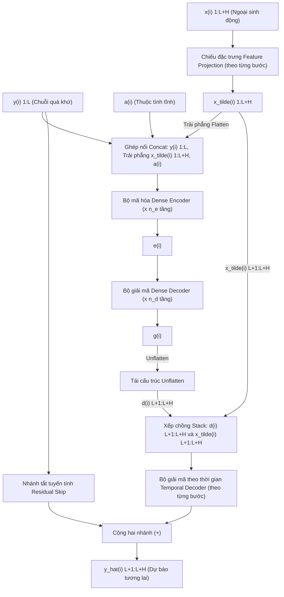

# PHẦN 1: SƠ ĐỒ KIẾN TRÚC CHUẨN XÁC THEO BÀI BÁO (FIGURE 1 TiDE) & GIẢI THÍCH TỪNG KÝ HIỆU

> 👤 **Người thực hiện:** Hiệu  
> 🤖 **Trợ lý kỹ thuật:** Antigravity  
> 📄 **Tài liệu tham chiếu:** *Long-term Forecasting with TiDE: Time-series Dense Encoder* (Google Research, 2023) - Trang 5, Figure 1

---

## 1. Sơ Đồ Kiến Trúc Khớp Tuyệt Đối Với Figure 1 Của Bài Báo (Mermaid Diagram)

Sơ đồ dưới đây được tái hiện chuẩn xác 100% theo **Figure 1 (Overview of TiDE architecture, Trang 5)** với toàn bộ chú thích bằng **Tiếng Việt có dấu đầy đủ và chuẩn xác**:

- Đúng chuẩn các biến toán học gốc:
  - Chuỗi quá khứ: $y_{1:L}^{(i)}$
  - Ngoại sinh động: $x_{1:L+H}^{(i)}$
  - Thuộc tính tĩnh: $a^{(i)}$
  - Ngoại sinh sau nén: $\tilde{x}_{1:L+H}^{(i)}$
  - Vector mã hóa bối cảnh: $e^{(i)}$
  - Vector giải mã phẳng: $g^{(i)}$
  - Đặc trưng giải mã tương lai: $d_{L+1:L+H}^{(i)}$
  - Ngoại sinh tương lai: $\tilde{x}_{L+1:L+H}^{(i)}$
  - Dự báo tương lai: $\hat{y}_{L+1:L+H}^{(i)}$
- Đúng các thao tác nối ghép: `Flatten`, `Concat`, `Unflatten`, `Stack`, `Residual (+)` và `per time-step`.
- Đúng số tầng nơ-ron: $n_e$ khối Dense Encoder và $n_d$ khối Dense Decoder.

---

## 2. Bảng Giải Thích Tận Gốc Từng Ký Hiệu & Chỉ Số Trong Sơ Đồ

Dưới đây là bảng tra cứu chi tiết toàn bộ các ký hiệu, chỉ số trên và chỉ số dưới xuất hiện trong Figure 1 của bài báo, giúp bạn nắm vững 100% ý nghĩa toán học:

| Ký Hiệu Trong Sơ Đồ | Tên Gọi & Vị Trí Trong Mạng | Chỉ Số & Ý Nghĩa Chi Tiết | Kích Thước Toán Học |
| :--- | :--- | :--- | :---: |
| **$y_{1:L}^{(i)}$** | **Lookback** (Chuỗi quá khứ) | - $(i)$: Chuỗi thời gian thứ $i$ trong tập dữ liệu đa biến. - $1:L$: Dải thời gian từ bước $1$ đến bước nhìn lại $L$. | $\mathbb{R}^L$ |
| **$x_{1:L+H}^{(i)}$** | **Dynamic Covariates** (Biến ngoại sinh động) | - $1:L+H$: Dải thời gian bao phủ cả quá khứ ($L$) và tương lai ($H$). - $r$: Số lượng biến ngoại sinh tại mỗi bước thời gian. | $\mathbb{R}^{(L+H) \times r}$ |
| **$a^{(i)}$** | **Attributes** (Thuộc tính tĩnh) | - Thông tin cố định của chuỗi thứ $i$ (ví dụ: mã cửa hàng, loại trạm biến áp), không phụ thuộc vào thời gian $t$. | $\mathbb{R}^{p_{\text{static}}}$ |
| **$\tilde{x}_{1:L+H}^{(i)}$** | **Projected Covariates** (Ngoại sinh đã nén) | - Dấu ngã $\sim$: Biểu thị dữ liệu đã được ánh xạ qua khối nén Feature Projection. - $\tilde{r}$: Chiều đặc trưng sau nén (`temporalWidth = 4`). | $\mathbb{R}^{(L+H) \times \tilde{r}}$ |
| **$e^{(i)}$** | **Encoding Vector** (Vector mã hóa bối cảnh) | - $e$: Chữ viết tắt của *Encoding* / *Embedding*. - Vector bối cảnh ẩn toàn cục của chuỗi $i$ do Encoder sinh ra. | $\mathbb{R}^{\text{hiddenSize}}$ |
| **$g^{(i)}$** | **Dense Decoder Output** (Vector giải mã phẳng) | - Đầu ra của Dense Decoder trước khi tách theo từng bước thời gian. - Là một vector 1 chiều phẳng có độ dài $H \cdot p$. | $\mathbb{R}^{H \cdot p}$ |
| **$d_{L+1:L+H}^{(i)}$** | **Decoded Feature Matrix** (Đặc trưng giải mã tương lai) | - $d$: Chữ viết tắt của *Decoded features*. - $L+1:L+H$: Dải $H$ bước tương lai. - Kết quả sau khi `Unflatten` vector $g^{(i)}$ thành $H$ vector lát cắt $d_t \in \mathbb{R}^p$. | $\mathbb{R}^{H \times p}$ |
| **$\tilde{x}_{L+1:L+H}^{(i)}$** | **Future Projected Covariates** (Ngoại sinh tương lai) | - Phần đuôi gồm $H$ bước tương lai của ma trận $\tilde{x}_{1:L+H}^{(i)}$, được đưa thẳng tới Temporal Decoder (Covariate Highway). | $\mathbb{R}^{H \times \tilde{r}}$ |
| **$\hat{y}_{L+1:L+H}^{(i)}$** | **Predictions** (Kết quả dự báo tương lai) | - Dấu mũ $\wedge$: Biểu thị giá trị ước lượng / dự báo của mô hình. - $L+1:L+H$: Dải giá trị cần dự báo từ thời điểm $L+1$ đến $L+H$. | $\mathbb{R}^H$ |
| **$n_e$** | Số khối Residual Block trong Dense Encoder | - Siêu tham số `numEncoderLayers` (thường chọn $n_e \in \{1, 2, 3\}$). | Số nguyên dương |
| **$n_d$** | Số khối Residual Block trong Dense Decoder | - Siêu tham số `numDecoderLayers` (thường chọn $n_d \in \{1, 2, 3\}$). | Số nguyên dương |

---

## 3. Giải Thích 5 Thao Tác Nối Ghép Cốt Lõi (Operations Walkthrough)

1. **`Feature Projection (theo từng bước)`**:
   - Áp dụng độc lập một khối Residual Block nhỏ cho từng bước thời gian $t \in \{1, \dots, L+H\}$ để nén vector ngoại sinh $x_t^{(i)} \in \mathbb{R}^r$ xuống vector $\tilde{x}_t^{(i)} \in \mathbb{R}^{\tilde{r}}$ với $\tilde{r} = 4$.

2. **`Trải phẳng Flatten`**:
   - Trải phẳng ma trận ngoại sinh 2D $\tilde{x}_{1:L+H}^{(i)} \in \mathbb{R}^{(L+H) \times \tilde{r}}$ thành vector 1D có độ dài $(L+H) \times \tilde{r}$.

3. **`Ghép nối Concat` (Đầu vào Encoder)**:
   - Nối 3 nguồn thông tin thành vector 1D duy nhất đưa vào Encoder:

$$
u_{\text{enc}}^{(i)} = \begin{bmatrix} y_{1:L}^{(i)} \\ \text{vec}(\tilde{x}_{1:L+H}^{(i)}) \\ a^{(i)} \end{bmatrix} \in \mathbb{R}^{L + (L+H)\tilde{r} + p_{\text{static}}}
$$

4. **`Tái cấu trúc Unflatten`**:
   - Nhận vector 1D $g^{(i)} \in \mathbb{R}^{H \cdot p}$ từ Dense Decoder và biến đổi ngược trở lại thành ma trận 2D $d_{L+1:L+H}^{(i)} \in \mathbb{R}^{H \times p}$.

5. **`Xếp chồng Stack` & `Temporal Decoder (theo từng bước)`**:
   - Tại mỗi bước thời gian tương lai $t \in \{L+1, \dots, L+H\}$, ghép cặp vector đặc trưng $d_t^{(i)} \in \mathbb{R}^p$ và biến ngoại sinh tương lai $\tilde{x}_t^{(i)} \in \mathbb{R}^{\tilde{r}}$ thành vector đầu vào cho khối Temporal Decoder để xuất ra giá trị dự báo phi tuyến:

$$
\hat{y}_{t,\text{NL}}^{(i)} = \text{TemporalDecoder} \left( \begin{bmatrix} d_t^{(i)} \\ \tilde{x}_t^{(i)} \end{bmatrix} \right) \in \mathbb{R}
$$

6. **`Cộng hai nhánh (+)` (Nhánh tắt tuyến tính Residual Skip)**:
   - Cộng kết quả phi tuyến của Temporal Decoder với dự báo tuyến tính từ nhánh Skip:

$$
\hat{y}_{L+1:L+H}^{(i)} = \hat{y}_{\text{NL}}^{(i)} + \left( W_{\text{skip}} \cdot y_{1:L}^{(i)} + b_{\text{skip}} \right)
$$
