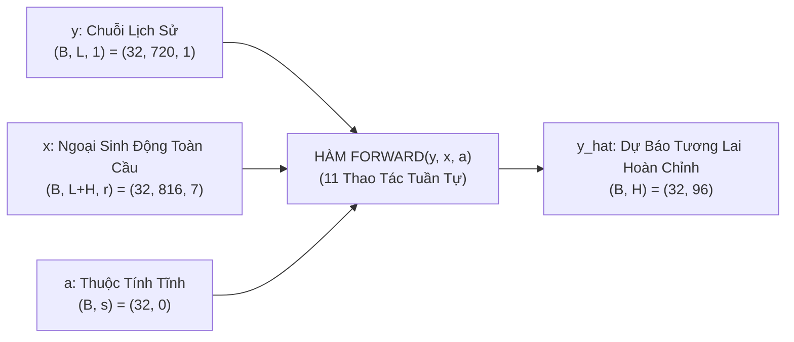

# PHẦN 2: GIẢI PHẪU DÒNG CHẢY DỮ LIỆU ĐỘNG FORWARD PASS (DYNAMIC RUNTIME EXECUTION)

> [!NOTE]
> **Điều hướng tài liệu**: [🏠 Trang Chủ](../../README.md) • [📋 Sprint 1 README](./README.md) • [📜 Yêu Cầu Sprint](./requirement.md) • [📊 Checklist Tiến Độ](./checklist.md) • [🛡️ Tự Kiểm Chứng](./05_self_verification.md) • [⬅️ Phần 1: Kiến Trúc Tĩnh](./01_architecture_diagram.md)  
> 👤 **Người thực hiện:** Hiệu  
> 🤖 **Trợ lý kỹ thuật:** Antigravity  
> 📄 **Tài liệu tham chiếu:** *Long-term Forecasting with TiDE: Time-series Dense Encoder* (Google Research, 2023) - Section 4

---

## 🧭 Tôn Chỉ Thiết Kế: Dòng Chảy Dữ Liệu Động (Dynamic Runtime Execution)

Trong khi **[Phần 1 (01_architecture_diagram.md)](./01_architecture_diagram.md)** đã giải phẫu chi tiết **Bản vẽ kết cấu phần cứng tĩnh** (các lớp, khối nơ-ron và ma trận trọng số trong hàm `__init__()`), thì **Phần 2 (Tài liệu này)** tập trung 100% vào **Hành trình sống của dữ liệu khi di chuyển qua mô hình**:

* Trả lời câu hỏi: *"Khi một batch dữ liệu thực tế được nạp vào, các tensor di chuyển qua những bước nào, gặp các phép toán động gì (`mean`, `flatten`, `cat`, `view`, `squeeze`), và kích thước hình dạng (Tensor Shapes) biến đổi chính xác ra sao ở từng dòng code PyTorch?"*
* Tương ứng với phương thức thực thi: **`def forward(self, y, x, a):`**.

---

## 1. Thiết Lập Dữ Liệu Đầu Vào Thực Nghiệm (Runtime Input Tensors)

> 📄 **Vị trí cụ thể trong bài báo gốc:**  
> **Trang 4, Mục 3 "Problem Setting" (Thiết lập biến $y, x, a$) & Trang 18, Phụ lục B.3, Bảng 10 (Cấu hình Electricity)**

Để theo dõi dòng chảy dữ liệu một cách trực quan và chính xác nhất, ta sử dụng cấu hình chuẩn của bài báo gốc trên tập dữ liệu benchmark lớn **Electricity**:
* Kích thước batch (**$B$**): `32` mẫu chuỗi thời gian.
* Cửa sổ quan sát lịch sử (**$L$**): `720` bước thời gian (Lookback horizon).
* Cửa sổ dự báo tương lai (**$H$**): `96` bước thời gian (Forecast horizon).
* Số biến ngoại sinh động thô (**$r$**): `7` đặc trưng (giờ trong ngày, ngày trong tuần, tháng, cờ ngày lễ...).
* Số chiều ngoại sinh sau nén (**$\tilde{r}$**): `4` đặc trưng (`temporalWidth = 4`).
* Kích thước bối cảnh giải mã (**$p$**): `8` đặc trưng (`decoderOutputDim = 8`).
* Kích thước không gian ẩn (**$d_{\text{hidden}}$**): `1024` nơ-ron (`hiddenSize = 1024`).



---

## 2. Bảng Đối Chiếu Song Song 11 Bước Nguyên Tử (Paper Math vs PyTorch Code)

> 📄 **Vị trí cụ thể trong bài báo gốc:**  
> **Trang 5 - 6, Toàn bộ Section 4 "Architecture" & Trang 15, Phụ lục B.1 "RevIN"**

Toàn bộ quy trình lan truyền xuôi `forward(y, x, a)` được chia thành **11 thao tác nguyên tử tuần tự theo thời gian**. Bảng dưới đây ánh xạ 1-1 từng công thức toán học trong bài báo sang từng dòng code PyTorch thực thi (toàn bộ công thức được chuẩn hóa bằng cú pháp backtick-math của GitHub để hiển thị hoàn hảo):

| Bước | Tên Thao Tác | Vị Trí Trong Paper Gốc | Công Thức Toán Học Chính Thức | Dòng Code PyTorch Thực Thi | Tensor Shape Biến Đổi |
|:---:|:---|:---|:---|:---|:---:|
| **0** | **RevIN Norm** | Trang 15, Phụ lục B.1 & Bảng 8 | $`y_{\text{norm}} = (y - \mu) / \sigma`$ | `y_norm = (y - mean) / std` | $`(B, L) \to (B, L)`$ |
| **1** | **Feature Proj** | Trang 5, Cột phải, Công thức (3) | $`\tilde{x}_t = \text{Proj}(x_t) \in \mathbb{R}^{\tilde{r}}`$ | `x_proj = self.feature_projection(x)` | $`(B, L+H, r) \to (B, L+H, \tilde{r})`$ |
| **2** | **Flatten** | Trang 5, Cột phải, Dòng 8-12 | $`\text{vec}(\tilde{x}) \in \mathbb{R}^{(L+H)\tilde{r}}`$ | `x_flat = x_proj.flatten(start_dim=1)` | $`(B, L+H, \tilde{r}) \to (B, (L+H)\tilde{r})`$ |
| **3** | **Concat** | Trang 5, Cột phải, Công thức (4) | $`u_{\text{enc}} = [ y_{\text{norm}} ; \text{vec}(\tilde{x}) ; a ]`$ | `enc_in = torch.cat([y_norm, x_flat, a], dim=-1)` | Ghép thành $`(B, d_{\text{enc}})`$ |
| **4** | **Dense Enc** | Trang 5, Cột phải, Công thức (4) | $`e = \text{Encoder}(u_{\text{enc}})`$ | `e = self.encoder(enc_in)` | $`(B, d_{\text{enc}}) \to (B, d_{\text{hidden}})`$ |
| **5** | **Dense Dec** | Trang 6, Cột trái, Dòng 1-6 | $`g = \text{Decoder}(e) \in \mathbb{R}^{H \cdot p}`$ | `g = self.decoder(e)` | $`(B, d_{\text{hidden}}) \to (B, H \cdot p)`$ |
| **6** | **Unflatten** | Trang 6, Cột trái, Dòng 7-14 | $`D = \text{Reshape}(g) \in \mathbb{R}^{H \times p}`$ | `d = g.view(B, H, p)` | $`(B, H \cdot p) \to (B, H, p)`$ |
| **7** | **Future Stack**| Trang 6, Cột trái, Đoạn 3 | $`[ d_t ; \tilde{x}_{L+t} ] \text{ tại mỗi } t`$ | `temp_in = torch.cat([d, x_future], dim=-1)` | Ghép thành $`(B, H, p + \tilde{r})`$ |
| **8** | **Temp Dec** | Trang 6, Cột trái, Công thức (5) | $`\hat{y}_{\text{NL}, t} = \text{TempDec}([ d_t ; \tilde{x}_{L+t} ])`$ | `y_nl = self.temporal_decoder(temp_in).squeeze(-1)` | $`(B, H, p + \tilde{r}) \to (B, H)`$ |
| **9** | **Linear Skip**| Trang 6, Cột phải, Dòng 1-8 | $`\hat{y}_{\text{Lin}} = W_{\text{skip}} y_{\text{norm}} + b_{\text{skip}}`$ | `y_lin = self.linear_skip(y_norm)` | $`(B, L) \to (B, H)`$ |
| **10**| **Residual Add**| Trang 6, Cột phải, Dòng 9-11 | $`\hat{y}_{\text{norm}} = \hat{y}_{\text{NL}} + \hat{y}_{\text{Lin}}`$ | `y_hat_norm = y_nl + y_lin` | $`(B, H) + (B, H) \to (B, H)`$ |
| **11**| **RevIN Denorm**| Trang 15, Phụ lục B.1 & Bảng 8 | $`\hat{y} = \hat{y}_{\text{norm}} \cdot \sigma + \mu`$ | `y_hat = y_hat_norm * std + mean` | $`(B, H) \to (B, H)`$ |

---

## 3. Giải Phẫu Chi Tiết Dòng Chảy Dữ Liệu Qua 11 Bước Nguyên Tử

---

### Bước 0: Chuẩn Hóa Cục Bộ RevIN (Reversible Instance Normalization)

> 📄 **Vị trí cụ thể trong bài báo gốc:**  
> **Trang 15 - 16, Phụ lục B.1 "Reversible Instance Normalization" & Bảng 8 (Table 8)**

#### 📐 1. Bản chất toán học:
Tính kỳ vọng $\mu$ và độ lệch chuẩn $\sigma$ trên từng chuỗi con độc lập, sau đó chuẩn hóa:

$$
\mu = \frac{1}{L} \sum_{t=1}^L y_t, \quad \sigma = \sqrt{\frac{1}{L} \sum_{t=1}^L (y_t - \mu)^2 + \epsilon}, \quad y_{\text{norm}} = \frac{y - \mu}{\sigma}
$$

#### 💻 2. Mã nguồn PyTorch thực thi:
```python
mean = y.mean(dim=1, keepdim=True)        # Kích thước: (32, 1)
std = y.std(dim=1, keepdim=True) + 1e-5   # Kích thước: (32, 1)
y_norm = (y - mean) / std                # Kích thước: (32, 720)
```

#### ⚡ 3. Bản chất động trong RAM:
Biến đổi phân phối của batch chuỗi lịch sử về kỳ vọng $0$ và phương sai $1$. Cặp giá trị $(\mu, \sigma)$ được lưu vào RAM để hoàn nguyên ở Bước 11.

---

### Bước 1: Chiếu Giảm Chiều Ngoại Sinh Động (Feature Projection)

> 📄 **Vị trí cụ thể trong bài báo gốc:**  
> **Trang 5, Cột phải, Mục 4.1 "Feature Projection", Đoạn 1, Công thức (3)**

#### 📐 1. Bản chất toán học:
Áp dụng khối chiếu tuyến tính từng đoạn qua hàm:

$$
\tilde{x}_t = \text{FeatureProjection}(x_t) \in \mathbb{R}^{\tilde{r}} \quad \forall t \in \{1, \dots, L+H\}
$$

#### 💻 2. Mã nguồn PyTorch thực thi:
```python
x_proj = self.feature_projection(x)      # (32, 816, 7) -> (32, 816, 4)
```

#### ⚡ 3. Bản chất động trong RAM:
Cùng một khối nơ-ron quét qua toàn bộ $816$ lát cắt thời gian, nén vector $7$ chiều về $4$ chiều giàu thông tin nhất.

---

### Bước 2 & 3: Trải Phẳng (Flatten) & Ghép Nối Siêu Vector Đầu Vào Encoder

> 📄 **Vị trí cụ thể trong bài báo gốc:**  
> **Trang 5, Cột phải, Mục 4.1 "Dense Encoder", Dòng 8-15 & Công thức (4)**

#### 📐 1. Bản chất toán học:
Duỗi phẳng ma trận ngoại sinh $2\text{D}$ thành vector $1\text{D}$ rồi ghép nối:

$$
u_{\text{enc}} = \begin{bmatrix} y_{\text{norm}, 1:L} \\ \text{vec}(\tilde{x}_{1:L+H}) \\ a \end{bmatrix} \in \mathbb{R}^{L + (L+H)\tilde{r} + p_{\text{static}}}
$$

#### 💻 2. Mã nguồn PyTorch thực thi:
```python
x_flat = x_proj.flatten(start_dim=1)            # (32, 816, 4) -> (32, 3264)
enc_in = torch.cat([y_norm, x_flat, a], dim=-1) # (32, 720 + 3264 + 0) = (32, 3984)
```

#### ⚡ 3. Bản chất động trong RAM:
Biến đổi cấu trúc không gian - thời gian thành một vector 1D phẳng duy nhất, sẵn sàng đưa vào mạng Perceptron đa tầng (MLP).

---

### Bước 4: Mã Hóa Dày Đặc (Dense Encoder)

> 📄 **Vị trí cụ thể trong bài báo gốc:**  
> **Trang 5, Cột phải, Mục 4.1 "Dense Encoder", Công thức (4) & Đoạn 3**

#### 📐 1. Bản chất toán học:
Lan truyền siêu vector qua $n_e$ khối Residual Block để tạo vector tiềm ẩn toàn cục:

$$
e = \text{DenseEncoder}(u_{\text{enc}}) \in \mathbb{R}^{d_{\text{hidden}}}
$$

#### 💻 2. Mã nguồn PyTorch thực thi:
```python
e = self.encoder(enc_in)                         # (32, 3984) -> (32, 1024)
```

#### ⚡ 3. Bản chất động trong RAM:
Nén $3,984$ chiều thông tin hỗn hợp thành $1,024$ chiều biểu diễn đặc trưng trừu tượng (*Context Embedding*).

---

### Bước 5: Giải Mã Dày Đặc (Dense Decoder)

> 📄 **Vị trí cụ thể trong bài báo gốc:**  
> **Trang 6, Cột trái, Mục 4.2 "Decoder", Đoạn 1, Dòng 1-6**

#### 📐 1. Bản chất toán học:
Giải mã từ vector tiềm ẩn sang vector dự báo phẳng:

$$
g = \text{DenseDecoder}(e) \in \mathbb{R}^{H \cdot p}
$$

#### 💻 2. Mã nguồn PyTorch thực thi:
```python
g = self.decoder(e)                              # (32, 1024) -> (32, 768)
```

#### ⚡ 3. Bản chất động trong RAM:
Vector $g$ có độ dài $H \cdot p = 96 \times 8 = 768$, mang toàn bộ bối cảnh dự báo cho $96$ bước tương lai.

---

### Bước 6: Tái Cấu Trúc (Unflatten / Reshape) Thành Ma Trận Bối Cảnh

> 📄 **Vị trí cụ thể trong bài báo gốc:**  
> **Trang 6, Cột trái, Mục 4.2 "Decoder", Đoạn 2, Dòng 7-14**

#### 📐 1. Bản chất toán học:
Bẻ vector phẳng $g$ thành ma trận $2\text{D}$ gồm $H$ hàng:

$$
D = \text{Reshape}(g, (H, p)) = \begin{bmatrix} d_1 \\ d_2 \\ \vdots \\ d_H \end{bmatrix} \in \mathbb{R}^{H \times p}
$$

#### 💻 2. Mã nguồn PyTorch thực thi:
```python
d = g.view(B, self.H, self.p)                   # (32, 768) -> (32, 96, 8)
```

#### ⚡ 3. Bản chất động trong RAM:
Khôi phục lại trục thời gian tương lai: mỗi bước $t \in [1, 96]$ nhận riêng một vector bối cảnh $d_t$ dài $8$ chiều.

---

### Bước 7 & 8: Làn Đường Cao Tốc (Covariate Highway) & Giải Mã Thời Gian (Temporal Decoder)

> 📄 **Vị trí cụ thể trong bài báo gốc:**  
> **Trang 6, Cột trái, Mục 4.2 "Temporal Decoder", Đoạn 3 & Công thức (5)**

#### 📐 1. Bản chất toán học:
Trích xuất ngoại sinh tương lai và kết hợp với bối cảnh giải mã tại từng bước:

$$
\hat{y}_{\text{NL}, t} = \text{TemporalDecoder}\left( \begin{bmatrix} d_t \\ \tilde{x}_{L+t} \end{bmatrix} \right) \in \mathbb{R} \quad \forall t \in \{1, \dots, H\}
$$

#### 💻 2. Mã nguồn PyTorch thực thi:
```python
x_future = x_proj[:, self.L:, :]                 # Cắt 96 bước tương lai: (32, 96, 4)
temp_in = torch.cat([d, x_future], dim=-1)       # Ghép bối cảnh: (32, 96, 12)
y_nl = self.temporal_decoder(temp_in).squeeze(-1)# Dự báo phi tuyến: (32, 96)
```

#### ⚡ 3. Bản chất động trong RAM:
Cơ chế đường cao tốc đưa trực tiếp đặc trưng tương lai vào ngõ ra, giúp mô hình phản ứng tức thời với các biến cố ngoại sinh đã biết trước.

---

### Bước 9: Nhánh Tắt Tuyến Tính Toàn Cục (Global Linear Skip)

> 📄 **Vị trí cụ thể trong bài báo gốc:**  
> **Trang 6, Cột phải, Mục 4.2 "Linear Skip", Đoạn 1, Dòng 1-8**

#### 📐 1. Bản chất toán học:
Ánh xạ tuyến tính trực tiếp từ quá khứ sang tương lai:

$$
\hat{y}_{\text{Lin}} = W_{\text{skip}} \cdot y_{\text{norm}} + b_{\text{skip}} \in \mathbb{R}^H
$$

#### 💻 2. Mã nguồn PyTorch thực thi:
```python
y_lin = self.linear_skip(y_norm)                 # (32, 720) -> (32, 96)
```

#### ⚡ 3. Bản chất động trong RAM:
Học xu hướng tăng giảm tự hồi quy tuyến tính cơ bản, tương tự như mô hình DLinear.

---

### Bước 10 & 11: Hợp Nhất Thặng Dư & Hoàn Nguyên Thang Đo Thực RevIN

> 📄 **Vị trí cụ thể trong bài báo gốc:**  
> **Trang 6, Cột phải, Dòng 9-11 (Hợp nhất `+`) & Trang 15, Phụ lục B.1 (RevIN Denorm)**

#### 📐 1. Bản chất toán học:
Cộng dồn dự báo tuyến tính + phi tuyến, sau đó giải chuẩn hóa:

$$
\hat{y}_{\text{norm}} = \hat{y}_{\text{NL}} + \hat{y}_{\text{Lin}}, \quad \hat{y}_{L+1:L+H} = \hat{y}_{\text{norm}} \odot \sigma + \mu
$$

#### 💻 2. Mã nguồn PyTorch thực thi:
```python
y_hat_norm = y_nl + y_lin                        # (32, 96) + (32, 96) = (32, 96)
y_hat = y_hat_norm * std + mean                  # Nhân lại std, cộng lại mean: (32, 96)
```

#### ⚡ 3. Bản chất động trong RAM:
Hoàn nguyên kết quả dự báo từ miền phân phối chuẩn về đúng đơn vị vật lý ban đầu (Megawatt, lượng xe/giờ...).

---

## 4. Bảng Nhật Ký Biến Đổi Tensor Shapes Động (Runtime Tensor Log)

> 📄 **Vị trí cụ thể trong bài báo gốc:**  
> **Trang 18, Phụ lục B.3, Bảng 10 (Siêu tham số thực nghiệm benchmark Electricity: $B=32, L=720, H=96, r=7, \tilde{r}=4, p=8$)**

Bảng ma trận dưới đây theo dõi trạng thái sống của từng biến Tensor trong bộ nhớ RAM/GPU qua từng dòng code của hàm `forward()`:

| Bước Thời Gian | Tên Biến Tensor Trong Code | Kích Thước Tensor Thực Nghiệm (Shape) | Kiểu Dữ Liệu | Trạng Thái Dữ Liệu / Ý Nghĩa Bộ Nhớ |
|:---:|:---|:---:|:---:|:---|
| **Khởi điểm** | `y` | `torch.Size([32, 720])` | `float32` | Chuỗi lịch sử thực tế chưa chuẩn hóa. |
| **Khởi điểm** | `x` | `torch.Size([32, 816, 7])` | `float32` | Ngoại sinh động thô $7$ chiều ($720$ quá khứ + $96$ tương lai). |
| **Khởi điểm** | `a` | `torch.Size([32, 0])` | `float32` | Thuộc tính tĩnh (rỗng với Electricity). |
| **Sau Bước 0** | `mean`, `std` | `torch.Size([32, 1])` | `float32` | Cặp thống kê kỳ vọng và độ lệch chuẩn lưu vào RAM. |
| **Sau Bước 0** | `y_norm` | `torch.Size([32, 720])` | `float32` | Chuỗi lịch sử đã đưa về $\text{Mean}=0, \text{Std}=1$. |
| **Sau Bước 1** | `x_proj` | `torch.Size([32, 816, 4])` | `float32` | Ngoại sinh đã nén từ $7 \to 4$ chiều tại mỗi bước thời gian. |
| **Sau Bước 2** | `x_flat` | `torch.Size([32, 3264])` | `float32` | Ma trận ngoại sinh được duỗi thẳng thành vector 1D phẳng. |
| **Sau Bước 3** | `enc_in` | `torch.Size([32, 3984])` | `float32` | Siêu vector ghép: $720 + 3264 + 0 = 3984$ phần tử. |
| **Sau Bước 4** | `e` | `torch.Size([32, 1024])` | `float32` | Vector tiềm ẩn toàn cục xuất ra từ Dense Encoder. |
| **Sau Bước 5** | `g` | `torch.Size([32, 768])` | `float32` | Vector giải mã phẳng xuất ra từ Dense Decoder ($96 \times 8$). |
| **Sau Bước 6** | `d` | `torch.Size([32, 96, 8])` | `float32` | Ma trận bối cảnh tương lai sau phép `view(B, H, p)`. |
| **Sau Bước 7** | `x_future` | `torch.Size([32, 96, 4])` | `float32` | Lát cắt $96$ bước tương lai của biến ngoại sinh đã nén. |
| **Sau Bước 7** | `temp_in` | `torch.Size([32, 96, 12])` | `float32` | Ghép bối cảnh và ngoại sinh tương lai: $8 + 4 = 12$ chiều. |
| **Sau Bước 8** | `y_nl` | `torch.Size([32, 96])` | `float32` | Thành phần dự báo phi tuyến từ Temporal Decoder. |
| **Sau Bước 9** | `y_lin` | `torch.Size([32, 96])` | `float32` | Thành phần dự báo tuyến tính từ Global Linear Skip. |
| **Sau Bước 10**| `y_hat_norm` | `torch.Size([32, 96])` | `float32` | Kết quả dự báo chuẩn hóa hoàn chỉnh: `y_nl + y_lin`. |
| **Sau Bước 11**| **`y_hat`** | `torch.Size([32, 96])` | `float32` | **KẾT QUẢ DỰ BÁO CUỐI CÙNG** sau khi giải chuẩn hóa RevIN. |

---

## 5. Mã Nguồn Hàm `forward()` Chuẩn Mực Trong PyTorch

> 📄 **Vị trí cụ thể trong bài báo gốc:**  
> **Trang 5 - 6, Section 4 "Architecture" & Figure 1**

Dưới đây là phương thức `forward` chuẩn mực trích xuất từ mô hình hoàn chỉnh của dự án:

```python
import torch
import torch.nn as nn

def forward(self, y: torch.Tensor, x: torch.Tensor, a: torch.Tensor = None) -> torch.Tensor:
    """
    Quy trình vận hành động Forward Pass của mô hình TiDE.
    
    Tham số đầu vào:
        y: Tensor chuỗi lịch sử mục tiêu, kích thước (B, L)
        x: Tensor biến ngoại sinh động, kích thước (B, L + H, r)
        a: Tensor thuộc tính tĩnh, kích thước (B, p_static) - Mặc định None
        
    Trả về:
        y_hat: Tensor dự báo tương lai hoàn chỉnh, kích thước (B, H)
    """
    B = y.shape[0]
    
    # -------------------------------------------------------------------------
    # [Bước 0] Chuẩn Hóa Cục Bộ RevIN Normalization (Phụ lục B.1, Trang 15)
    # -------------------------------------------------------------------------
    mean = y.mean(dim=1, keepdim=True)                   # Shape: (B, 1)
    std = y.std(dim=1, keepdim=True) + 1e-5              # Shape: (B, 1)
    y_norm = (y - mean) / std                           # Shape: (B, L)
    
    # -------------------------------------------------------------------------
    # [Bước 1] Chiếu Giảm Chiều Ngoại Sinh Động (Section 4.1, Công thức 3)
    # -------------------------------------------------------------------------
    x_proj = self.feature_projection(x)                  # Shape: (B, L + H, r_tilde)
    
    # -------------------------------------------------------------------------
    # [Bước 2 & 3] Trải Phẳng (Flatten) & Ghép Nối Siêu Vector (Section 4.1, Eq 4)
    # -------------------------------------------------------------------------
    x_flat = x_proj.flatten(start_dim=1)                 # Shape: (B, (L + H) * r_tilde)
    if a is not None and a.shape[-1] > 0:
        enc_in = torch.cat([y_norm, x_flat, a], dim=-1) # Shape: (B, L + (L+H)*r_tilde + p_static)
    else:
        enc_in = torch.cat([y_norm, x_flat], dim=-1)    # Shape: (B, L + (L+H)*r_tilde)
        
    # -------------------------------------------------------------------------
    # [Bước 4] Mã Hóa Dày Đặc Dense Encoder (Section 4.1, Công thức 4)
    # -------------------------------------------------------------------------
    e = self.encoder(enc_in)                             # Shape: (B, hidden_size)
    
    # -------------------------------------------------------------------------
    # [Bước 5 & 6] Giải Mã Dày Đặc & Tái Cấu Trúc Ma Trận Tương Lai (Section 4.2)
    # -------------------------------------------------------------------------
    g = self.decoder(e)                                  # Shape: (B, H * p)
    d = g.view(B, self.H, self.p)                        # Shape: (B, H, p)
    
    # -------------------------------------------------------------------------
    # [Bước 7 & 8] Đường Cao Tốc Ngoại Sinh & Temporal Decoder (Section 4.2, Eq 5)
    # -------------------------------------------------------------------------
    x_future = x_proj[:, self.L:, :]                     # Shape: (B, H, r_tilde)
    temp_in = torch.cat([d, x_future], dim=-1)           # Shape: (B, H, p + r_tilde)
    y_nl = self.temporal_decoder(temp_in).squeeze(-1)    # Shape: (B, H)
    
    # -------------------------------------------------------------------------
    # [Bước 9] Nhánh Tắt Tuyến Tính Toàn Cục Linear Skip (Section 4.2, Trang 6)
    # -------------------------------------------------------------------------
    y_lin = self.linear_skip(y_norm)                     # Shape: (B, H)
    
    # -------------------------------------------------------------------------
    # [Bước 10 & 11] Hợp Nhất Thặng Dư & Hoàn Nguyên Thang Đo (Section 4.2 & B.1)
    # -------------------------------------------------------------------------
    y_hat_norm = y_nl + y_lin                            # Shape: (B, H)
    y_hat = y_hat_norm * std + mean                      # Shape: (B, H)
    
    return y_hat
```

---

> [!TIP]
> Bạn có thể kiểm chứng tính toàn vẹn và độ chính xác của các kích thước Tensor Shapes này bằng cách chạy kịch bản tự động hóa tại [`test_tensor_shapes.py`](./test_tensor_shapes.py).
