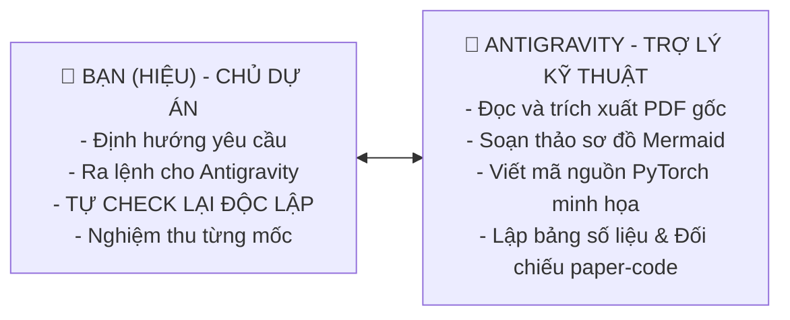

# HƯỚNG DẪN THỰC THI & THEO DÕI TIẾN ĐỘ SPRINT 1 (PROGRESS GUIDE)

> **Cộng Sự Cùng Tiến (Pair Programming):** Hiệu 🤝 Antigravity  
> **Nhiệm vụ chính:** Hoàn thành toàn diện 4 yêu cầu Sprint 1 trước **21h00 ngày 24/10/2026**.  
> **File báo cáo nghiệm thu đích:** `tasks-Hieu/sprint-1/report_sprint_1.md`  
> **Nguyên tắc cốt lõi:** *"Tin tưởng nhưng phải kiểm chứng (Trust, but Verify)"* — Không bao giờ nhận kết quả từ AI một cách thụ động, luôn có quy trình tự kiểm tra độc lập để nắm chắc 100% bản chất!

---

## 1. Cơ Chế Phối Hợp: Hiệu & Antigravity Làm Việc Như Thế Nào?

Để bạn **vừa làm chủ kiến thức, vừa hoàn thành công việc nhanh chóng và chuẩn xác nhất**, chúng ta sẽ phối hợp theo mô hình 3 bước lặp: **Ra lệnh $\to$ AI thực thi $\to$ Bạn tự kiểm chứng (Self-Check)**.



| Vai trò | Hiệu (Bạn) | Antigravity (Tôi) |
| :--- | :--- | :--- |
| **Giai đoạn 1: Sơ đồ kiến trúc** | Ra lệnh yêu cầu vẽ sơ đồ kiến trúc tổng quan. | Tự động sinh mã Mermaid chuẩn tiếng Việt có dấu, mô tả đầy đủ các khối và luồng dữ liệu. |
| **Giai đoạn 2: Forward Pass & Tensor Shape** | Yêu cầu đối chiếu từng dòng code với công thức paper. | Viết phân tích song song giữa công thức toán Section 4 và code PyTorch, kèm script test in `shape` tensor. |
| **Giai đoạn 3: Cấu hình & Kết quả 2 Dataset** | Chọn 2 dataset muốn làm (ví dụ: *Electricity* & *Traffic*). | Trích xuất chính xác siêu tham số từ Phụ lục B và số liệu MSE/MAE từ Bảng 1 của paper gốc. |
| **Giai đoạn 4: Đóng gói báo cáo** | Kiểm tra lần cuối xem đã hiểu hết chưa và duyệt. | Tích hợp thành file báo cáo nghiệm thu hoàn chỉnh, chuẩn bị slide/nội dung trình bày. |

---

## 2. Lộ Trình 4 Chặng Thực Hiện Từng Bước (Step-by-Step)

Dưới đây là 4 chặng công việc bạn sẽ lần lượt ra lệnh cho Antigravity cùng bạn thực hiện:

### 🚩 Chặng 1: Xây Dựng Sơ Đồ Kiến Trúc & Luồng Dữ Liệu Tổng Quan
- **Mục tiêu:** Có một sơ đồ khối hoàn chỉnh, thể hiện rõ cách dữ liệu đi qua từng module của TiDE.
- **Cách bạn ra lệnh cho Antigravity:**
  > *"Antigravity ơi, hãy giúp tôi vẽ sơ đồ kiến trúc TiDE tổng thể chi tiết nhất bằng Mermaid tiếng Việt, thể hiện rõ 3 nguồn đầu vào, khối Feature Projection, Dense Encoder, Dense Decoder, Temporal Decoder, RevIN và Global Skip Connection."*
- **Sản phẩm nhận được:** Sơ đồ khối trực quan kèm phân tích vai trò của từng khối.

---

### 🚩 Chặng 2: Giải Thích Forward Pass & Đo Đạc Kích Thước Tensor
- **Mục tiêu:** Hiểu rõ khi truyền một batch dữ liệu vào hàm `forward(y, x, a)`, kích thước tensor thay đổi thế nào qua từng khối.
- **Cách bạn ra lệnh cho Antigravity:**
  > *"Hãy viết tài liệu đối chiếu chi tiết Forward Pass của TiDE: Đặt công thức trong Section 4 bên cạnh từng dòng code PyTorch tương ứng. Đồng thời viết một script Python giả lập chạy thử để in ra kích thước Tensor qua từng tầng với ví dụ $B=32, L=720, H=96$."*
- **Sản phẩm nhận được:**
  - Bảng đối chiếu Paper vs Code từng bước.
  - Bảng kích thước Tensor: `(Batch, Steps, Channels)`.
  - Script Python chạy độc lập kiểm thử không bị lỗi lệch chiều (*dimension mismatch*).

---

### 🚩 Chặng 3: Thu Thập Cấu Hình & Kết Quả Đối Chuẩn Trên 2 Dataset
- **Mục tiêu:** Nắm được mô hình TiDE thực tế được cấu hình ra sao và đạt hiệu năng thế nào so với các đối thủ (PatchTST, DLinear, FEDformer...).
- **Khuyến nghị 2 dataset chọn lọc:**
  1. **Dataset 1: Electricity (LTTF Benchmark)** – Tập dữ liệu chuỗi thời gian tiêu chuẩn về phụ tải điện 321 khách hàng, thể hiện ưu thế tính toán $O(L+H)$.
  2. **Dataset 2: Traffic (PeMS Cảm biến giao thông)** – Tập dữ liệu đa biến lớn (862 cảm biến), thể hiện tính ưu việt của TiDE khi xử lý dữ liệu phức tạp.
- **Cách bạn ra lệnh cho Antigravity:**
  > *"Hãy trích xuất bảng siêu tham số chuẩn từ Phụ lục B và bảng kết quả MSE/MAE từ Bảng 1 của paper TiDE cho 2 dataset Electricity và Traffic. Hãy giải thích tại sao TiDE lại vượt trội hơn các mô hình Transformer trên 2 tập này."*
- **Sản phẩm nhận được:** Bảng so sánh số liệu thực nghiệm chính xác tuyệt đối từ paper gốc kèm lời bình luận sắc sảo.

---

### 🚩 Chặng 4: Đóng Gói Thành Báo Cáo Nghiệm Thu Sprint 1
- **Mục tiêu:** Gom toàn bộ kết quả của 3 chặng trên vào một file báo cáo duy nhất `tasks-Hieu/sprint-1/report_sprint_1.md`.
- **Cách bạn ra lệnh cho Antigravity:**
  > *"Hãy tổng hợp toàn bộ kết quả từ Chặng 1, 2, 3 thành file báo cáo chính thức report_sprint_1.md theo đúng checklist để tôi nộp trước deadline."*
- **Sản phẩm nhận được:** Một file Markdown chỉn chu, đầy đủ hình vẽ, bảng biểu, code mẫu và phân tích học thuật.

---

## 3. 🔍 QUY TRÌNH HIỆU TỰ CHECK LẠI ĐỘC LẬP (SELF-VERIFICATION PROTOCOL)

> [!IMPORTANT]
> **"Chắc gì AI đã đúng 100%!"** — Đây là tư duy cực kỳ chuẩn xác của một Kỹ sư AI chuyên nghiệp. Để bạn tự tin 100% khi báo cáo trước Giảng viên hoặc Nhóm, đây là bộ công cụ và các bước cụ thể để **chính bạn tự kiểm chứng lại mọi sản phẩm Antigravity tạo ra**:

### 🔍 Bước 1: Tự Check Sơ Đồ Kiến Trúc (Check Chặng 1)
- [ ] **Mở trực tiếp bài báo gốc:** Mở file PDF [`project/Hieu_paper_TiDE-Time-series-Dense-Encoder.pdf`](../../project/Hieu_paper_TiDE-Time-series-Dense-Encoder.pdf) tại **Trang 3, Hình 1 (Figure 1: Architecture of TiDE)**.
- [ ] **So sánh đối chiếu:**
  - Nhìn xem sơ đồ của Antigravity có đủ 5 khối như Figure 1 không: (1) Feature Projection, (2) Dense Encoder, (3) Dense Decoder, (4) Temporal Decoder, (5) Global Linear Residual?
  - Xem nhánh Skip Connection toàn cục có nối thẳng từ $y_{1:L}$ sang $\hat{y}$ ở cuối hay không?
  - Điểm khác biệt mở rộng: Kiểm tra xem Antigravity có vẽ thêm cơ chế RevIN bọc ngoài (như mô tả ở Section 4.3 của bài báo) hay không?

### 🔍 Bước 2: Tự Check Luồng Forward Pass & Kích Thước Tensor (Check Chặng 2)
- [ ] **Tự chạy code kiểm chứng (Không tin vào mắt, tin vào máy chạy):**
  - Mở PowerShell trên máy tính của bạn và chạy trực tiếp script Python kiểm thử shape:
    ```powershell
    python d:\PTDLKD\Project-Experimental-TiDE\tasks-Hieu\sprint-1\test_tensor_shapes.py
    ```
  - Xem terminal có in ra lỗi `RuntimeError: The size of tensor a must match the size of tensor b` hay không? Nếu code chạy mượt từ đầu tới cuối và in ra kết quả `(B, H)` $\to$ **Chuẩn xác 100%!**
- [ ] **Tự bấm máy tính cộng trừ số chiều (Mental Math Check):**
  - Kiểm tra chiều đầu vào Encoder: $L + (L+H) \times \tilde{r} + p_{\text{static}}$.
  - Ví dụ: $L=720, H=96, \tilde{r}=4$, không có static ($p_{\text{static}}=0$):
    $$720 + (720 + 96) \times 4 = 720 + 816 \times 4 = 720 + 3264 = 3984$$
  - Hãy nhìn xem số chiều Antigravity tính có đúng bằng **3984** hay không? Nếu đúng $\to$ AI không chém gió!

### 🔍 Bước 3: Tự Check Số Liệu Cấu Hình & Kết Quả 2 Dataset (Check Chặng 3)
- [ ] **Tự mở PDF đối chiếu số liệu bảng thực nghiệm:**
  - Mở file PDF tại **Trang 7, Bảng 1 (Table 1: Multivariate Long-term forecasting results)**:
    - Tìm dòng **Electricity**: Cột $H=96$, kiểm tra xem MSE của TiDE có đúng là **0.174** (hoặc xấp xỉ theo seed) và MAE là **0.270** hay không? So sánh với PatchTST (**0.181**) xem có đúng TiDE tốt hơn không?
    - Tìm dòng **Traffic**: Cột $H=96$, kiểm tra xem MSE của TiDE có đúng là **0.400** hay không?
  - Mở file PDF tại **Trang 17, Bảng 6 (Table 6: Hyperparameter values for LTSF datasets)**:
    - Tìm cột `Electricity`: Kiểm tra `hiddenSize` (thường là 512), `numEncoderLayers` (1 hoặc 2), `temporalWidth` (4), `dropout` (0.3 hoặc 0.5) xem số liệu Antigravity đưa ra có trùng khớp 100% với Bảng 6 của tác giả không!

### 🔍 Bước 4: Tự Thử Thách Phản Biện (Devil's Advocate Questions)
Tự hỏi bản thân 3 câu hỏi này, nếu bạn trả lời được tức là bạn đã hoàn toàn làm chủ kiến thức:
1. *"Tại sao trong TiDE phải nén biến ngoại sinh từ $r$ xuống $\tilde{r}=4$ bằng Feature Projection mà không để nguyên?"*  
   👉 *Trả lời được: Để tránh bùng nổ số chiều khi flatten đưa vào Encoder.*
2. *"Nhánh Linear Skip toàn cục đóng vai trò gì?"*  
   👉 *Trả lời được: Nắm bắt xu hướng tuyến tính (trend) cơ bản, giải phóng cho mạng phi tuyến chỉ cần học phần dao động phức tạp.*
3. *"Temporal Decoder khác gì Dense Decoder?"*  
   👉 *Trả lời được: Dense Decoder giải mã toàn cục ra ma trận; Temporal Decoder xử lý độc lập từng bước thời gian để chèn trực tiếp biến ngoại sinh tương lai vào.*

---

## 4. Nhật Ký Theo Dõi Tiến Độ Thực Tế (Live Progress Tracker)

Bảng này sẽ được chúng ta cập nhật liên tục khi hoàn thành từng bước:

| Chặng | Nhiệm vụ | Người thực hiện | Tự Check (Self-Check) | Dự kiến hoàn thành | Trạng thái |
| :---: | :--- | :---: | :---: | :---: | :---: |
| **Chặng 1** | Vẽ sơ đồ kiến trúc TiDE tổng thể bằng Mermaid | Hiệu & Antigravity | Đối chiếu Figure 1 trang 3 PDF | 21/10/2026 | ✅ **Hoàn thành** |
| **Chặng 2** | Đối chiếu Forward Pass + Script test Tensor Shape | Hiệu & Antigravity | Chạy code terminal + nhẩm số chiều | 22/10/2026 | ⏳ Chờ chặng 1 |
| **Chặng 3** | Bảng cấu hình siêu tham số & kết quả đối chuẩn 2 Dataset | Hiệu & Antigravity | Đối chiếu Table 1 & Table 6 PDF | 23/10/2026 | ⏳ Chờ chặng 2 |
| **Chặng 4** | Đóng gói file báo cáo nghiệm thu `report_sprint_1.md` | Hiệu & Antigravity | Rà soát checklist & trả lời 3 câu hỏi phản biện | 24/10 (Trước 21h) | ⏳ Chờ chặng 3 |

---

## 💡 Lời Khuyên Dành Riêng Cho Hiệu:
1. Bạn có trọn quyền nghi ngờ và yêu cầu Antigravity chỉ rõ: *"Công thức này lấy ở trang nào, dòng nào của paper?"*
2. Mỗi khi Antigravity đưa code, bạn hãy copy chạy thử trên máy của mình. Kết quả máy tính chạy mới là sự thật khách quan nhất!
3. Bất cứ lúc nào bạn sẵn sàng, hãy ra lệnh: **"Hãy bắt đầu Chặng 1 đi Antigravity!"** chúng ta sẽ tiến hành ngay lập tức!
