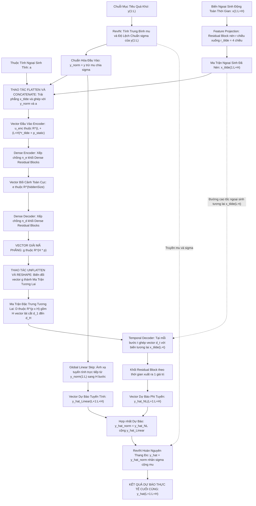

# BÁO CÁO NGHIỆM THU SPRINT 1: KIẾN TRÚC MÔ HÌNH TiDE & ĐỐI CHIẾU THỰC NGHIỆM

> 👤 **Người thực hiện:** Hiệu  
> 🤖 **Trợ lý kỹ thuật:** Antigravity  
> ⏰ **Mục tiêu hoàn thành:** Trước 21h00 ngày 24/10/2026  
> 📄 **Tài liệu tham chiếu gốc:** *Long-term Forecasting with TiDE: Time-series Dense Encoder* (Google Research, 2023)

---

## MỤC LỤC BÁO CÁO
1. [Phần 1: Sơ Đồ Kiến Trúc TiDE Toàn Diện & Phân Tích Luồng Dữ Liệu](#phần-1-sơ-đồ-kiến-trúc-tide-toàn-diện--phân-tích-luồng-dữ-liệu)
2. [Phần 2: Giải Phẫu Luồng Forward Pass (Paper vs Code PyTorch)](#phần-2-giải-phẫu-luồng-forward-pass-paper-vs-code-pytorch)
3. [Phần 3: Theo Dõi Kích Thước Tensor & Script Kiểm Thử Chạy Thật](#phần-3-theo-dõi-kích-thước-tensor--script-kiểm-thử-chạy-thật)
4. [Phần 4: Cấu Hình Siêu Tham Số & Kết Quả Đối Chuẩn Trên 2 Dataset](#phần-4-cấu-hình-siêu-tham-số--kết-quả-đối-chuẩn-trên-2-dataset)
5. [Phần 5: Biên Bản Tự Kiểm Chứng Của Hiệu (Self-Verification Report)](#phần-5-biên-bản-tự-kiểm-chứng-của-hiệu-self-verification-report)

---

# PHẦN 1: SƠ ĐỒ KIẾN TRÚC TiDE TOÀN DIỆN & PHÂN TÍCH LUỒNG DỮ LIỆU

## 1.1. Sơ Đồ Kiến Trúc Tổng Thể (Mermaid Architecture Diagram)

Dưới đây là sơ đồ kiến trúc tổng thể toàn diện của mô hình TiDE, thể hiện chi tiết:
- **3 nguồn dữ liệu đầu vào** ($y_{1:L}, x_{1:L+H}, a$) và cơ chế chuẩn hóa 2 chiều **RevIN**.
- **Khối Feature Projection** nén $r \to \tilde{r} = 4$.
- **Thao tác Flatten (Trải phẳng)** các nguồn dữ liệu thành vector đầu vào Encoder $u_{\text{enc}} \in \mathbb{R}^{L + (L+H)\tilde{r} + p_{\text{static}}}$.
- **Khối Dense Encoder** sinh vector bối cảnh ẩn $e \in \mathbb{R}^{\text{hiddenSize}}$.
- **Khối Dense Decoder** sinh vector giải mã phẳng **$g \in \mathbb{R}^{H \cdot p}$**.
- **Thao tác Unflatten / Reshape** biến đổi vector $g$ thành ma trận đặc trưng tương lai **$D \in \mathbb{R}^{p \times H}$** gồm $H$ vector lát cắt $d_1, d_2, \dots, d_H$.
- **Khối Temporal Decoder** (Covariate Highway) và **Global Linear Skip Connection**.

---

## 1.2. Phân Tích Sâu: Bản Chất Của Vector $g^{(i)}$, Thao Tác Flatten & Unflatten

### 1. Thao Tác Flatten (Trải Phẳng) Trước Khối Dense Encoder
- **Động cơ:** Trong kiến trúc mạng MLP (Multi-Layer Perceptron) cổ điển, các tầng Linear chỉ có thể nhận đầu vào là một **vector 1 chiều phẳng** thay vì ma trận 2D hoặc tensor 3D như Transformer hay RNN.
- **Cách thức thực hiện:**
  - Chuỗi lịch sử đã chuẩn hóa: $y_{\text{norm}, 1:L}^{(i)} \in \mathbb{R}^L$.
  - Ma trận ngoại sinh sau nén: $\tilde{x}_{1:L+H}^{(i)} \in \mathbb{R}^{(L+H) \times \tilde{r}}$. Ma trận này được **trải phẳng (Flatten)** thành một vector 1 chiều có độ dài $(L+H) \times \tilde{r}$.
  - Thuộc tính tĩnh: $a^{(i)} \in \mathbb{R}^{p_{\text{static}}}$.
- **Vector đầu vào hợp nhất $u_{\text{enc}}^{(i)}$:**

$$
u_{\text{enc}}^{(i)} = \begin{bmatrix} y_{\text{norm}, 1:L}^{(i)} \\ \text{vec}(\tilde{x}_{1:L+H}^{(i)}) \\ a^{(i)} \end{bmatrix} \in \mathbb{R}^{L + (L+H)\tilde{r} + p_{\text{static}}}
$$

---

### 2. Vector Giải Mã Phẳng $g^{(i)}$ (Dense Decoder Output Vector)
- **Định nghĩa trong bài báo:** Sau khi vector bối cảnh ẩn $e^{(i)} \in \mathbb{R}^{\text{hiddenSize}}$ đi qua $n_d$ khối Dense Residual Blocks của Decoder, tầng tuyến tính cuối cùng của Dense Decoder ánh xạ ra một vector phẳng duy nhất ký hiệu là **$g^{(i)}$**.
- **Kích thước toán học:**
  - $H$: Tầm nhìn dự báo tương lai (Forecast Horizon).
  - $p$: Siêu tham số `decoderOutputDim` (số chiều đặc trưng giải mã cho mỗi bước thời gian tương lai, thường chọn $p = 4$ đến $32$).
  - Vector $g^{(i)}$ có kích thước:

$$
g^{(i)} = \text{DenseDecoder}(e^{(i)}) \in \mathbb{R}^{H \cdot p}
$$

---

### 3. Thao Tác Unflatten / Reshape (Tái Cấu Trúc Thành Ma Trận Tương Lai $D^{(i)}$)
- **Vấn đề:** Vector $g^{(i)}$ là một dải $H \cdot p$ con số phẳng, chưa thể hiện được cấu trúc phân tách theo từng mốc thời gian $t = 1, 2, \dots, H$.
- **Thao tác Unflatten (trong PyTorch là `reshape` hoặc `view`):**
  - Biến đổi vector 1D $g^{(i)} \in \mathbb{R}^{H \cdot p}$ ngược trở lại thành ma trận 2D $D^{(i)} \in \mathbb{R}^{p \times H}$ (hoặc $\mathbb{R}^{H \times p}$):

$$
D^{(i)} = \text{Unflatten}(g^{(i)}) = \begin{bmatrix} d_1^{(i)}, d_2^{(i)}, \dots, d_H^{(i)} \end{bmatrix} \in \mathbb{R}^{p \times H}
$$

- **Ý nghĩa của từng vector lát cắt $d_t^{(i)} \in \mathbb{R}^p$:**
  - Mỗi cột $d_t^{(i)}$ chính là "chân dung đặc trưng bối cảnh" riêng biệt của bước thời gian tương lai thứ $t$.
  - Cột $d_t^{(i)}$ sau đó được ghép đôi trực tiếp với biến ngoại sinh tương lai $\tilde{x}_{L+t}^{(i)}$ để đưa vào khối **Temporal Decoder**, sinh ra con số dự báo phi tuyến cho bước $t$.

---

## 1.3. Bảng Tóm Tắt Vai Trò Từng Phân Khu Trong Kiến Trúc

| Thành Phần Kiến Trúc | Ký Hiệu Toán Học | Kích Thước Tensor Mẫu ($B=32, L=720, H=96, \tilde{r}=4, p=4$) | Vai Trò Cốt Lõi |
| :--- | :---: | :---: | :--- |
| **RevIN Normalization** | $y_{\text{norm}, 1:L}$ | `(32, 720)` | Đưa dữ liệu về $\text{Mean}=0, \text{Std}=1$, triệt tiêu hiện tượng trôi dạt phân phối. |
| **Feature Projection** | $\tilde{x}_{1:L+H}$ | `(32, 816, 4)` | Nén biến ngoại sinh từ $r$ chiều xuống $\tilde{r}=4$ chiều, chống bùng nổ số chiều. |
| **Flatten & Concat** | $u_{\text{enc}}$ | `(32, 3984)` | Trải phẳng và ghép tất cả thông tin quá khứ thành 1 vector 1D đưa vào Encoder. |
| **Dense Encoder** | $e$ | `(32, 512)` | Chắt lọc toàn bộ tri thức chuỗi lịch sử thành 1 vector bối cảnh ẩn toàn cục. |
| **Dense Decoder** | **$g$** | **`(32, 384)`** ($96 \times 4$) | **Vector phẳng giải mã bối cảnh tương lai toàn bộ Horizon $H$.** |
| **Unflatten / Reshape** | **$D$** | **`(32, 96, 4)`** | **Tách vector $g$ thành $H=96$ vector lát cắt $d_t \in \mathbb{R}^4$.** |
| **Temporal Decoder** | $\hat{y}_{\text{NL}}$ | `(32, 96)` | Ghép $d_t$ với ngoại sinh tương lai $\tilde{x}_{L+t}$ sinh dự báo phi tuyến từng bước. |
| **Global Linear Skip** | $\hat{y}_{\text{Linear}}$ | `(32, 96)` | Ánh xạ tuyến tính trực tiếp từ quá khứ sang tương lai, học xu hướng (trend). |
| **RevIN Denormalization** | $\hat{y}_{L+1:L+H}$ | `(32, 96)` | Nhân lại $\sigma$ và cộng lại $\mu$ để đưa dự báo về thang đo thực tế ban đầu. |

---

> 💡 **Xem tiếp:** [Phần 2: Giải Phẫu Luồng Forward Pass (Paper vs Code PyTorch)](#phần-2-giải-phẫu-luồng-forward-pass-paper-vs-code-pytorch)
