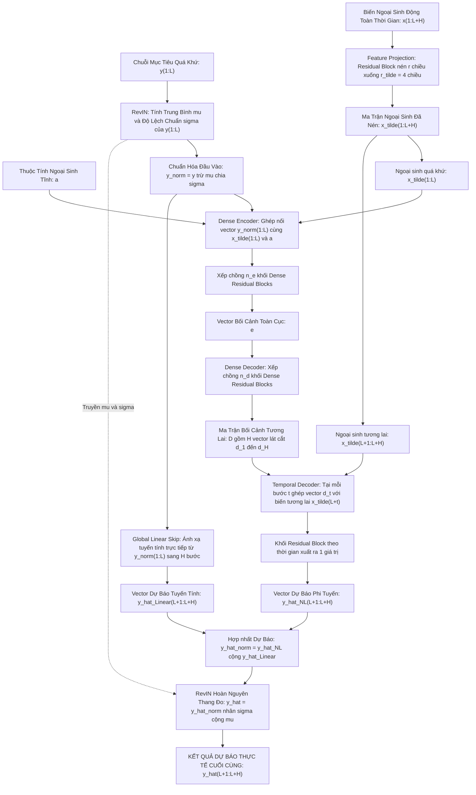

# BÁO CÁO NGHIỆM THU SPRINT 1: KIẾN TRÚC MÔ HÌNH TiDE & ĐỐI CHIẾU THỰC NGHIỆM

> 👤 **Người thực hiện:** Hiệu  
> 🤖 **Trợ lý kỹ thuật:** Antigravity  
> ⏰ **Mục tiêu hoàn thành:** Trước 21h00 ngày 24/10/2026  
> 📄 **Tài liệu tham chiếu gốc:** *Long-term Forecasting with TiDE: Time-series Dense Encoder* (Google Research, 2023)

---

## MỤC LỤC BÁO CÁO
1. [Phần 1: Sơ Đồ Kiến Trúc TiDE Toàn Diện & Phân Tích Luồng Dữ Liệu](#phần-1-sơ-đồ-kiến-trúc-tide-toàn-diện--phân-tích-luồng-dữ-liệu)
2. [Phần 2: Giải Phẫu Luồng Forward Pass (Paper vs Code PyTorch)](#phần-2-giải-phẫu-luồng-forward-pass-paper-vs-code-pytorch)
3. [Phần 3: Theo Dõi Kích Thước Tensor & Script Kiểm Thử Chạy Thật](#phần-3-theo-dõi-kích-thước-tensor--script-kiểm-thử-chạy-thật)
4. [Phần 4: Cấu Hình Siêu Tham Số & Kết Quả Đối Chuẩn Trên 2 Dataset](#phần-4-cấu-hình-siêu-tham-số--kết-quả-đối-chuẩn-trên-2-dataset)
5. [Phần 5: Biên Bản Tự Kiểm Chứng Của Hiệu (Self-Verification Report)](#phần-5-biên-bản-tự-kiểm-chứng-của-hiệu-self-verification-report)

---

# PHẦN 1: SƠ ĐỒ KIẾN TRÚC TiDE TOÀN DIỆN & PHÂN TÍCH LUỒNG DỮ LIỆU

## 1.1. Sơ Đồ Kiến Trúc Tổng Thể (Mermaid Architecture Diagram)

Dưới đây là sơ đồ kiến trúc tổng thể toàn diện của mô hình TiDE, thể hiện rõ **3 nguồn dữ liệu đầu vào**, cơ chế chuẩn hóa 2 chiều **RevIN**, các khối nơ-ron cốt lõi (**Feature Projection, Dense Encoder, Dense Decoder, Temporal Decoder**) và nhánh tắt tuyến tính toàn cục (**Global Linear Skip Connection**):

---

## 1.2. Phân Tích Chi Tiết Vai Trò Của Từng Phân Khu Trong Kiến Trúc

### 1. Ba Nguồn Dữ Liệu Đầu Vào (Multimodal Time-Series Inputs)
Mô hình TiDE được thiết kế để tiếp nhận đầy đủ mọi dạng thông tin chuỗi thời gian mà các mô hình truyền thống (DLinear, Transformer đơn) thường bỏ sót:
1. **Chuỗi mục tiêu quá khứ ($y_{1:L}^{(i)} \in \mathbb{R}^L$):** Chuỗi giá trị cần dự báo trong khoảng thời gian nhìn lại $L$ (ví dụ: lượng điện tiêu thụ trong 30 ngày qua).
2. **Biến ngoại sinh động toàn thời gian ($x_{1:L+H}^{(i)} \in \mathbb{R}^{(L+H) \times r}$):** Tập hợp các thông tin đã biết trước cho cả quá khứ và tương lai (ví dụ: thứ trong tuần, giờ trong ngày, ngày nghỉ lễ, kế hoạch khuyến mãi, dự báo nhiệt độ).
3. **Thuộc tính ngoại sinh tĩnh ($a^{(i)} \in \mathbb{R}^p$):** Các thông tin cố định không thay đổi theo thời gian của từng thực thể (ví dụ: mã cửa hàng, nhóm ngành hàng, vị trí địa lý của trạm biến áp).

---

### 2. Chuẩn Hóa & Hoàn Nguyên Đảo Nghịch Hai Chiều (RevIN)
- **Vấn đề thực tế:** Dữ liệu chuỗi thời gian thường xuyên bị **trôi dạt phân phối (distribution shift)** do lạm phát, mùa vụ hoặc sự gia tăng tải tiêu thụ theo năm tháng.
- **Cơ chế RevIN:**
  - **Chiều đi (Normalize):** Tại đầu vào, tính giá trị trung bình $\mu^{(i)}$ và độ lệch chuẩn $\sigma^{(i)}$ của chính cửa sổ quá khứ $y_{1:L}^{(i)}$, sau đó đưa dữ liệu về phân phối chuẩn:
  
$$
y_{\text{norm}, t}^{(i)} = \frac{y_t^{(i)} - \mu^{(i)}}{\sigma^{(i)}}
$$

  - **Môi trường huấn luyện:** Mô hình nơ-ron chỉ cần tập trung học hình thù dao động sóng trong thế giới chuẩn hóa ($\text{Mean}=0, \text{Std}=1$).
  - **Chiều về (Denormalize):** Tại ngõ ra cuối cùng, kết quả dự báo chuẩn hóa được hoàn nguyên về thang đo thực tế:
  
$$
\hat{y}_{L+t}^{(i)} = \hat{y}_{\text{norm}, L+t}^{(i)} \cdot \sigma^{(i)} + \mu^{(i)}
$$

---

### 3. Khối Chiếu Đặc Trưng (Feature Projection)
- **Vấn đề:** Nếu một bài toán có $r = 20$ biến ngoại sinh và tổng số bước thời gian là $L+H = 1440$, việc giữ nguyên kích thước sẽ tạo ra ma trận đầu vào $1440 \times 20 = 28,800$ chiều $\to$ gây bùng nổ số lượng tham số (*Curse of Dimensionality*) và khiến mô hình học vẹt.
- **Giải pháp:** Sử dụng một khối Residual Block nhỏ áp dụng độc lập cho từng bước thời gian để nén từ $r$ chiều xuống $\tilde{r} = 4$ chiều đặc trưng tinh gọn.
- Sau đó, ma trận nén được tách làm 2 phần:
  - $\tilde{x}_{1:L}$: Biến ngoại sinh quá khứ $\to$ đưa vào Dense Encoder.
  - $\tilde{x}_{L+1:L+H}$: Biến ngoại sinh tương lai $\to$ đưa thẳng tới Temporal Decoder.

---

### 4. Bộ Mã Hóa Toàn Cục (Dense Encoder)
- **Ghép nối toàn diện:** Toàn bộ chuỗi quá khứ chuẩn hóa $y_{\text{norm}, 1:L}$, biến ngoại sinh quá khứ đã nén $\tilde{x}_{1:L}$, và thuộc tính tĩnh $a$ được **trải phẳng (flatten)** và ghép lại thành một vector 1D duy nhất.
- **Xử lý sâu:** Vector này đi qua $n_e$ khối Dense Residual Block (mỗi khối gồm 2 tầng Linear, hàm kích hoạt ReLU, Dropout, Layer Normalization và Skip Connection).
- **Đầu ra:** Một vector bối cảnh ẩn toàn cục $e \in \mathbb{R}^{\text{hiddenSize}}$ đại diện cho toàn bộ tri thức chắt lọc từ quá khứ.

---

### 5. Bộ Giải Mã Toàn Cục (Dense Decoder)
- Nhận vector bối cảnh $e$ và đưa qua $n_d$ khối Dense Residual Block.
- Đầu ra của khối cuối cùng được ánh xạ thành một vector có kích thước $H \times p_{\text{dec}}$, sau đó được tái định hình (**reshape**) thành ma trận tương lai:

$$
D \in \mathbb{R}^{H \times p_{\text{dec}}} = \begin{bmatrix} d_1^\top \\ d_2^\top \\ \vdots \\ d_H^\top \end{bmatrix}
$$

- Trong đó, mỗi vector hàng $d_t \in \mathbb{R}^{p_{\text{dec}}}$ đại diện cho bối cảnh trừu tượng của riêng bước thời gian tương lai thứ $t$.

---

### 6. Bộ Giải Mã Theo Thời Gian (Temporal Decoder - Tuyến Cao Tốc Ngoại Sinh)
- **Sự khác biệt đột phá của TiDE:** Thay vì bắt biến ngoại sinh tương lai phải đi xuyên qua Encoder (nơi thông tin dễ bị suy hao), TiDE tạo ra một **làn đường cao tốc riêng (Covariate Highway)** đưa thẳng $\tilde{x}_{L+t}$ vào ngõ ra.
- Tại mỗi bước thời gian $t \in \{1, 2, \dots, H\}$:

$$
\hat{y}_{L+t, \text{NL}} = \text{TemporalDecoder} \left( \begin{bmatrix} d_t \\ \tilde{x}_{L+t} \end{bmatrix} \right) \in \mathbb{R}
$$

- Khối này kết hợp:
  - $d_t$: Bối cảnh xu hướng vĩ mô dài hạn từ quá khứ.
  - $\tilde{x}_{L+t}$: Cú sốc cục bộ của chính thời điểm tương lai (ví dụ: khuyến mãi, nắng nóng cực đoan).
- Giúp mô hình phản ứng tức thời với sự kiện đột xuất và hồi phục ngay sau khi sự kiện kết thúc!

---

### 7. Nhánh Tắt Tuyến Tính Toàn Cục (Global Linear Skip Connection)
- Tương tự như ResNet trong thị giác máy tính, TiDE bố trí một tầng tuyến tính đơn giản nối thẳng từ $y_{\text{norm}, 1:L}$ sang $H$ bước tương lai:

$$
\hat{y}_{\text{Linear}} = W_{\text{skip}} \cdot y_{\text{norm}, 1:L} + b_{\text{skip}}
$$

- **Ý nghĩa:** Nhánh này đóng vai trò như một mô hình DLinear thu nhỏ, đảm nhận việc nắm bắt xu hướng tuyến tính (trend) cơ bản.
- Nhờ có nhánh tuyến tính gánh vác phần cơ bản, các khối mạng nơ-ron sâu (Encoder/Decoder) được giải phóng để chuyên tâm học các thành phần phi tuyến tính phức tạp!
- Dự báo chuẩn hóa hoàn chỉnh là phép cộng:

$$
\hat{y}_{\text{norm}} = \hat{y}_{\text{NL}} + \hat{y}_{\text{Linear}}
$$

---

> 💡 **Xem tiếp:** [Phần 2: Giải Phẫu Luồng Forward Pass (Paper vs Code PyTorch)](#phần-2-giải-phẫu-luồng-forward-pass-paper-vs-code-pytorch)
